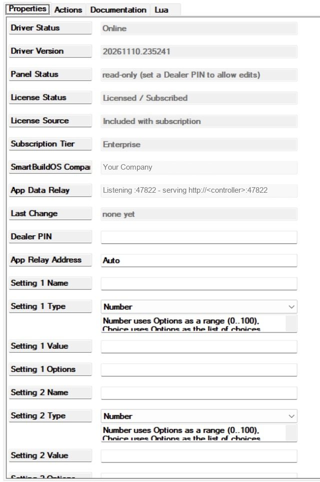
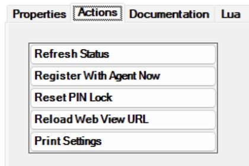

# SmartBuildOS Dealer Settings

Dealer Settings keeps the values you adjust on service calls (a motion
timeout, a dim level, a delay, a mode) as up to twelve named settings, instead
of numbers typed into programming. Programming reads each setting as a
variable. You change a setting from a tile in Navigator after entering a PIN,
with no Composer Pro session. Anyone who opens the tile can read the settings;
only someone with the PIN can change them there.

Requires the SmartBuildOS Agent (`smartbuildos.c4z`) paired to a SmartBuildOS
system, and Control4 OS 3.3.2 or later. The Agent is the licensing authority
(SKU `SBOS_DEALER_PANEL`): **License Status** shows this driver's standing. A
definitive licence denial with enforcement on makes the panel read-only;
uncertainty never does.

## Why not a project variable

The stock way is a variable in the project (the Variables agent) or a number
typed straight into a programming line. Both work. As far as we know, both
are changed in Composer, not by someone standing in the house with Navigator.

What this driver adds:

- A setting is changed from a Navigator tile, behind a PIN.
- A setting has a type and a range. A value that does not fit is refused and
  the previous value stays.
- Every change fires one event, *Setting Changed*, and names the setting and
  its new value.
- The tile and *Print Settings* list everything that is tunable in this home
  in one place.

Keep a project variable for a flag or a counter that only programming
changes: it needs no tile and no PIN, and this driver has twelve slots. The
driver holds values and nothing else. It does not time anything and does not
set a light; your programming does that with the value.

## What it is for

| You want | Use |
| --- | --- |
| A value programming reads, that you can change on site without Composer | A setting: **Setting N Name**, **Setting N Type**, **Setting N Options**, **Setting N Value**, read as `SETTING_1` to `SETTING_12` |
| Programming that takes one branch or another by a mode | A Choice or Toggle setting and the conditional *Setting 1 value* (one per slot, to *Setting 12 value*) |
| A number tested against a threshold | `SETTING_1_NUMBER` in Composer's own conditional on a variable |
| The homeowner to see the values and not change them | The tile, without the PIN. It shows every setting and changes nothing until it is unlocked with the **Dealer PIN** |
| No edits from the tile at all | Leave **Dealer PIN** empty |
| A keypad button or a schedule that changes a setting | The commands `SET_SETTING` and `TOGGLE_SETTING` |
| Something done the moment a setting changes, wherever the change came from | *Setting Changed*, with `CHANGED_SETTING` and `CHANGED_VALUE` |
| To know that someone is guessing the PIN | *Panel Locked* |
| To know in programming whether the tile accepts edits | The conditional *Dealer panel accepts writes*, or `PANEL_STATUS` |
| A record of the settings as they stand | *Print Settings* |

## Setup

<!-- walkthrough: Set up Dealer Settings -->
1. Install and pair the SmartBuildOS Agent.
1. Add this driver to a room. Use one copy per project: the port its tile
   uses is fixed. **Driver Status** reads `Online`, and the driver appears as
   a **Dealer Settings** tile in Navigator.
1. For each setting you want, fill **Setting N Name**, **Setting N Type** and
   **Setting N Options**, then **Setting N Value**. A slot with an empty Name
   is unused. The types:
   - **Number**: Options is the allowed range, `0..100` (the default when
     empty).
   - **Toggle**: On or Off.
   - **Text**: free text up to 200 characters.
   - **Choice**: Options is the list, `Low, Medium, High`.
1. Set a **Dealer PIN**. With no PIN the tile is read-only; nothing in a
   home can be changed from it without a secret. Use digits: the tile asks a
   phone for its number keypad. **Panel Status** then reads, for example,
   `3 setting(s) configured, writable`.
1. Read **App Data Relay**. The line to expect is
   `Listening :47822 - serving http://<controller>:47822 to the app`.
   [How the tile reaches the driver](#how-the-tile-reaches-the-driver)
   explains every other line.
1. Reference the settings in programming: `SETTING_1` (text form),
   `SETTING_1_NUMBER` (the number, 1/0 for a toggle) and `SETTING_1_NAME` for
   slot 1, and the same for each slot up to 12. Use the conditional *Setting
   1 value* for comparisons.
1. Open the tile, type the PIN, press Unlock and change a value. **Last
   Change** in Composer names the setting, the new value, where the change
   came from and the time.

## A setting: name, type, options, value

Each of the twelve slots is four properties. N is the slot number.

| **Setting N Type** | **Setting N Options** | A value is accepted when it is | An empty **Setting N Value** means |
| --- | --- | --- | --- |
| `Number` | The range: `0..100`, `0-100` or `0,100`. Decimals and negative numbers are allowed; a range typed backwards is turned round. Empty means 0 to 100 | A number inside the range, ends included | 0, or the bottom of the range when 0 is outside it |
| `Toggle` | Not used | `On` or `Off`. Also taken: true, yes, 1 and false, no, 0, in any capitals | Off |
| `Text` | Not used | Text of at most 200 characters (counted in bytes) | Empty text |
| `Choice` | The choices, separated by commas, semicolons or `\|`. At most 24; a repeat is dropped | One of the choices, in any capitals. It is stored as the list spells it | The first choice |

- **Setting N Name** is cut at 40 characters. Give each setting its own name:
  a command finds a setting by name and takes the first match. Do not use a
  bare number from 1 to 12 as a name, because a command reads that as a slot
  number.
- A number is shown without a needless decimal: `200.0` reads `200`, `2.5`
  stays `2.5`.
- A value is never clamped or shortened to make it fit. It is accepted as it
  is or refused with a reason.

**A slot that is named but cannot be used.** When the Options do not make
sense for the type (a Number whose Options are not a range, a Choice with no
choices), the setting has no value. `SETTING_1` is empty and
`SETTING_1_NUMBER` is 0 for that slot, it is not counted in
`SETTINGS_CONFIGURED`, the commands do not find it, and the tile and *Print
Settings* show the reason, for example `Options must be a range like 0..100`.

**A value typed in Composer that does not fit.** Composer lets you type
anything into **Setting N Value**. If it does not fit, the driver uses the
empty-value default from the table, and the tile and *Print Settings* say so:
`Value outside 0..600; default in force`. The property still shows what you
typed. This is the one case where the property and the variable differ:
correct the property.

## One truth: where a value lives

The Composer properties **Setting N Value** hold the values. A write from
the tile or from a command lands in that property; the driver rebuilds from
the properties; the variables, the event and the tile follow. An open tile
reads the settings again every 30 seconds and after each save.

| A change from | Needs | A value that does not fit |
| --- | --- | --- |
| The tile | The **Dealer PIN** | Refused. The tile shows the reason, *Setting Change Refused* fires, the value stays |
| `SET_SETTING`, `TOGGLE_SETTING` | Nothing. Programming is not asked for the PIN and is not stopped by a PIN lock | Refused. *Setting Change Refused* fires, the reason goes to the log as a warning, the value stays |
| A Composer edit of the slot's properties | Composer | Not refused: the default is in force, as described above |

When a change from the tile or a command is accepted the driver, in this
order: writes **Setting N Value**, writes `CHANGED_SETTING` and
`CHANGED_VALUE`, updates the slot's variables and **Last Change**, and then
fires *Setting Changed*.

- Writing the value a setting already has is accepted and changes nothing:
  no event. Numbers are compared as numbers (`200` and `200.0` are the same)
  and choices without regard to capitals.
- A Composer edit fires *Setting Changed* for each slot whose value or name
  moved, so renaming a setting fires it too. Here the event is fired before
  the slot's own variables are rewritten: in programming on *Setting
  Changed*, read `CHANGED_VALUE` or use the conditional, not `SETTING_1`.
- Nothing fires when the driver starts. The variables are set from the
  properties.
- With the licence read-only, the tile and the commands are refused with
  `unlicensed`. Reading goes on: the variables, the conditionals and the tile
  keep showing the values, and a Composer edit still applies.

## The tile: who sees what

The tile is one page. From the top it shows the panel's status, a PIN box
with an Unlock button, and one card per named setting: its name, its type
(and range, for a Number), its value, and a control. A Toggle has a switch; a
Choice has a list and Save; a Number or a Text has a box and Save.

- **Without the PIN** every setting can be read and no control works. This is
  what the homeowner has.
- **With the PIN**, typed and accepted with Unlock, the controls work and a
  change applies at once. The page keeps the PIN in memory only, until the
  tile is closed.
- The PIN box is shown only while the panel accepts edits. With no **Dealer
  PIN** set, during a lock, or with the licence read-only, the page says why
  instead.
- **Five wrong PINs in a row** lock edits from the tile for one minute and
  fire *Panel Locked* once. During the lock the right PIN is refused too. The
  lock ends by itself; *Reset PIN Lock*, or changing **Dealer PIN**, ends it
  at once. A correct PIN before the fifth miss clears the count.

Give the PIN to the homeowner only if you want them to change these values.

**Panel Status**, and the variable `PANEL_STATUS`, read one of:

| Value | Meaning |
| --- | --- |
| `starting` | The driver has not started yet |
| `read-only (set a Dealer PIN to allow edits)` | **Dealer PIN** is empty. The tile shows the settings and changes nothing. The commands still work |
| `3 setting(s) configured, writable` | A PIN is set and the tile accepts edits. The number is `SETTINGS_CONFIGURED` |
| `locked for 60s after wrong PINs` | Five wrong PINs. The seconds are those left when the line was written; it is rewritten once a minute |
| `unlicensed` | A licence denial with enforcement on. The tile and the commands are refused |

The conditional *Dealer panel accepts writes* is true only in the `writable`
state. It describes the tile: with no PIN set it is false, and the commands
still change settings.

## How the tile reaches the driver

The driver opens a small web server on the controller, the relay, on port
47822. The tile's page asks the relay for the settings and sends changes to
it, over the home network. The driver gives Navigator one of three addresses
for the tile:

| Tile address | Used when | How the page talks to the driver |
| --- | --- | --- |
| `http://<controller>:47822/app?k=<token>` | The relay is listening, the controller's address is known, and the driver can read its page from its own package | The relay serves the page and the data |
| `controller://driver/smartbuildos-dealer-panel/app/index.html?relay=…&k=<token>` | The relay is listening and the address is known, but the driver cannot read its page | Navigator loads the page from the driver package; the page uses the relay named in the address |
| `controller://driver/smartbuildos-dealer-panel/app/index.html` | The address is unknown, or the relay is not listening | Navigator loads the page from the driver package; with no relay to ask, the page uses Navigator's own JavaScript channel to the driver, where the Navigator has one |

The second address is the designed fallback, and it is the one in use on the
bench controller (see [What is not claimed](#what-is-not-claimed)).

The token is minted once per installation and stored on the controller. The
relay gives the settings only to a request that carries it; a change needs
the token and the PIN.

### How the driver finds the controller's address

The driver works out the controller's address on the home network and checks
it. In order:

1. **App Relay Address**, when it holds anything but `Auto` or nothing. It
   is used as written and is not checked.
1. The address the controller reports for itself. It is published at once
   and then checked.
1. Every address found on a device in the project that runs one of
   Control4's own `control4_` drivers, lowest device id first. Such an
   address is published only after it has passed the check.

The check: the driver asks each address for the relay's `/ping` and takes the
first one where this driver's relay answers by name. Another Control4 device
on the network, or another driver's relay, does not pass. Each address is
given four seconds. A confirmed address is checked again every 15 minutes, so
a changed address is followed. After a pass with no answer the driver asks
again after 1, 2, 4 and 8 minutes, then every 15.

When the address changes the driver gives Navigator the new tile address.
Navigator does not change the address of a tile that is open: close the tile
and open it again.

### Reading App Data Relay

| **App Data Relay** | Meaning | What to do |
| --- | --- | --- |
| `starting` | The driver has not started yet | Wait |
| `Not listening - port 47822 unavailable` | The controller did not give the driver the port. The tile is published at the third address | The driver asks for the port only when it starts. Check that the project holds one copy of this driver |
| `Listening :47822 - controller address UNKNOWN, set App Relay Address` | No address passed the check and the controller reported none. Nothing is published rather than a wrong address; the tile is at the third address | Type the controller's address in **App Relay Address**, with no `http://` and no port |
| `Listening :47822 - serving http://<controller>:47822 to the app (checking)` | The address the controller reports is published and is being checked | See the note below |
| `Listening :47822 - serving http://<controller>:47822 to the app (no answer on it: check App Relay Address)` | The reported address is published, but the relay did not answer on it or on any other address | Compare the address with the controller's. If it is wrong, type the right one in **App Relay Address** |
| `Listening :47822 - serving http://<controller>:47822 to the app` | The relay answered on this address, or you typed it in **App Relay Address** | Nothing. A typed address is not checked: read it once more |

The line is written when the driver publishes the tile address: at start,
when the address changes, when you change **App Relay Address**, and on
*Reload Web View URL*. It is not rewritten when a check simply ends, so
`(checking)` can stay on show after the check is over. Press *Reload Web View
URL* to have the line written again.

The line reads the same for the first and the second tile address. To tell
them apart, and to test the relay from outside, open these in a browser on a
computer on the same network:

- `http://<controller>:47822/ping` answers
  `{"ok":true,"service":"dealer-panel"}` when the relay is up at that
  address.
- `http://<controller>:47822/app` shows the page (first address), or answers
  `503` with `app not loadable` (second address).

## Worked examples

### A welcome light level picked on the tile

<!-- walkthrough: A level chosen on site -->
1. Set **Setting 1 Name** to `Welcome level`, **Setting 1 Type** to `Choice`
   and **Setting 1 Options** to `Low, Medium, High`. Leave **Setting 1
   Value** empty: the first choice is in force and `SETTING_1` reads `Low`.
1. In Programming, pick the event that should bring the light on, a door
   unlocking for example. From this driver's conditionals take *Setting 1
   value*, set it to equal, and type `Low`. Put the light at your low level
   under it.
1. Add the same conditional twice more for `Medium` and `High`, each with its
   own level.
1. On site, open the tile, unlock it with the PIN, choose `High` and press
   Save. **Last Change** names `Welcome level = High` and `web view`. The
   next time the event runs, the `High` branch runs.

The conditional is named by slot number, not by the name you gave the
setting. *Print Settings* lists which slot holds which setting.

### A mode with a keypad button and a tile

Set **Setting 2 Name** to `Holiday mode` and **Setting 2 Type** to `Toggle`.

- On the keypad button's press, add `TOGGLE_SETTING` with `NAME` set to
  `Holiday mode`. Each press flips the setting. No PIN is involved: the PIN
  guards the tile, not programming.
- On *Setting Changed*, add the conditional *Setting 2 value* equal to `On`
  and light the button's LED under it; add it again as not equal and put the
  LED out. `CHANGED_SETTING` holds `Holiday mode` if you would rather test
  which setting changed.
- In any routine that should not run during a holiday, test *Setting 2
  value* first.

The tile shows the mode to anyone who opens it, and whoever has the PIN can
flip it there. `SETTING_2_NUMBER` is 1 while it is on and 0 while it is off.

### A number with a range, and what a refusal looks like

Set **Setting 1 Name** to `Hall timeout`, **Setting 1 Type** to `Number`,
**Setting 1 Options** to `0..600` and **Setting 1 Value** to `120`.
`SETTING_1` reads `120` and `SETTING_1_NUMBER` is 120.

| Written from the tile or with `SET_SETTING` | What happens |
| --- | --- |
| `200` | Accepted. **Setting 1 Value** and `SETTING_1` read `200`, `SETTING_1_NUMBER` is 200, `CHANGED_SETTING` is `Hall timeout`, `CHANGED_VALUE` is `200`, and *Setting Changed* fires |
| `200` again | Accepted, nothing changes, no event |
| `900` | Refused: `outside 0..600`. The value stays 200 and *Setting Change Refused* fires |
| `abc` | Refused: `not a number` |

`SETTING_1_NUMBER` is a number variable like any other. Test it with
Composer's own conditional on a variable when you need greater than or less
than; the driver's conditional *Setting 1 value* tests equal and not equal
only.

### Tell the office when a setting is changed on site

With the SmartBuildOS Notification Router in the project, add its `NOTIFY`
command on *Setting Changed*: the text `Changed on site:`, then this driver's
`CHANGED_SETTING` as the first picked variable, the text `is now`, then
`CHANGED_VALUE` as the second. Both variables are written before the event
fires. After the change above the message reads "Changed on site: Hall
timeout is now 200".

## Programming reference

### Commands

| Command | Parameters | What it does |
| --- | --- | --- |
| `SET_SETTING` | `NAME`, `VALUE` | Sets a setting. `VALUE` follows the rules of the setting's type: On or Off for a Toggle, one of the choices for a Choice |
| `TOGGLE_SETTING` | `NAME` | Flips a Toggle setting. Refused for a setting of any other type |

`NAME` is the setting's name, in any capitals, or its slot number, 1 to 12. A
name that matches no usable setting is refused.

### Events

| Event | Fires when |
| --- | --- |
| *Setting Changed* | A setting's value changed, from the tile, a command or a Composer edit. Also when a Composer edit renames a setting or makes a slot usable. `CHANGED_SETTING` and `CHANGED_VALUE` are written first |
| *Setting Change Refused* | A write from the tile or a command was refused: a value that does not fit, no setting of that name, `TOGGLE_SETTING` on a setting that is not a Toggle, no **Dealer PIN** set, a wrong PIN, a lock, or the licence. It does not fire for a value typed in Composer, nor for a wrong PIN typed at Unlock |
| *Panel Locked* | The fifth wrong PIN in a row. Once per lock |

### Conditionals

- *Setting 1 value* to *Setting 12 value*: compares the setting with the text
  you type, equal or not equal. A Number is compared as a number (`300`
  equals `300.0`). A Toggle accepts On and Off and the other forms in the
  type table. A Choice ignores capitals. A Text must match exactly, capitals
  included. For a slot that is unused or cannot be used, equal is always
  false and not equal is always true.
- *Dealer panel accepts writes*: true while **Panel Status** reads
  `writable`.

### Variables

All are read-only.

| Variable | Type | Holds |
| --- | --- | --- |
| `SETTING_1` to `SETTING_12` | Text | The value as text: the number, `On` or `Off`, the choice, or the text. Empty for a slot that is unused or cannot be used |
| `SETTING_1_NUMBER` to `SETTING_12_NUMBER` | Number | The number. 1 or 0 for a Toggle. For a Text or a Choice, the value when it reads as a number, otherwise 0 |
| `SETTING_1_NAME` to `SETTING_12_NAME` | Text | The setting's name. Empty for an unused slot |
| `CHANGED_SETTING`, `CHANGED_VALUE` | Text | The name and the new value of the setting that changed last |
| `SETTINGS_CONFIGURED` | Number | How many settings are named and usable |
| `PANEL_STATUS` | Text | The same text as **Panel Status** |

## Properties

| Property | What it is |
| --- | --- |
| **Driver Status** | `Online` once the driver has started |
| **Driver Version** | The build that is running |
| **Panel Status** | Whether the tile accepts edits. See [The tile](#the-tile-who-sees-what) |
| **License Status**, **License Source**, **Subscription Tier**, **SmartBuildOS Company** | What the Agent reports for this driver |
| **App Data Relay** | The relay and the address the tile is served from. See [Reading App Data Relay](#reading-app-data-relay) |
| **Last Change** | The last accepted change: setting, value, source (`web view`, `programming` or `Composer`) and time. `none yet` until there is one |
| **Dealer PIN** | The secret the tile asks for before a change. Masked. Empty makes the tile read-only |
| **App Relay Address** | `Auto` (the default) lets the driver find the controller's address. Anything else is used as the address |
| **Setting N Name**, **Setting N Type**, **Setting N Options**, **Setting N Value** | The twelve settings. See [A setting](#a-setting-name-type-options-value) |
| **Log Level**, **Log Mode** | Logging. Defaults `2 - Warning` and `Off`. A refused command is a warning; an accepted change is logged at `3 - Info` |

## Actions

| Action | What it does |
| --- | --- |
| Print Settings | The panel status, the licence, the relay line, and every named setting with its slot, type, value and any refusal, in the Lua tab |
| Reload Web View URL | Reads the page from the package again, publishes the tile address again and rewrites **App Data Relay** |
| Reset PIN Lock | Clears a lock after wrong PINs |
| Register With Agent Now | Asks the Agent for the licence again |
| Refresh Status | Rebuilds from the properties and repaints **Panel Status**, **Last Change** and the variables. It does not rewrite **App Data Relay** |

## Troubleshooting

| You see | Cause and what to do |
| --- | --- |
| The tile says it cannot reach the driver | The tile's address is out of date or the relay is not reachable from that device. Close the tile and open it again. Read **App Data Relay**, and try `/ping` from a browser as shown above |
| The tile shows the settings and no PIN box | The panel is not accepting edits. **Panel Status** says which: no **Dealer PIN**, a lock, or the licence |
| The controls are greyed | The PIN has not been entered since the tile was opened. Type it and press Unlock |
| The right PIN is refused | The panel is locked after five wrong PINs. Wait a minute or press *Reset PIN Lock* |
| A value is refused on the tile | It does not fit the type. The reason is shown: outside the range, not a number, not one of the choices, longer than 200 characters |
| A command in programming changes nothing | It was refused, and *Setting Change Refused* fired. Set **Log Mode** to `Print` and read the warning in the Lua tab: it names the setting and the reason. The usual cause is a `NAME` that matches no setting |
| A variable reads 0 or the first choice while **Setting N Value** shows something else | The value typed in Composer does not fit. *Print Settings* names it. Correct the property |
| A setting is on the tile with a reason and no value | Its Options do not suit its type. Correct **Setting N Options** |
| **App Data Relay** stays on `(checking)` | The line is not rewritten when a check ends. Press *Reload Web View URL* |
| **App Data Relay** names an address that is not the controller's | Type the controller's address in **App Relay Address** and reopen the tile. A typed address does not follow a change of address: update it if the controller's address changes, or go back to `Auto` |
| **License Status** stays on a "Checking" line | Press *Register With Agent Now* |

## What is not claimed

The driver does not change other devices' properties. It holds values; your
programming applies them. Navigator does not change the URL of an open
tile: after a relay change, close and reopen the tile.

What the bench has and has not shown (bench controller, OS 4.3, 9 and 10
November 2026):

- Seen: the driver added to a project, the status properties read, **Panel
  Status** reading `read-only (set a Dealer PIN to allow edits)`, *Print
  Settings* run and read in the Lua tab, the relay answering `/ping` on the
  controller's address, and **App Data Relay** naming the controller.
- The relay answered `503` for `/app` there, so the tile uses the
  `controller://` page with the relay in its address. The page served by the
  relay itself has not been seen working on a controller.
- Not exercised on a controller: `SET_SETTING` and `TOGGLE_SETTING` (no
  command was run in that pass), the conditionals, the three events, a
  change made from the tile in a Navigator, the PIN lock, and the page's use
  of Navigator's JavaScript channel. The driver's side of each is covered by
  the test suite only; the page's own script has no test.

Limits:

- The PIN guards the tile only. Programming and Composer change settings
  without it.
- The relay is plain HTTP on the home network. The PIN and the values cross
  the local network unencrypted.
- There is no history of changes beyond **Last Change** and the event, and no
  description per setting on the tile.
- A Number may hold a decimal such as `2.5`. `SETTING_1` carries it as text;
  how a Control4 number variable holds a decimal has not been checked on a
  controller.

## Privacy

The Dealer PIN is a password property, never shown, logged or sent in a
response. The tile keeps an entered PIN in memory only, for that session.
Settings are plain values you named, and anyone who can open the tile can
read them: do not store codes or personal details in Text settings.
