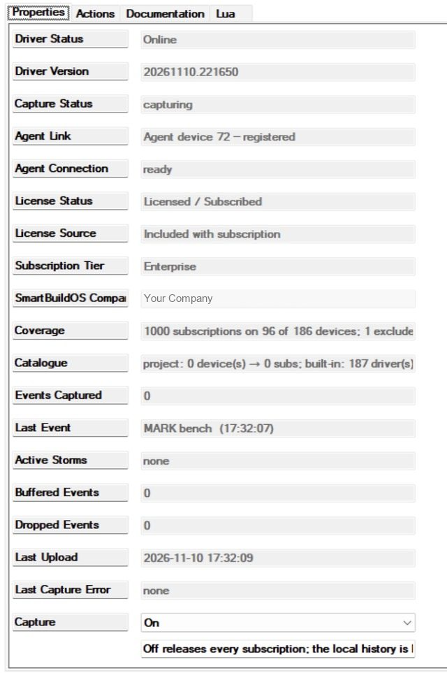
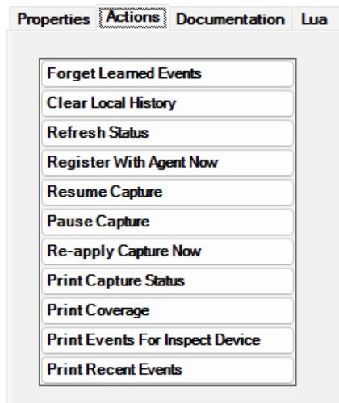

# SmartBuildOS Event Tracer

Captures every Composer event every device in the project fires, with no
configuration, and keeps a timeline in two places: a local history you can
print from Composer without a Pro session, and the SmartBuildOS timeline in
System Studio through the **SmartBuildOS Agent**. It answers "what happened
just before the hall light came on at 3 am" with the sequence of events around
it, named the way Composer names them.

Requires the SmartBuildOS Agent (`smartbuildos.c4z`, a build with module
services) paired to a SmartBuildOS system. The Agent is the licensing authority
(SKU `SBOS_EVENT_TRACER`): **License Status** shows this driver's standing.
Local capture continues during an internet outage; uploads wait in the Agent's
bounded, journaled queue.

## Setup

<!-- walkthrough: Set up Event Tracer -->
1. Install the SmartBuildOS Agent from Composer's Agents tab and pair it.
1. Add this driver (one per project). **Agent Link** shows the Agent's device
   id and **Agent Connection** reads `ready` once registered.
1. That is all. **Coverage** reports how many event subscriptions are active on
   how many devices, and which devices the catalogue does not know.
1. Optionally add **Mark Timeline** to routines (Device Specific Commands) so a
   routine's start shows up as a named marker between the device events.

## What is captured

Director fires a device event to a driver only after the driver subscribes to
that device and event id. The tracer knows which event ids exist from three
catalogues, best first:

- **Project** — the controller's own project data, when the OS includes each
  device's events in it (**Read Events From Project**). This covers Control4's
  built-in drivers.
- **Built-in** — generated at build time from the dealer's driver library.
- **Learned** — ids seen at run time on a probe subscription, kept across
  restarts.

A device whose driver is in none of them is reported under Coverage as
"unknown driver". Turn on **Probe Unknown Drivers** to subscribe to event ids
1..**Probe Range** on those devices; anything that fires is learned and shown
as "Event N" until the catalogue is updated.

## Protection

- **Storms.** One device firing one event more than **Storm Threshold** times
  in a minute is a storm: one *Event Storm Detected* event and one warning in
  the timeline, then that event is counted but not recorded until the minute
  rolls, when *Event Storm Ended* carries the totals. A chattering contact
  cannot flood the history or the uplink; the storm itself is the finding.
- **Upload budget.** Events beyond **Upload Budget** per minute are counted as
  dropped, not uploaded. The local history is not budgeted (it is bounded by
  **Local History Size** instead), so *Print Recent Events* can show what the
  uplink did not get.
- **Subscription cap.** Devices are covered in ascending id order until **Max
  Subscriptions**; what did not fit is listed under Coverage, never skipped
  silently.
- **Exclusions.** **Exclude Device IDs** and **Exclude Driver Files** take
  devices out of capture. The tracer never subscribes to itself.

## What is NOT claimed

Director does not tell a driver which programming ran. An entry says which
device fired which event, when. The "why" is the sequence of entries around it,
which is what the timeline shows. Nothing guesses a cause.

## Actions

| Action | What it does |
| --- | --- |
| Print Recent Events | The last 50 entries of the local history to the Lua output |
| Print Events For Inspect Device | The last 50 entries of the device in **Inspect Device ID**, with its coverage |
| Print Coverage | Every device: driver, catalogue tier, events subscribed |
| Print Capture Status | Status, licence, counters, active storms |
| Re-apply Capture Now | Re-plan against the current project (also automatic on project changes) |
| Pause / Resume Capture | Release / rebuild every subscription (also programming commands) |
| Clear Local History | Empty the local ring |
| Forget Learned Events | Drop the learned catalogue tier |

## Programming

- **Mark Timeline** (NAME, DETAIL, DEVICE): a named marker in the timeline.
- **Pause Capture** (REASON) / **Resume Capture**.
- Events: *Capture Degraded*, *Capture Restored*, *Event Storm Detected*, *Event
  Storm Ended*, *Agent Connected*, *Agent Disconnected*, *Unknown Event Learned*.
- Conditionals: *Capture is active*, *Agent link is ready*, *An event storm is
  in progress*.
- Variables: `CAPTURE_STATUS`, `SUBSCRIPTIONS`, `EVENTS_CAPTURED`,
  `ACTIVE_STORMS`, `LAST_EVENT`, `LAST_EVENT_DEVICE`, `BUFFERED_EVENTS`,
  `DROPPED_EVENTS`, `LAST_CAPTURE_ERROR`.

## Privacy

Only event ids and names, device and room labels, and timestamps are captured;
no variable values. Marker text is a service record written by the programmer
and is flagged as unreviewed text in Studio: do not put codes or personal
details into it.
