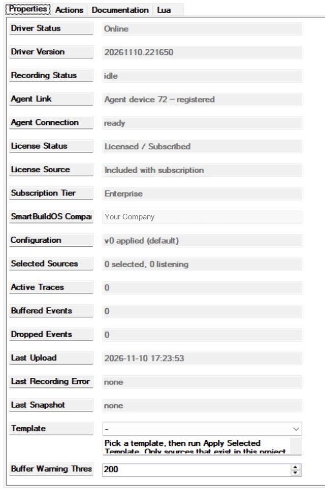
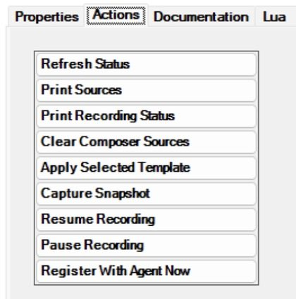

# SmartBuildOS Flight Recorder

When a homeowner says "the lights did not go off last night", the question is
what the system actually did. The Flight Recorder keeps that record. It notes
every change of the device and room variables you select, with the value before
and after; it records what your programming says it is doing, step by step, as
a trace; and it can capture a diagnostic snapshot on demand. All of it goes
through the **SmartBuildOS Agent** to System Studio, where it answers: what
happened, which device or routine was involved, what happened just before and
after, and whether an action was only requested or its result was observed.

Requires the SmartBuildOS Agent (`smartbuildos.c4z`, a build with module
services) paired to a SmartBuildOS system. The Agent is the licensing authority
(SKU `SBOS_FLIGHT_RECORDER`): **License Status** shows this driver's standing.
Local recording continues during an internet outage; uploads wait in the
Agent's bounded, journaled queue. Minimum OS 3.3.2.

## Flight Recorder or Event Tracer

Both drivers feed System Studio through the Agent, and they record different
things. Many projects want both.

| | Event Tracer | Flight Recorder |
| --- | --- | --- |
| Records | The Composer events devices fire: which device, which event, when | The values of the variables you select, before and after each change; selected SmartBuildOS system events; what your programming records |
| Setup | None: it covers the project by itself | Nothing is recorded until you select sources or add commands to routines |
| Variable values | Not captured | Captured, for selected sources only |
| Your routines | A marker command | Traces: start, steps, decisions, expected results, completed or failed |
| Snapshots | No | Yes |
| Read back in Composer | A local history, printed from its Actions tab | The last 100 recorded events, in *Print Recording Status* |

Use the Event Tracer to see the sequence of events around a moment without
deciding anything beforehand. Use the Flight Recorder when you need the values
(the light went from 75 to 0) or the story of one routine (which branch it
took, whether it finished). The Flight Recorder does not record other drivers'
Composer events; that is the Event Tracer's job.

## What it is for

| You want | Use |
| --- | --- |
| To know afterwards what a light, a door contact or a motion sensor did, and when | A source on its variable: **Template** and *Apply Selected Template*, or Recorder settings in System Studio |
| To see whether a routine ran to the end and which branch it took | `START_TRACE`, `RECORD_TRACE_STEP`, `RECORD_TRACE_DECISION`, then `COMPLETE_TRACE` or `FAIL_TRACE` |
| What the routine asked for, next to what the device then reported | `RECORD_EXPECTED_RESULT`, and a source on that device |
| A single named mark in the record, with no trace | `RECORD_EVENT` |
| Controller restarts, project changes and programming changes in the same record | The `SmartBuildOS events` template |
| The recorder's own state at the moment of a fault | `CAPTURE_SNAPSHOT`, or the action *Capture Snapshot* |
| To be told when a routine did not finish | The event *Trace Failed* |
| To be told when recording is impaired or events are piling up | *Recording Degraded*, *Buffer Threshold Reached* |
| Nothing recorded during a service visit | `PAUSE_RECORDING` and `RESUME_RECORDING` |
| To check from programming whether recording is on | The conditional *Recording is active*, or `RECORDING_STATUS` |

## Setup

<!-- walkthrough: Set up Flight Recorder -->
1. Install the SmartBuildOS Agent from Composer's Agents tab and pair it.
1. Add this driver (one per project). **Agent Link** shows the Agent's device id
   and **Agent Connection** reads `ready` once registered. **License Status**
   shows the licence.
1. Pick what to record in System Studio (Activity → Flight Recorder → Recorder
   settings), or choose a **Template** here and run *Apply Selected Template*
   (adds only sources that exist in this project; System Studio owns the
   configuration and shows this as a Composer revision).
1. Read **Selected Sources**: it says how many sources are selected and how
   many are listening. **Recording Status** reads `recording` once at least
   one is.
1. Add the trace commands to routines (Device Specific Commands):
   `START_TRACE`, `RECORD_TRACE_STEP`, `RECORD_TRACE_DECISION`,
   `RECORD_EXPECTED_RESULT`, `COMPLETE_TRACE`, `FAIL_TRACE`, `RECORD_EVENT`,
   `CAPTURE_SNAPSHOT`, `PAUSE_RECORDING`, `RESUME_RECORDING`. Every trace
   command takes a `CHANNEL` you name (default `main`); routines that may
   overlap use different channels.

## Sources: what is recorded

A source is one thing the recorder listens to. Nothing is recorded that is not
a source or a command your programming runs. There are three kinds.

| Kind | What it is | Recorded when |
| --- | --- | --- |
| Device variable | One variable of one device, by name | The variable changes |
| Room variable | One variable of one room | The variable changes |
| SmartBuildOS event | A system event the Agent reports | The Agent reports it |

The system events a configuration can select are `director_reloaded`,
`unexpected_restart`, `os_update_started`, `project_changed`,
`programming_changed`, `clock_drift`, `device_offline`, `device_online`,
`cloud_connected` and `cloud_disconnected`.

The list of sources is a versioned configuration. System Studio owns it; the
driver checks a whole revision before applying it. If any part is invalid the
revision is refused, the last valid one stays in force, and **Configuration**
says so. The last valid configuration survives a restart and a driver update.

### Templates

A template adds the sources of one kind of device, for the devices in this
project that have them. Pick it in **Template** and run *Apply Selected
Template*. The driver looks through the project's devices (up to 400) for
variables with the template's names and adds those that exist, up to the source
limit. It adds to what is already selected and never adds a source twice.

| Template | Looks for these variables | Settings it gives each source |
| --- | --- | --- |
| `Lighting` | `LIGHT_LEVEL`, `Brightness Percent`, `LIGHT_STATE` | Debounce 1.5 s, coalesce 1.5 s, minimum change 1 |
| `Contacts and openings` | `ContactState`, `CONTACT_STATE`, `STATE`, `DOOR_STATE`, `GARAGE_STATE`, `OPENED`, `ContactSensorState` | No debounce |
| `Motion and occupancy` | `MotionState`, `MOTION_STATE`, `OCCUPANCY_STATE`, `MOTION` | Debounce 2 s, coalesce 5 s |
| `Room media` | `POWER_STATE`, `CURRENT_VOLUME`, `CURRENT_SELECTED_DEVICE`, `CURRENT MEDIA INFO`, `PLAYING`, as room variables | Debounce 1 s, coalesce 3 s |
| `SmartBuildOS events` | The ten system events above | None |

Names are matched without regard to capitals, spaces or underscores. A
template that finds nothing changes nothing, and **Last Recording Error** reads
`template added no sources (none exist here)` until the next status refresh.

In this build `Room media` adds nothing when applied from Composer: the
driver's own look through the project offers device variables only, and this
template wants room variables. Select room sources in System Studio.

The result is applied as a new revision marked `composer`. The next revision
saved in System Studio replaces it.

### Initial reads, changes and the three filters

- **Initial reads are not changes.** Applying a configuration reads each new
  source once and records it as an initial observation. The previous value of
  a source stays unknown until its first change after that read.
- **A change that is not a change is not recorded.** If a device announces the
  value it already had, nothing is recorded.
- **Debounce.** Each change restarts the source's timer; when the timer runs
  out, the last value is recorded. One record per quiet period.
- **Minimum change.** A numeric change smaller than the threshold is not
  recorded. It is measured against the last recorded value, so a slow drift
  still shows once it adds up.
- **Coalesce.** After a record, further changes inside the window are gathered
  into one record at the window's end. It carries how many changes it stands
  for, the value before the window and the latest value.

Debounce, minimum change and coalescing are per source. A template sets them;
otherwise they come with the configuration from System Studio. Composer has no
property for them.

### Requested is not observed

Every record says where its evidence came from. The recorder never turns one
kind into another: it never infers success, a button press or a cause from a
nearby change.

| Record | Made by | Evidence |
| --- | --- | --- |
| Initial observation | A source read when a configuration is applied | `initial`: a state, not a change |
| Change | A source's variable changing | `observed`: the device reported it |
| System event | A selected SmartBuildOS event | `system` |
| Trace start, step, decision, end | Your programming | `instrumented`: the programmer's words |
| Expected result, `RECORD_EVENT` | Your programming | `requested`: what was asked for, not what happened |
| Configuration applied or refused, paused, resumed, budget exceeded | The recorder | `derived` |

### Traces and channels

A trace is the story of one run of a routine: a start, steps, and an end.
Composer programming cannot keep a value a command returns, so there is no
handle to carry from the start to the end. The `CHANNEL` is the handle: a
short name you type, the same on every command of one routine. Left empty, it
is `main`.

| Situation | What is recorded |
| --- | --- |
| `START_TRACE` on a channel with no open trace | A new trace opens |
| `START_TRACE` on a channel that already has one | The earlier trace ends as `interrupted`; a new one opens. Two runs are never merged |
| A step, decision or expected result on a channel with no open trace | An orphan step: visible, attached to no trace |
| `COMPLETE_TRACE` or `FAIL_TRACE` on a channel with no open trace | A duplicate completion (a warning); nothing else changes |
| No `COMPLETE_TRACE` or `FAIL_TRACE` within 10 minutes | The trace ends as `abandoned` (checked every 30 seconds) |
| A 17th trace while 16 are open | Refused, and the refusal is recorded |
| Recording is paused, or the driver is updated or removed | Every open trace ends as `interrupted` |

A trace that ends `completed` fires *Trace Completed*. Every other ending
(`failed`, `interrupted`, `abandoned`) fires *Trace Failed*.

A change the recorder observes while a trace is open is not attached to the
trace. It is recorded on its own, and System Studio shows it beside the
expected result for a person to judge.

### Snapshots

A snapshot is diagnostic evidence, not a project backup. It holds: the driver
and Agent versions and registration, this driver's status, licence standing and
counters, the configuration and its limits, the upload queue's health as the
Agent last reported it, the current values of the selected sources (up to 200),
the last recorded events the driver still holds (up to 100), and warnings about
what is missing. It is held to 64 KB by leaving out recent events first, then
observations, and it says what it left out.

A snapshot is built a moment after it is asked for and handed to the Agent.
**Last Snapshot** follows it: `uploading`, then `completed` with the time, or
`failed` with the reason. *Snapshot Completed* fires when the Agent confirms
it; *Snapshot Failed* fires when it could not be built, there is no Agent, the
Agent reports a failure, or the request is refused. If the Agent never
answers, **Last Snapshot** reads `expired` after ten minutes and neither event
fires.

The driver keeps ten snapshot jobs, and a finished one stays on the list for an
hour. An eleventh request inside the hour is refused: **Last Snapshot** reads
`refused: too many snapshot jobs pending`.

### Pausing

`PAUSE_RECORDING` (or the action *Pause Recording*) releases every listener
and ends open traces as `interrupted`. No source is recorded while paused, and
what happened in between is not known afterwards. The pause survives a restart.
`RESUME_RECORDING` re-reads every source as an initial observation.

Commands your programming runs while paused (`START_TRACE`, `RECORD_EVENT` and
the rest) are still recorded.

## Limits

Everything is bounded. What does not fit is dropped and counted, never dropped
silently.

| What | Limit |
| --- | --- |
| Sources | 64 by default, 200 at most (set with the configuration) |
| Observations per minute | 120 by default, 600 at most. Beyond it observations are dropped and counted, with one budget warning in the record per minute. Trace commands and `RECORD_EVENT` are not counted against it |
| Debounce and coalesce, per source | 0 to 60 seconds |
| Open traces | 16 |
| Trace timeout | 10 minutes |
| Text | `CHANNEL` 48 characters; `NAME` 120; `MESSAGE`, `CONDITION`, `EXPECTED`, `DETAIL`, and the `NOTE` or `REASON` that ends a trace 400; `OUTCOME` 60; a snapshot's `NOTE` 200 |
| Events not yet sent to the Agent | 300. Beyond it the oldest is dropped and counted |
| The Agent's queue | 2,000 events or 512 KB |
| Snapshot | 64 KB; ten jobs in an hour |

**Dropped Events** counts what this driver dropped: observations over the
per-minute budget, events pushed out of the 300 waiting, events the Agent
rejected, and batches the Agent did not acknowledge after three tries. The
Agent's queue is the Agent's own: it records the range it had to drop so that
System Studio can show a gap.

## Worked examples

### Good Night: a routine you can read back

<!-- walkthrough: Trace the Good Night routine -->
1. Select the sources. Set **Template** to `Lighting` and run *Apply Selected
   Template*; set it to `Contacts and openings` and run it again. **Selected
   Sources** shows the count.
1. On the Good Night button's event, first line: `START_TRACE` with `NAME`
   Good Night and `CHANNEL` good_night. Use the same `CHANNEL` on every line
   below.
1. Before the command that switches the kitchen pendants off, add
   `RECORD_TRACE_STEP` with `MESSAGE` "Kitchen pendants: OFF requested" and
   `DEVICE` the pendants. After it, add `RECORD_EXPECTED_RESULT` with
   `EXPECTED` "Kitchen pendants at 0%" and the same `DEVICE`.
1. Before the garage check, add `RECORD_TRACE_STEP` with `MESSAGE` "Garage
   contact check".
1. Inside the conditional that the garage door is closed, add
   `RECORD_TRACE_DECISION` with `CONDITION` "Garage door closed?" and
   `OUTCOME` yes, then `COMPLETE_TRACE` with `NOTE` ok.
1. In the else branch, add `RECORD_TRACE_DECISION` with `OUTCOME` no, then
   `FAIL_TRACE` with `REASON` garage open.
1. Press the button. **Active Traces** goes to 1 and back to 0, and *Trace
   Completed* or *Trace Failed* fires.

With the pendants at 75% and the garage closed, the record holds: the trace
start; the step; the expected result; a change on the pendants' level from 75
to 0, observed; the second step; the decision; and the trace end, `completed`,
with 4 steps. That is the order in the driver's own test, where the light is
recorded at once. With the `Lighting` template the light's change is held for
its 1.5-second debounce, so it can land after the trace has ended. Either way
it is not attached to the trace: the expected result is what the routine asked
for, the change is what the light reported, and they sit side by side.

If the button is pressed again before the first run has finished, the first
trace ends as `interrupted` and a second one opens. Give a routine that can
overlap with this one its own channel, for example `garage_check`.

### A dimmer that ramps

A light with the `Lighting` template is at 40. It ramps down and reports 30,
20, 10 and 0, a fifth of a second apart. The recorder writes one change, 40 to
0, a second and a half after the last report. The steps in between are not
recorded.

### A door contact, every time

A contact with the `Contacts and openings` template has no debounce: Closed to
Open is recorded at once with the previous value, and Open to Closed a second
later is a second record. A state that is a word rather than a number is
recorded and flagged as unreviewed text, or not recorded at all when the
configuration excludes text values.

### Know when recording stops, and keep the evidence when a routine fails

- On *Recording Degraded*, send yourself a notification with the variable
  `RECORDING_STATUS` in it: it reads, for example, `recording_local
  (degraded)`. *Recording Restored* fires when it is healthy again.
- On *Buffer Threshold Reached*, do the same with `BUFFERED_EVENTS`: events
  are waiting for the Agent and have reached **Buffer Warning Threshold**.
- On *Trace Failed*, run `CAPTURE_SNAPSHOT` with a `NOTE` such as "trace
  failed". The snapshot holds the selected sources' values and the last
  recorded events at that moment. Mind the limit of ten snapshots in an hour.

## Programming reference

### Commands

| Command | Parameters | What it records |
| --- | --- | --- |
| `RECORD_EVENT` | `NAME`, `DETAIL`, `CHANNEL`, `DEVICE` | One named event, as a request. `NAME` is required. If the channel (`main` when left empty) has an open trace, the event is tied to it |
| `START_TRACE` | `NAME`, `CHANNEL` | Opens a trace. With no `NAME` the trace is named after the channel |
| `RECORD_TRACE_STEP` | `MESSAGE`, `CHANNEL`, `DEVICE` | A step: something the programming did or asked for |
| `RECORD_TRACE_DECISION` | `CONDITION`, `OUTCOME`, `CHANNEL` | A conditional and the branch taken |
| `RECORD_EXPECTED_RESULT` | `EXPECTED`, `CHANNEL`, `DEVICE` | What the programming expects to see next. The recorder never checks it |
| `COMPLETE_TRACE` | `NOTE`, `CHANNEL` | Ends the trace as `completed` |
| `FAIL_TRACE` | `REASON`, `CHANNEL` | Ends the trace as `failed` |
| `CAPTURE_SNAPSHOT` | `NOTE` | Asks for a snapshot; see **Last Snapshot** |
| `PAUSE_RECORDING` | `REASON` | Pauses recording |
| `RESUME_RECORDING` | none | Resumes; sources are re-read as initial observations |

`DEVICE` is optional everywhere: it ties the record to a device of the project.

### Events

| Event | Fires when |
| --- | --- |
| *Recording Degraded* | **Recording Status** leaves `recording`, `idle` or `disabled` for anything else |
| *Recording Restored* | It returns to one of those three. After a restart the driver is not healthy until the Agent has registered it, so this normally fires once after every start |
| *Buffer Threshold Reached* | **Buffered Events** reaches **Buffer Warning Threshold**. It can fire again once the count has fallen below half the threshold |
| *Snapshot Completed* | The Agent confirms a snapshot |
| *Snapshot Failed* | A snapshot could not be built, sent or stored, or was refused |
| *Trace Completed* | A trace ends as `completed` |
| *Trace Failed* | A trace ends as `failed`, `interrupted` or `abandoned` |
| *Agent Connected* | The Agent accepts this driver's registration, including each time it registers again |
| *Agent Disconnected* | The Agent refuses the registration |

The status is looked at at least once a minute, so *Recording Degraded*,
*Recording Restored* and *Buffer Threshold Reached* can follow their cause by
up to a minute. To be told that the Agent has gone, use *Recording
Degraded*: *Agent Disconnected* fires on a refusal only.

### Conditionals

- *Recording is active*: true while **Recording Status** is `recording` or
  starts with `recording_local`.
- *SmartBuildOS Agent link is ready*: true while **Agent Connection** is
  `ready`.

### Variables

All read-only. The recorder refuses its own device as a source, so these never
feed back into the record.

| Variable | Holds |
| --- | --- |
| `RECORDING_STATUS` | The same text as **Recording Status** |
| `AGENT_CONNECTION` | The same text as **Agent Connection** |
| `SELECTED_SOURCES` | How many sources are selected (a number) |
| `ACTIVE_TRACES` | How many traces are open |
| `BUFFERED_EVENTS` | Events waiting in this driver or sent to the Agent and not yet acknowledged |
| `DROPPED_EVENTS` | Events this driver dropped |
| `LAST_UPLOAD` | When the Agent last acknowledged a batch, in UTC; empty until then |
| `LAST_RECORDING_ERROR` | The same text as **Last Recording Error** |
| `CONFIG_VERSION` | The version of the configuration in force |

## Properties

| Property | What it shows or sets |
| --- | --- |
| **Driver Status**, **Driver Version** | `Online` once started, and the build |
| **Recording Status** | See [Reading the status](#reading-the-status) |
| **Agent Link** | The Agent's device id and whether this driver is registered with it |
| **Agent Connection** | See [Reading the status](#reading-the-status) |
| **License Status**, **License Source**, **Subscription Tier**, **SmartBuildOS Company** | This driver's licence standing, as the Agent reports it |
| **Configuration** | The version in force and where it came from (`default`, `studio` or `composer`); a refused revision and the reason |
| **Selected Sources** | For example `4 selected, 2 listening, 1 stale` |
| **Active Traces** | Open traces |
| **Buffered Events**, **Dropped Events** | As the variables above |
| **Last Upload** | When the Agent last acknowledged a batch from this driver, in the controller's time; `never` until then |
| **Last Recording Error** | The last problem, or `none` |
| **Last Snapshot** | The last snapshot's job and state |
| **Template** | The template *Apply Selected Template* will add |
| **Buffer Warning Threshold** | 50 to 300, default 200: the count at which *Buffer Threshold Reached* fires |
| **Log Level**, **Log Mode** | The driver's own logging |

## Actions

| Action | What it does |
| --- | --- |
| *Register With Agent Now* | Looks for the Agent and registers again, without waiting for the retry |
| *Pause Recording*, *Resume Recording* | The same as the two commands |
| *Capture Snapshot* | The same as `CAPTURE_SNAPSHOT`, with the note "Composer action" |
| *Apply Selected Template* | Adds the sources of the chosen **Template** |
| *Clear Composer Sources* | Removes every selected source, whoever selected it, as a new `composer` revision |
| *Print Recording Status* | Status, Agent, licence, configuration, counters, the Agent's queue, open traces and the last 100 recorded events, in the Lua tab |
| *Print Sources* | Each source and whether it is on; the stale, unsupported and excluded ones with the reason; each listening source's current value |
| *Refresh Status* | Repaints the properties and sends the status to the Agent |

## Reading the status

**Recording Status** is one of these. A value in brackets is the **Agent
Connection** at that moment.

| Recording Status | Meaning | What to do |
| --- | --- | --- |
| `starting` | The driver has not finished starting | Wait |
| `recording` | The Agent is ready and at least one variable source is listening | Nothing |
| `idle` | The Agent is ready and no variable source is listening: none selected, or all of them stale, unsupported or excluded. Selected SmartBuildOS events are still recorded | Select sources; read **Selected Sources** and run *Print Sources* |
| `recording_local (…)` | Sources are listening and recorded; the Agent link is not ready, so events wait | Read **Agent Connection** |
| `idle (…)` | No variable source is listening and the Agent link is not ready | Both of the above |
| `paused` | Paused from Composer, programming or System Studio | *Resume Recording* |
| `disabled` | The configuration in force has recording switched off | Change the configuration in System Studio |
| `unlicensed` | The licence was refused and enforcement is on for this driver | Read **License Status** |

| Agent Connection | Meaning | What to do |
| --- | --- | --- |
| `ready` | Registered; the Agent is paired and connected to SmartBuildOS | Nothing |
| `waiting_for_agent` | No Agent in the project, or it has not accepted the registration. The driver asks again by itself, after 30 seconds at first and then less often, up to every 5 minutes. An Agent build without module services never answers | Install or update the Agent; *Register With Agent Now* |
| `incompatible` | The Agent refused the registration: the two do not speak the same protocol version | Update the Agent and this driver to matching builds |
| `unpaired` | Registered, but the Agent is not paired to a SmartBuildOS system | Pair the Agent |
| `degraded` | Registered and paired, but the Agent has no connection to SmartBuildOS. Recording goes on; uploads wait in the Agent | Check the controller's internet |

**Selected Sources.** `selected` is how many sources the configuration holds;
`listening` is how many the driver found and subscribed to. `stale` means the
source's device is no longer in the project. `unsupported` means the device is
there but has no variable of that name. *Print Sources* names each one.

**Configuration.** `v3 applied (studio)` is the normal reading. After a
refused revision it reads, for example, `v3 applied (studio) — desired v4
refused: sources[1].variable: credential-bearing variables are never
recorded`: version 3 is still in force.

**Last Upload** is the hand-off to the Agent, not proof that the platform has
the events. For the Agent's own queue, run *Print Recording Status* and read
the `agent queue` line.

**Last Recording Error** is cleared when a configuration is next applied, so a
line can outlast its cause. Check it against **Recording Status**.

## Privacy: what leaves the controller

The driver opens no network connection of its own. Everything it sends goes to
the SmartBuildOS Agent on the same controller, and the Agent uploads it.

What it sends:

- **Each record.** Its kind, the controller's time, a sequence number, the
  label, the device and room, and its content: for an observation the variable
  name, the value and the previous value; for a system event its name and the
  Agent's detail; for a trace or `RECORD_EVENT` the text you typed.
- **Its registration and status**: its version at registration, then every
  five minutes and on *Refresh Status* the recording status, the last error
  and its counters.
- **A snapshot**, only when one is asked for.

What is never recorded:

- A variable that is not a selected source.
- A variable whose name contains `USERCODE`, `ACCESSCODE`, `PINCODE`,
  `PASSCODE`, `PASSWORD`, `PASSWD`, `TOKEN`, `SECRET`, `APIKEY`, `DISARMCODE`,
  `ARMCODE`, `KEYCODE`, `LOCKCODE` or `CREDENTIAL`, ignoring capitals, spaces
  and underscores (`User Code` counts). A configuration that names one is
  refused whole. The list is fixed.
- A variable that matches one of the configuration's exclusion patterns.
- This driver's own variables.
- Text values, when the configuration's privacy setting excludes them. By
  default they are recorded and flagged as unreviewed text.
- Other drivers' Composer events, driver properties and logs.

Before a record or a snapshot leaves the driver, any field named like a
credential and any value that looks like a long token is replaced by
`[redacted]`, and every text in a record is cut at 512 characters. This is a
second net, not a filter on variable names: the fixed list above does that.
The design notes say the platform applies the same rules again on receipt.

A short number is not redacted: a four-digit code typed into a `MESSAGE` is
recorded as typed. Programmer text is a service record and is flagged as
unreviewed text. Do not put codes or personal details into it.

## What is not claimed

- **Cause.** A variable change carries no origin: the recorder cannot tell a
  person at a keypad from programming, and never guesses.
- **Success.** An expected result is never checked against what followed, and
  an observed change is never attached to a trace.
- **Completeness.** What happened while recording was paused, before a source's
  first read, or beyond a limit is not known. Dropped events are counted.
- **Exact times.** Times are the controller's clock, which can be wrong; each
  record also carries a sequence number that only ever goes up.
- **A backup.** A snapshot is diagnostic evidence, not a project backup.
- **Other drivers' events.** Not recorded by this driver.

### Hardware validation

Simulator-verified (driver test suite with a scripted Agent). On a bench
controller (OS 4.3, Composer Pro 2026.10.14) the driver was imported, updated
in place and its status read back: `idle`, registered with the Agent. Nothing
more has been exercised on a physical controller: no source, trace, snapshot
or programming command. See the repository's
`docs/flight-recorder/VERIFICATION.md` for the bench steps and evidence owed.

<!-- #embed-changelog -->
