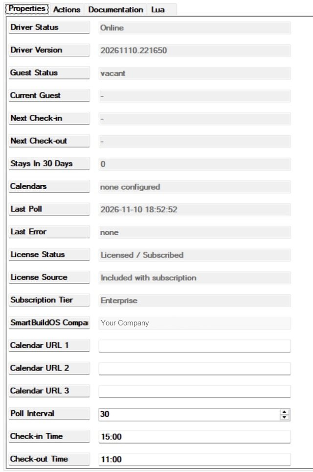
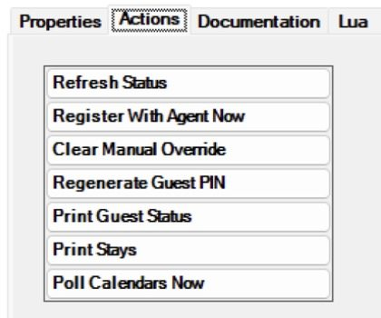

# SmartBuildOS Guest Mode

A Control4 project does not know that a rental has guests unless someone
tells it. The booking calendar already says who is coming and when they
leave. This driver reads
that calendar (the iCal address Airbnb, Booking.com or VRBO give every host)
and turns it into something programming can use: one status for the unit, an
event at each step of a stay, and conditionals you can ask at any moment.
Guests never see it; you program the house around it: warm it up on the
arrival day, shut it down after check-out, tell the cleaner when the unit is
free.

Three kinds of job use it:

- **Short-term rentals.** The calendars drive everything; nobody on site has
  to do anything.
- **House guests in a private home.** No calendar: a keypad button checks the
  guests in and another checks them out, and the owner's own routines stand
  down in between.
- **Staff.** The cleaner is told when a turnover starts, and a housekeeper or
  property manager has a button for a walk-in or an early departure.

Requires the SmartBuildOS Agent (`smartbuildos.c4z`) paired to a SmartBuildOS
system. The Agent is the licensing authority (SKU `SBOS_GUEST_MODE`);
**License Status** shows this driver's standing.

## Why not a schedule or a guest button

Without this driver there are two stock ways to tell a house that a guest is
in: someone enters each booking in the Scheduler, or someone presses a button
that sets a variable. Both work until a booking changes. A schedule nobody
edited fires on the wrong day, and a button waits for a person to be there.
Neither reads the booking calendar, as far as we know, so neither hears about
a booking made, moved or cancelled last night.

Keep the stock tools where they fit. A cleaner who comes every Friday at ten
is a Scheduler event, and so is anything that must happen at a set hour of a
guest's day, with one of this driver's conditionals inside it. This driver
has no schedule of its own. It adds the part that follows the bookings.

## What it is for

| You want | Use |
| --- | --- |
| The house warm, or cool, and lit before the guests arrive | *Guest Arriving Today*, then *Guest Checked In* |
| Everything off, the temperature set back and the doors locked once they have left | *Guest Checked Out* |
| The cleaner told the moment the unit is free | *Turnover Due* |
| An away mode only when nobody is in and nobody is due | *Property Vacant* |
| A different door code for every stay | **Guest PIN** set to `Per Stay`, with `GUEST_PIN`, *Guest PIN Changed* and *Guest PIN Cleared* |
| The owner's routines (wake-up scenes, announcements) kept quiet while a guest is in | The conditional *A guest is checked in* |
| A house guest or a walk-in with no booking | `CHECK_IN_NOW` and `CHECK_OUT_NOW` |
| A guest who leaves two days early | `CHECK_OUT_NOW` |
| The owner's own weeks to count as someone being in | **Blocked Dates** set to `Count As Occupied` |
| The guest Wi-Fi password where your programming can show it | `SET_GUEST_WIFI_PASSWORD` and `GUEST_WIFI_PASSWORD` |
| To know that bookings have stopped loading | *Calendar Unreachable*, *Calendar Recovered*, `CALENDARS_OK` |

## Setup

<!-- walkthrough: Set up Guest Mode -->
1. Install and pair the SmartBuildOS Agent.
1. Add this driver, one per rental unit. **Driver Status** reads `Online` and
   **Guest Status** reads `vacant`.
1. Paste the unit's calendar address into **Calendar URL 1** (the "export
   calendar" link of the platform). Use **Calendar URL 2** and
   **Calendar URL 3** for the other platforms the unit is listed on. The
   driver loads a calendar as soon as you enter it: **Calendars** reads
   `1 configured, 1 loaded`.
1. Set **Check-in Time** and **Check-out Time** as the listing states them, in
   24-hour `HH:MM`. All-day bookings become stays from check-in time on the
   arrival day to check-out time on the departure day.
1. Press *Print Stays* on the Actions tab and compare the list in the Lua tab
   with the hosting calendar. **Next Check-in** shows the next arrival and the
   guest's name.
1. Program the events: *Guest Arriving Today*, *Guest Checked In*, *Guest
   Checked Out*, *Turnover Due*, *Property Vacant*. The worked examples below
   show how.





For a home with house guests and no calendar, leave the three addresses empty
and go straight to [Manual override](#manual-override).

## From a booking to a stay

A stay is one visit with a check-in instant and a check-out instant. The
driver builds the stays again after every calendar load.

| In the calendar | Becomes |
| --- | --- |
| An all-day booking, which is what the platforms publish | A stay from **Check-in Time** on the first day to **Check-out Time** on the end date. A booking from 10 to 13 November is Tue 10 Nov 15:00 to Fri 13 Nov 11:00 |
| An all-day entry with no end date | A stay of one night |
| An entry with clock times | A stay at those times, as written (see [What is not claimed](#what-is-not-claimed) for time zones) |
| A cancelled entry | Nothing |
| A block: the title contains "not available", "blocked", "unavailable", "closed", "owner" or "maintenance" | Nothing, or a stay named `Blocked` when **Blocked Dates** is `Count As Occupied` |
| An entry with no start date, or one that ends before it starts | Nothing |

The guest's name is the title of the booking, cut to 80 characters. A title
that is empty, reads "Reserved" or starts with "Airbnb" becomes `Guest`.

**Check-in Time** and **Check-out Time** take `15:00` or `9:30`. Anything that
is not a time of day is ignored and the default is used: 15:00 for check-in,
11:00 for check-out. Changing either, or **Turnover Window** or
**Blocked Dates**, works every stay out again at once. If the new time puts a
check-in or a check-out in the past, its event fires straight away.

*Print Stays* lists what the driver holds:

```
== Guest Mode stays (2) ==
  Tue 10 Nov 15:00 → Fri 13 Nov 11:00  Guest
  Fri 13 Nov 15:00 → Sun 15 Nov 11:00  Jane Doe
```

A block counted as occupied is marked `(blocked)`, a stay ended by hand
`(checked out early)`, and a manual check-in has a line of its own.

## The life of a stay

The driver looks at the clock once a minute and keeps one status,
**Guest Status** (variable `GUEST_STATUS`):

| Status | Means |
| --- | --- |
| `vacant` | Nobody in, nobody due today, no turnover running |
| `arriving_today` | Nobody in, and a stay checks in later today |
| `occupied` | A stay is in progress |
| `departing_today` | The stay in progress checks out today |
| `turnover` | A guest left less than **Turnover Window** hours ago and nobody is in yet |

Events fire on a change, once; nothing repeats while a status lasts. This is
the driver's own test calendar, two bookings back to back, with the default
times and a four-hour turnover window:

| When | Guest Status | Events, in order |
| --- | --- | --- |
| Tue 10 Nov 00:00 | `arriving_today` | *Guest Arriving Today* |
| Tue 10 Nov 15:00 | `occupied` | *Guest Checked In*, *Guest PIN Changed* |
| Fri 13 Nov 00:00 | `departing_today` | none |
| Fri 13 Nov 11:00 | `turnover` | *Guest Checked Out*, *Guest PIN Cleared*, *Turnover Due* |
| Fri 13 Nov 15:00 | `occupied` | *Guest Checked In*, *Guest PIN Changed* |
| Sun 15 Nov 00:00 | `departing_today` | none |
| Sun 15 Nov 11:00 | `turnover` | *Guest Checked Out*, *Guest PIN Cleared*, *Turnover Due* |
| Sun 15 Nov 15:00 | `vacant` | *Property Vacant* |

### Arrival day

From midnight on the arrival day the status is `arriving_today` and *Guest
Arriving Today* fires once. If the driver learns of the booking later that
day, it fires then. It fires only when nobody is in: while another guest is
still in the unit, or a turnover is running, the status stays theirs.

### Check-in

At **Check-in Time** the status becomes `occupied` and *Guest Checked In*
fires. **Current Guest** and **Next Check-out** fill in. With **Guest PIN** on
`Per Stay` a new code is written to `GUEST_PIN` and *Guest PIN Changed* fires
next.

Check-in is the booked time, not the guest at the door. The driver reads a
calendar; it does not know when anyone actually arrives.

During the stay nothing fires. The conditional *A guest is checked in* is
true and `GUEST_PRESENT` is `true`. From midnight on the last day the status
reads `departing_today`, without an event; the guest still counts as checked
in.

### Check-out and turnover

At **Check-out Time** three things happen in this order: *Guest Checked Out*
fires, the code is cleared and *Guest PIN Cleared* fires, and *Turnover Due*
fires. The status is `turnover` for **Turnover Window** hours (1 to 12,
default 4) or until the next guest checks in, whichever comes first. Then:

- nobody else is due today: `vacant`, and *Property Vacant* fires;
- a guest is due later today: `arriving_today`, and *Guest Arriving Today*
  fires.

### A same-day changeover

With the defaults (out at 11:00, in at 15:00, a four-hour window) the turnover
runs right up to the next check-in. The incoming guest gets no *Guest Arriving
Today*, the conditional *A guest arrives today* stays false, and *Property
Vacant* does not fire. Put what must happen before that guest on *Turnover
Due*, or shorten the window: with **Turnover Window** at 2, the same Friday
gives *Guest Arriving Today* at 13:00.

Two bookings that overlap never check in twice. The first stays the current
guest until its check-out time. If the second is still running then, the same
minute gives *Guest Checked Out*, *Guest PIN Cleared*, *Guest Checked In*,
*Guest PIN Changed*, and no turnover.

### Manual override

Two commands and one action let a person overrule the calendar.

| Control | Nobody is in | Somebody is in |
| --- | --- | --- |
| `CHECK_IN_NOW` | A stay starts now under the `NAME` you give, or `Guest`. It runs until `CHECK_OUT_NOW`, or until the next calendar stay starts | Refused |
| `CHECK_OUT_NOW` | Refused | The stay ends now and the turnover starts, as after any check-out |
| *Clear Manual Override* | Forgets an early check-out | Ends a manual stay at once |

- **A walk-in or a house guest.** `CHECK_IN_NOW` fires *Guest Checked In* and
  makes a code like any check-in. With no later booking known, **Next
  Check-out** reads `open-ended (manual)` and the stay lasts until someone
  runs `CHECK_OUT_NOW`. When a calendar stay takes over, the walk-in is
  checked out and the booked guest checked in during the same minute.
- **An early departure.** After `CHECK_OUT_NOW` a booked guest stays
  departed: the rest of the booking does not check them in again, and the
  next booking is not affected.
- **Undoing it.** *Clear Manual Override* forgets both. A manual stay in
  progress ends (*Guest Checked Out*, *Guest PIN Cleared*, *Property
  Vacant*). A booked guest who was checked out early, and whose booking is
  still running, is checked in again with a new code.
- **The end of a manual stay is set once**, to the start of the next calendar
  stay known at that moment. A booking that turns up afterwards with an
  earlier start does not shorten it, and does not check in while the manual
  stay runs. Check the walk-in out yourself.

## Calendars

The driver loads every calendar five seconds after it starts, whenever you
change a calendar address, every **Poll Interval** minutes (5 to 240, default
30), and on *Poll Calendars Now*. A booking made a moment ago is unknown until
the next load.

- The stays of all calendars go into one list. The same booking published by
  two calendars is one check-in and one check-out; **Stays In 30 Days** counts
  it twice.
- A load waits 20 seconds for an answer. A calendar larger than 2 MB is
  ignored, and at most 2000 entries are read from one calendar.
- **A calendar that does not load keeps its last good data.** The stays stay
  as they were and nothing fires for a guest.
- When every calendar fails in the same load, *Calendar Unreachable* fires
  once. *Calendar Recovered* fires once when at least one loads again. One
  failing calendar among several fires nothing: read **Calendars**.
- The loaded calendars are stored on the controller, so after a restart the
  stays are there before the first load.
- Emptying a calendar address drops that calendar's stays. If its guest is in,
  that is a check-out.

## Guest PIN and Wi-Fi

With **Guest PIN** on `Per Stay`, a fresh code of **PIN Length** digits (4 to
8, default 6) is generated at each check-in and cleared at check-out: variable
`GUEST_PIN`, events *Guest PIN Changed* and *Guest PIN Cleared*. A code is
never one digit repeated, a straight run up or down (1234, 8765, 9012), two
digits alternating (1212), or the same as the code before it.

**The driver never programs a lock.** Wire those two events to the lock
driver's own user-code programming in Composer.

- `REGENERATE_PIN`, or *Regenerate Guest PIN*, makes a new code now and fires
  *Guest PIN Changed*. It does so whether or not a guest is in, and with
  **Guest PIN** on `Off` too.
- Setting **Guest PIN** to `Off` clears the current code and fires *Guest PIN
  Cleared*. While it is `Off` the driver neither makes nor clears a code at
  check-in and check-out, so a code you regenerate by hand stays until you
  change it.
- A new **PIN Length** applies from the next code; the current one is kept.
- The code is stored encrypted and read back after a controller restart.

`GUEST_WIFI_PASSWORD` is whatever `SET_GUEST_WIFI_PASSWORD` last set, cut to
63 characters, for a welcome screen or an announcement. The driver does not
change it at check-out and does not touch the network. An empty `PASSWORD`
clears it.

## Worked examples

### A rental that looks after itself

<!-- walkthrough: Program a rental -->
1. In Programming, pick this driver and the event *Guest Arriving Today*. Add
   the commands that get the unit ready: the thermostat to its comfort
   setting, the water heater on.
1. Pick *Guest Checked In*. Add the welcome: entry and porch lights on, the
   shades open.
1. Pick *Guest Checked Out*. Add the shutdown: lights and audio off, the
   thermostat set back, the doors locked.
1. Pick *Turnover Due*. Add the message to the cleaner (see the staff example
   below).
1. Pick *Property Vacant*. Add the away mode: a deeper setback, the shades
   closed.

For the booking of 10 to 13 November above, that readies the unit on Tuesday
just after midnight, welcomes at 15:00, shuts down on Friday at 11:00 and
calls the cleaner in the same minute. Nobody edits anything when the booking
moves: the next calendar load moves the stay.

If midnight is too early to start heating, use the Scheduler instead of the
first step: an event at 11:00 every day, with the conditional *A guest
arrives today* around the commands.

### A door code for each stay

Leave **Guest PIN** on `Per Stay`. On *Guest PIN Changed*, use the lock
driver's own programming to set its guest user code to the variable
`GUEST_PIN`. On *Guest PIN Cleared*, remove that code the same way. What the
lock offers there depends on the lock's driver; this driver sends nothing to
it.
The Friday changeover above then removes the first guest's code at 11:00 and
sets a different one at 15:00.

### House guests, with two buttons and no calendar

Leave the calendar addresses empty. On one keypad button, add this driver's
command `CHECK_IN_NOW` with `NAME` set to `House guest`. On another, add
`CHECK_OUT_NOW`.

- The first press gives `occupied`, **Current Guest** `House guest`, **Next
  Check-out** `open-ended (manual)`, a new code, and *Guest Checked In*.
- The guests stay in for as long as it takes. Nothing fires at midnight.
- The second press gives *Guest Checked Out*, *Guest PIN Cleared* and
  *Turnover Due*, then *Property Vacant* four hours later.

### The owner's routines, and the staff

- **A routine that should not run for guests.** Inside the owner's wake-up
  schedule, add the conditional *A guest is checked in* from this driver,
  turned to "has no guest checked in", and put the scene inside it.
- **The cleaner.** On *Turnover Due*, send a message. With the SmartBuildOS
  Notification Router, add its Notify command and pick this driver's variable
  `NEXT_CHECKIN` for the message: on a changeover day the cleaner reads the
  deadline, written as `2026-11-13T15:00`.
- **A door left open during the clean.** On the door contact's event, add the
  conditional *Turnover is due* and skip the alert while it is true.
- **A reminder on the last morning.** In a Scheduler event at 09:00 every day,
  test the variable `GUEST_STATUS` for `departing_today` and put the
  announcement inside.
- **The Wi-Fi password.** Run `SET_GUEST_WIFI_PASSWORD` once, from a
  programming line you delete afterwards, with `PASSWORD` set to
  `<guest Wi-Fi password>`. Read `GUEST_WIFI_PASSWORD` wherever your
  programming shows it.

## Programming reference

### Events

| Event | Fires when |
| --- | --- |
| *Guest Arriving Today* | The status becomes `arriving_today` |
| *Guest Checked In* | A stay begins: its check-in time is reached, or `CHECK_IN_NOW` |
| *Guest Checked Out* | A stay ends: its check-out time is reached, or `CHECK_OUT_NOW` |
| *Turnover Due* | The status becomes `turnover` |
| *Property Vacant* | The status becomes `vacant` |
| *Calendar Unreachable* | Every configured calendar failed in the same load. Once, not at every load |
| *Calendar Recovered* | A calendar loaded again after *Calendar Unreachable* |
| *Guest PIN Changed* | `GUEST_PIN` holds a new code |
| *Guest PIN Cleared* | `GUEST_PIN` was emptied |

Events fire first and the variables are written a moment later in the same
pass. `GUEST_PIN` is the exception: it is written before its two events. In a
script on an event, ask this driver's conditionals rather than test
`GUEST_STATUS`.

### Conditionals

| Conditional | True when |
| --- | --- |
| *A guest is checked in* | The status is `occupied` or `departing_today` |
| *A guest arrives today* | The status is `arriving_today`: nobody in, and a check-in still to come today |
| *Turnover is due* | The status is `turnover` |
| *SmartBuildOS Agent is licensed and found* | The Agent is in the project and the licence is in order |

### Variables

All are read-only.

| Variable | Holds |
| --- | --- |
| `GUEST_STATUS` | The status, as in **Guest Status** |
| `GUEST_NAME` | The current guest's name; empty when nobody is in |
| `NEXT_CHECKIN` | The next stay's check-in, local time, as `2026-11-10T15:00`; empty when none is known |
| `NEXT_CHECKOUT` | The current stay's check-out in the same form; empty when nobody is in or the stay is open-ended |
| `GUEST_PIN` | The code for this stay; empty when there is none |
| `GUEST_WIFI_PASSWORD` | What `SET_GUEST_WIFI_PASSWORD` last set |
| `STAYS_NEXT_30_DAYS` | Stays that start in the next 30 days. Blocks are not counted |
| `GUEST_PRESENT` | True while the status is `occupied` or `departing_today` |
| `CALENDARS_OK` | How many calendars loaded without an error at the last load |
| `LAST_ERROR` | **Last Error**, empty when there is none |

### Commands

| Command | Parameters | What it does |
| --- | --- | --- |
| `CHECK_IN_NOW` | `NAME`: the guest's name, up to 80 characters; empty gives `Guest` | Checks a guest in now. Refused while somebody is in |
| `CHECK_OUT_NOW` | none | Checks the current guest out now. Refused while nobody is in |
| `SET_GUEST_WIFI_PASSWORD` | `PASSWORD`: up to 63 characters | Sets `GUEST_WIFI_PASSWORD` |
| `REGENERATE_PIN` | none | Makes a new code now and fires *Guest PIN Changed* |
| `POLL_CALENDARS` | none | Loads the calendars now |

## Settings

| Property | Sets | Range and default |
| --- | --- | --- |
| **Calendar URL 1** to **Calendar URL 3** | The calendar addresses | Empty |
| **Poll Interval** | Minutes between calendar loads | 5 to 240, default 30 |
| **Check-in Time**, **Check-out Time** | The listing's times, 24-hour | Default `15:00` and `11:00` |
| **Turnover Window** | Hours the status stays `turnover` after a check-out | 1 to 12, default 4 |
| **Blocked Dates** | Whether the platform's blocks count as stays | `Ignore` (default), `Count As Occupied` |
| **Guest PIN** | Whether a code is made for each stay | `Per Stay` (default), `Off` |
| **PIN Length** | Digits in the code | 4 to 8, default 6 |
| **Log Level**, **Log Mode** | Logging to the Lua tab and the controller log | Off by default |

With **Blocked Dates** on `Count As Occupied` a block is a stay like any
other: it fires every event and gets a code. Only **Stays In 30 Days** leaves
it out.

## Actions

| Action | What it does |
| --- | --- |
| Poll Calendars Now | Loads every calendar now |
| Print Stays | Every stay with its check-in and check-out instants, in the Lua tab |
| Print Guest Status | Status, licence, each calendar with its entry count and any error, the current and next stay, whether a code and a Wi-Fi password are set |
| Regenerate Guest PIN | A new code now (fires *Guest PIN Changed*) |
| Clear Manual Override | Forgets `CHECK_IN_NOW` and `CHECK_OUT_NOW` |
| Register With Agent Now / Refresh Status | Asks the Agent for the licence again / runs the minute check now |

## Reading the status

The status properties sit at the top of the Properties tab.
**Current Guest** names who is in. **Next Check-in** reads like
`Tue 10 Nov 15:00 Guest`. **Next Check-out** is the current stay's check-out,
or `open-ended (manual)`. **Last Poll** is when the calendars were last
loaded. A `-` means there is nothing to show.

**Guest Status** has two values beyond the five above:

| Value | Means | Do |
| --- | --- | --- |
| `starting` | The driver has not finished starting | Wait for **Driver Status** to read `Online` |
| `unlicensed` | SmartBuildOS has refused the licence for this driver and enforces it. **License Status** ends in `(read-only)` | See SmartBuildOS. Until then the calendars are not loaded, no stay event fires, the three guest conditionals are false, and `CHECK_IN_NOW`, `CHECK_OUT_NOW` and `REGENERATE_PIN` are ignored |

An Agent that is still checking, or a SmartBuildOS that cannot be reached,
never stops the driver. If **License Status** stays on
`SmartBuildOS Agent Found - Checking...`, press *Register With Agent Now*.

**Calendars** reads `none configured`, or a count such as
`2 configured, 2 loaded, 1 failing`. "Loaded" means the driver holds data for
that calendar, which includes the last good data of one that is failing now.

**Last Error** is the most recent problem, not the current state. It returns
to `none` only when *Calendar Recovered* fires or a licence comes back, so
after one bad load among several good ones it keeps the old text.

| Last Error | Means | Do |
| --- | --- | --- |
| `calendar load failed (503)` | The address did not answer, or answered with that HTTP code; `no answer` when there was none | Check the address and the controller's internet. The last good data stays in force |
| `calendar returned an empty body` | The address answered with nothing | The same |
| `calendar feed larger than 2 MB ignored` | The calendar is too large to read | Use the platform's export link for this one unit |
| `a calendar URL did not return an iCalendar document` | The address answered with something that is not a calendar: a web page, a sign-in page | Paste the export link, not the page address. **This calendar's stays are dropped until it loads again** |
| `SmartBuildOS licence: ...` | The licence was refused, as above | See SmartBuildOS |

| What you see | Why |
| --- | --- |
| `vacant` although the unit is booked | The calendar has not loaded (**Calendars**), or the booking is missing from *Print Stays*: its title contains one of the block words, it is cancelled, or it ends before it starts |
| `CHECK_IN_NOW` does nothing | Somebody is already checked in, or the status is `unlicensed` |
| No *Guest Arriving Today* on a changeover day | The turnover ran up to the check-in. See [A same-day changeover](#a-same-day-changeover) |
| `GUEST_PIN` is empty during a stay | **Guest PIN** is `Off`, or was switched to `Per Stay` after the check-in: run *Regenerate Guest PIN* |
| Events an hour or more out | **Check-in Time**, **Check-out Time**, or the controller's own clock and time zone |

## What is not claimed

- Check-in and check-out are the booked times. The driver does not detect a
  guest arriving, leaving, or staying past check-out.
- Times in a feed with a `TZID` are taken as controller-local; `Z` times are
  converted. Platforms publish all-day bookings, so this rarely matters.
- Guest names appear only when the platform includes them (Airbnb says
  "Reserved", shown as "Guest").
- No lock, no Wi-Fi controller and no platform API is written to.
- A block is recognised by a word in the title, wherever it sits: a guest
  whose name contains "owner" or "closed" is read as a block.
- Repeating calendar entries are not expanded.
- One unit per driver. Add the driver again for a second unit.
- A controller restart replays no event: the last state is stored and only a
  real change fires. A check-in or check-out that came due while the
  controller was off fires when it is back.
- On the bench the driver has run with no calendar: the status properties,
  *Print Guest Status*, *Print Stays*, *Poll Calendars Now*, `CHECK_IN_NOW`
  (to `occupied`, `open-ended (manual)`) and *Clear Manual Override* (back to
  `vacant`). Loading a real booking calendar on a controller, a whole stay
  with its events, a code kept across a driver update, and the code on a real
  lock are not confirmed there yet; the rules in this manual are those the
  driver's test suite checks.

## Privacy

Calendar URLs are credentials: keep them in this driver only. They are
ordinary text properties, visible to anyone with Composer, and *Print Guest
Status* writes the first 60 characters of each to the Lua tab. Guest names
and descriptions from the feeds stay on the controller; nothing is uploaded.
A guest's name is shown in **Current Guest** and `GUEST_NAME`, and written to
the log when logging is on at **Log Level** `3 - Info` or above.

The PIN and Wi-Fi password are stored encrypted, and the driver's own log
lines and print actions never show them. Two things to know:

- They are Composer variables. Any programming can read them, and the
  SmartBuildOS Notification Router will send `GUEST_PIN` in a message if you
  pick it (it sends `GUEST_WIFI_PASSWORD` as `[hidden]`).
- At **Log Level** `5 - Trace` with **Log Mode** on, the storage layer logs
  every value it saves, the code and the password included. Do not leave
  Trace on at a rental.
