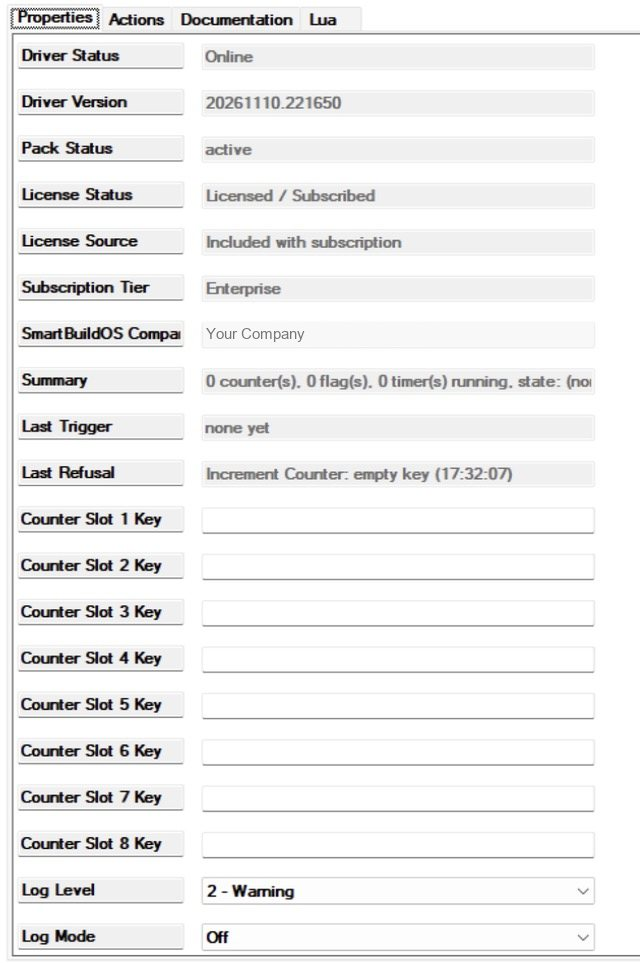
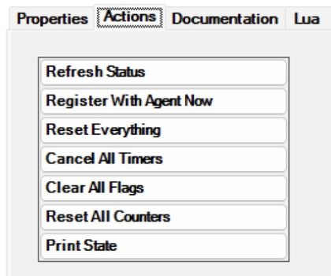

# SmartBuildOS Logic Pack

The Logic Pack adds a set of small building blocks to Composer programming:
counters, flags, one named state, timers you can restart and cancel, and three
ways to tame a busy trigger: wait until it goes quiet (debounce), let it through
at most once per period (throttle), or let it through once a day. You address
each one by a name you type in the programming line, its key. There is nothing
to create first: a counter, a flag or a timer exists from the first line that
names it. One driver serves the whole project, and what it holds is stored on
the controller and comes back after a restart.

It also holds up to 16 **Logic Blocks**: named rules such as a cooldown, a
restartable timer or a threshold with a deadband, each with its own events,
variables and conditionals. They have their own section,
[Logic Blocks](#logic-blocks).

Requires the SmartBuildOS Agent (`smartbuildos.c4z`) paired to a SmartBuildOS
system. The Agent is the licensing authority (SKU `SBOS_LOGIC_PACK`): **License
Status** shows this driver's standing. A definitive licence denial with
enforcement on makes the pack **read-only**: commands are refused and say so
under **Last Refusal**, conditionals and variables keep answering, nothing is
lost. Only a definitive denial does this. A missing Agent, an Agent that has not
answered yet or a cloud that cannot be reached leave the pack active.

## Why not plain Composer variables and timers

Composer already has the Variables agent, the Timer agent and the Scheduler, and
for many jobs they are enough. A Number variable that programming adds 1 to is a
counter. A Boolean variable is a flag. A String variable is a state. A timer
that every motion event restarts is the classic "off after the last motion".

Keep the stock way when:

- You need one flag or one counter, used in one place. A variable in the
  Variables agent needs no driver and no licence, and it is where the next
  technician will look first.
- The job runs on the clock or the calendar. That is the Scheduler. This driver
  has no clock events; the only date it knows is the midnight roll of
  once-per-day.
- A device already knows the answer. If a light's or a room's own conditional
  says what you need, use it instead of copying it into a flag.
- You need many counters that conditionals compare. Here only the eight counters
  mapped to a slot have a variable and a conditional.
- The programming must not depend on anything else. A script that uses this
  driver stops acting if the pack is ever read-only.

The Logic Pack is for the rest:

- **Nothing to create per item.** Each stock variable or timer is made in its
  agent before programming can use it. Here the key is typed in the line. Twenty
  rooms with an off-after-motion countdown are twenty keys in one driver.
- **The fiddly patterns are one command.** "Wait until it has been quiet for two
  seconds", "at most once a minute" and "only once today" can each be built from
  a stock timer or variable and two or three scripts that have to stay in step.
  Here they are `DEBOUNCE`, `THROTTLE` and `ONCE_PER_DAY`.
- **Timers know when they are due.** A timer is stored with the moment it runs
  out. After a controller restart it either carries on with the time it has left
  or, if that moment passed while the controller was down, fires at once and
  says it is late.
- **Events fire on a real change only.** Setting a flag that is already set, or
  the state the house is already in, fires nothing.
- **One place to look.** The action *Print State* lists every counter, flag,
  running timer and once-per-day key, and **Last Refusal** names any command the
  driver did not accept, with the reason.

## What it is for

| You want                                                                       | Use                                                                              |
| ------------------------------------------------------------------------------ | -------------------------------------------------------------------------------- |
| A light or a fan that goes off N minutes after the last motion or button press | `START_TIMER` on every trigger, then the event *Timer Expired*                   |
| That countdown stopped when somebody switches off by hand                      | `CANCEL_TIMER`                                                                   |
| To know whether a countdown is still running                                   | The conditional *Timer is running*                                               |
| Door openings, doorbell presses or visits counted                              | `INCREMENT_COUNTER`, and **Counter Slot 1 Key** to read the count in `COUNTER_1` |
| Something done on the tenth time                                               | The event *Counter Changed* with the conditional *Counter slot 1*                |
| Something done only the first time each day: a greeting, a reminder            | `ONCE_PER_DAY`, then the event *Once Per Day Passed*                             |
| One action when a chattering sensor or a dragged slider settles                | `DEBOUNCE`, then the event *Debounced Trigger*                                   |
| A doorbell or an alert that cannot repeat more than once a minute              | `THROTTLE`, then the event *Throttled Trigger*                                   |
| A yes or no remembered: guests staying, an alert acknowledged                  | `SET_FLAG`, `CLEAR_FLAG`, `TOGGLE_FLAG` and the conditional *Flag is set*        |
| One named mode that any script can ask about                                   | `SET_STATE`, the event *State Changed* and the conditional *Current state*       |
| To see what programming did                                                    | The action *Print State*, **Last Trigger** and **Last Refusal**                  |

## Setup

<!-- walkthrough: Set up Logic Pack -->

1. Install and pair the SmartBuildOS Agent from Composer's Agents tab.
1. Add this driver (one per project, anywhere; a Utility room is fine). **Driver
   Status** reads `Online` and **Pack Status** reads `active`.
1. Read **License Status**. The driver asks the Agent by itself until it
   answers; the action *Register With Agent Now* asks at once.
1. Optionally map up to eight counters to the variables `COUNTER_1` to
   `COUNTER_8` with the **Counter Slot N Key** properties, so programming can
   read them as numbers and the *Counter slot N* conditionals can compare them.
   Type the counter's key; a slot left empty reads 0.
1. In programming, pick this driver and add one command to any script, for
   example `INCREMENT_COUNTER` with `KEY` set to `test`. Run it, then press
   *Print State* on the Actions tab: the Lua tab lists the counter `test` with
   the value 1. *Reset All Counters* removes it again.





## Keys

Every building block except the state is addressed by a `KEY` you type in
programming. The driver tidies what you type, so small differences in spelling
still reach the same key.

| You type                                   | The key is         |
| ------------------------------------------ | ------------------ |
| `Good Night`, `good night` or `GOOD_NIGHT` | `good_night`       |
| `Front Door Opens`                         | `front_door_opens` |
| `kitchen.motion #2`                        | `kitchen_motion_2` |

- The key is trimmed and lower-cased. Every run of spaces or punctuation becomes
  one `_`, and it is cut to 40 characters. Keep to plain letters, digits and
  spaces: an accented letter is not kept (`Séjour` becomes `s_jour`).
- An empty key, or one with nothing but punctuation, is refused.
- Each kind of block has its own keys. The counter `porch` and the timer `porch`
  do not touch each other.
- Keys are project-wide, not per room. Put the room in the key yourself:
  `kitchen_motion`, `hall_light`.
- Where you type a key (a command, a keyed conditional, a slot property) any
  spelling works. Where you compare a variable such as `LAST_TIMER_KEY`, the
  variable holds the tidied key: compare with `hall_light`, not `Hall Light`.

## One event per kind: check the key

The driver has one *Timer Expired* event for all timers, one *Counter Changed*
for all counters, and so on. A script on one of these events runs for every key,
so start it with a conditional on the variable that says which key it was.

| Event                 | The key is in      | Also set                                                |
| --------------------- | ------------------ | ------------------------------------------------------- |
| *Timer Expired*       | `LAST_TIMER_KEY`   | `LAST_TIMER_LATE`                                       |
| *Counter Changed*     | `LAST_COUNTER_KEY` | `LAST_COUNTER_VALUE`, and the slot variable when mapped |
| *Flag Changed*        | `LAST_FLAG_KEY`    | `LAST_FLAG_VALUE`                                       |
| *Debounced Trigger*   | `LAST_TRIGGER_KEY` |                                                         |
| *Throttled Trigger*   | `LAST_TRIGGER_KEY` |                                                         |
| *Once Per Day Passed* | `ONCE_KEY`         |                                                         |
| *State Changed*       | (one state only)   | `CURRENT_STATE`, `PREVIOUS_STATE`                       |

The variables are set first and the event fires after, so a script on the event
can read them.

## Counters

A counter is a whole number under a key. A counter nobody has used reads 0.

- `INCREMENT_COUNTER` adds `BY` to the counter `KEY`, and `DECREMENT_COUNTER`
  subtracts it. Leave `BY` empty to count by 1.
- `SET_COUNTER` sets the counter to `VALUE`. `RESET_COUNTER` sets it to 0.
- `BY` and `VALUE` must be whole numbers. `1.5` or a word is refused.
- A counter stays within plus or minus 1,000,000,000. A result beyond that is
  held at the limit.

When the value changes, the driver sets `LAST_COUNTER_KEY` and
`LAST_COUNTER_VALUE`, updates the slot variable if the counter is mapped to one,
and fires *Counter Changed*. A command that leaves the value where it was fires
nothing. The one exception is the first command that names a new counter: it
creates the counter and fires the event, even when the value is 0.

**Slots.** Composer conditionals take one value, so a conditional cannot ask "is
counter KEY at least N". Instead, type a counter's key in **Counter Slot 1 Key**
and that counter is copied to the variable `COUNTER_1` and answered by the
conditional *Counter slot 1*, which compares it with a number (equal, not equal,
less, less or equal, greater, greater or equal). There are eight slots. Changing
a slot property updates its variable at once. A counter that is not in a slot
still counts; read it from `LAST_COUNTER_VALUE` in a script on *Counter
Changed*.

## Flags

A flag is a yes or no under a key. A flag nobody has set is not set.

- `SET_FLAG` sets it, `CLEAR_FLAG` clears it, `TOGGLE_FLAG` turns it over.
  Toggling a flag that was never set sets it.
- *Flag Changed* fires only when the flag really changes, with `LAST_FLAG_KEY`
  and `LAST_FLAG_VALUE` (`True` or `False`). Setting a flag that is already set
  fires nothing.
- The conditional *Flag is set* takes the key as its value: with "equal" it is
  true when the flag is set, with "not equal" when it is not.

## The state

The state is one name for the whole project: `Home`, `Away`, `Night`, or
whatever your programming needs. It is empty until the first `SET_STATE`.

- `SET_STATE` moves to `STATE`. The name is trimmed and cut to 60 characters,
  and otherwise kept exactly as typed. Unlike a key, capitals count: `Night` and
  `night` are two different states. An empty name is refused.
- When the state differs from the current one, `PREVIOUS_STATE` takes the old
  name, `CURRENT_STATE` the new one, and *State Changed* fires. Setting the
  state it is already in fires nothing.
- The conditional *Current state* compares the name, equal or not equal, with
  the same exact capitals.
- The driver has no rules about which state may follow which. Any `SET_STATE` is
  accepted; the "machine" is the programming you put on *State Changed*, using
  `CURRENT_STATE` and `PREVIOUS_STATE`.
- *Print State* shows the last ten changes since the driver started, with their
  times.

## Timers

A timer is a countdown under a key.

- `START_TIMER` starts the timer `KEY` for `SECONDS`. If that timer is already
  running it starts again from now, with the new `SECONDS`. That is what makes
  "N minutes after the last motion" one command.
- `SECONDS` must be more than 0. Fractions are accepted (`1.5`). Anything above
  seven days is cut to seven days.
- When the time runs out the driver sets `LAST_TIMER_KEY`, sets
  `LAST_TIMER_LATE` to `False`, and fires *Timer Expired* once. The timer is
  then gone.
- `CANCEL_TIMER` stops the timer `KEY`. Nothing fires. Cancelling a timer that
  is not running is not an error.
- The conditional *Timer is running* takes the key: "equal" is true while it
  runs, "not equal" while it does not.

**After a controller restart.** A timer whose time passed while the driver was
down fires as soon as the driver starts, with `LAST_TIMER_LATE` set to `True`. A
timer still in the future carries on with the time it has left. Take a
100-second and a 1000-second timer started together, and a controller that comes
back 200 seconds later: the first fires at once, marked late; the second fires
800 seconds after that, not late. Use `LAST_TIMER_LATE` when a late action could
be wrong, such as an announcement.

## Debounce

Debounce turns a burst of triggers into one event after the burst ends.

- `DEBOUNCE` restarts the quiet timer of `KEY`. When `KEY` has had no `DEBOUNCE`
  call for `MILLISECONDS`, the driver sets `LAST_TRIGGER_KEY` and fires
  *Debounced Trigger* once.
- Example: with 2000 milliseconds, calls at 0 and at 1.5 seconds give one event
  at 3.5 seconds.
- The `MILLISECONDS` of the latest call is the one that counts. `0` fires at
  once. Anything above one hour (3,600,000) is cut to one hour. An empty or
  negative value is refused.
- A pending debounce is not kept across a controller restart, and *Cancel All
  Timers* drops it. In both cases nothing fires.

Use it for a slider somebody drags, a setpoint somebody turns, or several
sensors that trip together. For a countdown of minutes that must survive a
restart, use a timer.

## Throttle

Throttle lets the first trigger through and drops the rest for a while.

- `THROTTLE` fires *Throttled Trigger* at once, with `LAST_TRIGGER_KEY` set,
  unless `KEY` already fired within the last `MILLISECONDS`. In that case the
  call is dropped: nothing fires then, and nothing fires later.
- The window is counted from the last time the key fired, not from the last
  dropped call. With 60,000 milliseconds: a call at 0 fires, a call at 40
  seconds is dropped, a call at 65 seconds fires.
- `0` always fires. Anything above one hour is cut to one hour.
- A dropped call is not a refusal and does not appear under **Last Refusal**.
  *Print State* counts dropped calls as `throttle_suppressed`.

## Once per day

- `ONCE_PER_DAY` fires *Once Per Day Passed*, with `ONCE_KEY` set, the first
  time it is called for `KEY` today. Later calls the same day fire nothing and
  are not refusals.
- "Today" is the controller's local calendar date. The day rolls at local
  midnight, not 24 hours after the last pass: a key that passed at 23:59 passes
  again at 00:01.
- The conditional *Once-per-day already passed today* takes the key and asks
  without using the pass up: "equal" is true when it has passed today.
- Passes from earlier days are forgotten by the driver; there is nothing to
  reset.

## What comes back after a restart

The driver writes what it holds two seconds after any change, and once more when
it is stopped in the normal way (by an update, for example). A change made in
the last two seconds before a power cut may not have been written.

| Block        | After a restart                                                                                   |
| ------------ | ------------------------------------------------------------------------------------------------- |
| Counters     | Values kept; `COUNTER_1` to `COUNTER_8` are filled in again                                       |
| Flags        | Kept                                                                                              |
| State        | Kept; `CURRENT_STATE` and `PREVIOUS_STATE` are filled in again, and *State Changed* does not fire |
| Timers       | Overdue timers fire at once, marked late; the others carry on                                     |
| Debounce     | A pending one is dropped; nothing fires                                                           |
| Throttle     | The last fire time is kept, so the window continues                                               |
| Once per day | Today's passes are kept                                                                           |

## Worked examples

### A light that goes off five minutes after the last motion

<!-- walkthrough: Off after the last motion -->

1. On the motion sensor's event for motion, turn the hall light on. Under it add
   this driver's command `START_TIMER` with `KEY` set to `hall light` and
   `SECONDS` set to `300`.
1. Pick this driver's event *Timer Expired*. Add a conditional on the variable
   `LAST_TIMER_KEY` being equal to `hall_light` (the tidied key, with the
   underscore). Inside it, turn the hall light off.
1. Optional: on the event for the light being switched off, add `CANCEL_TIMER`
   with `KEY` set to `hall light`, so a countdown does not stay behind when
   somebody switches off by hand.
1. Walk past the sensor, then press *Print State*: the Lua tab lists
   `hall_light` under the running timers with the seconds it has left.

Every new motion starts the 300 seconds again. Motion at 12:00:00 and again at
12:03:20 turns the light off at 12:08:20. For a second room, use another key and
add its own conditional to the same *Timer Expired* script.

### Counting door openings

- On the door contact's event for opening, add `INCREMENT_COUNTER` with `KEY`
  set to `front door opens`. Leave `BY` empty.
- Type `Front Door Opens` in **Counter Slot 1 Key**. `COUNTER_1` now follows the
  count: after the third opening it reads 3.
- To act on the tenth opening, pick the event *Counter Changed*, add a
  conditional on `LAST_COUNTER_KEY` being equal to `front_door_opens`, and
  inside it the conditional *Counter slot 1* equal to 10. Use "equal", not
  "greater or equal", or the script runs again on every opening after the tenth.
- To start again each day, add `RESET_COUNTER` with the same `KEY` to a
  Scheduler event at midnight.

`COUNTER_1` is an ordinary read-only number variable, so it can also go wherever
Composer lets you pick a variable.

### A morning scene, once a day

- On the kitchen motion sensor's event for motion, inside a time conditional of
  your own (after 06:00, say), add `ONCE_PER_DAY` with `KEY` set to
  `morning kitchen`.
- Pick the event *Once Per Day Passed*. Add a conditional on `ONCE_KEY` being
  equal to `morning_kitchen`, and inside it raise the shades and start the
  radio.

The first motion after 06:00 runs the scene. Every later motion that day does
nothing. The time conditional matters: the day starts at midnight, so without it
a trip to the kitchen at 00:30 would use up today's pass. Any other script can
ask whether the scene has run with *Once-per-day already passed today* and the
key `morning kitchen`.

### A simple state machine: Home, Away, Night

- Pick three names and type them the same way everywhere: `Home`, `Away`,
  `Night`.
- On the Good Night button add `SET_STATE` with `STATE` set to `Night`. On the
  Away button, `Away`. On the front door unlocking, `Home`.
- Pick the event *State Changed* and add one conditional per state: *Current
  state* equal to `Night` runs the night scene, equal to `Away` the away scene.
- For a welcome scene only on coming home, use *Current state* equal to `Home`
  together with a conditional on `PREVIOUS_STATE` being equal to `Away`. Coming
  from `Night`, it does not run.
- In any other script, ask the state: on hall motion, *Current state* equal to
  `Night` sets the light to 20%, otherwise to 100%.

Pressing Good Night twice does not replay the scene, because the second
`SET_STATE` changes nothing. After a controller restart `CURRENT_STATE` is still
`Night` and *State Changed* does not fire again. There is one state per project;
a second, independent yes or no is a flag.

## Logic Blocks

A Logic Block is a named rule you set up once and then use from programming. You
give it a name and a type in Composer, programming tells it when something
happened, and it answers with its own event when its rule says so.

```
When Driveway Motion senses motion
    → Logic Pack: BLOCK_TRIGGER (Block 01)

When Logic Pack: Block 01 Passed
    → run the Welcome lighting scene
```

Block 01 here is a Cooldown named Driveway Welcome, set to 10 minutes. The
driver decides whether the trigger passes and says what it decided. Running the
scene is still your programming. The driver operates no equipment.

Blocks and the keys described in the rest of this manual live side by side. A
key exists the moment a programming line names it and tells you which key fired
through one shared variable. A block is created on purpose, has its own events,
variables and conditionals, shows its settings and its last decisions, and can
be simulated before it is trusted. A block never takes over a key because it has
the same name: the two are stored apart.

### Create a block

<!-- walkthrough: Create a Logic Block -->

1. Open the driver's Properties. Type **New Block Name** (for example
   `Driveway Welcome`) and pick **New Block Type** (`Cooldown`).
1. On the Actions tab run *New Draft*. **Draft** reads
   `New Cooldown block - not checked`, and only the Draft properties this type
   uses are shown.
1. Fill in the Draft properties. For a cooldown that is **Draft Duration**:
   `10m`.
1. Run *Validate Draft*. **Draft Check** reads `Valid` or names every problem at
   once. **Draft Impact** says what applying it will do.
1. Run *Apply Draft*. **Blocks** now reads `01 Driveway Welcome (Cooldown)`: the
   block is in slot 01.
1. In Programming, use the commands and events of **Block 01**.

Nothing you type in a Draft property reaches a live block. A draft is checked as
a whole and applied in one step, or not at all. A draft that does not validate
leaves the block exactly as it was.

To start from a recipe, pick **Template** and run *Load Template Into Draft*
instead of *New Draft*. A template fills the draft only. It never creates a
block and never picks a device for you.

A duration is written the way it is said: `10m`, `90s`, `1h30m`, `500ms`. A bare
number is seconds. The longest is 7 days.

### The block types

| Type                    | What it does                                                                                  | Feed it with                                                               | It fires                                       |
| ----------------------- | --------------------------------------------------------------------------------------------- | -------------------------------------------------------------------------- | ---------------------------------------------- |
| Cooldown                | Passes the first trigger, suppresses repeats for the duration. No pass when the duration ends | `BLOCK_TRIGGER`                                                            | *Passed*                                       |
| Quiet-Period Trigger    | Each trigger restarts a countdown. Passes once when triggers have stopped for the duration    | `BLOCK_TRIGGER`, `BLOCK_CANCEL`                                            | *Started*, *Passed*, *Cancelled*               |
| Restartable Timer       | A countdown you start, restart and cancel                                                     | `BLOCK_START`, `BLOCK_RESTART`, `BLOCK_CANCEL`                             | *Started*, *Expired*, *Cancelled*              |
| Once Per Day            | Passes the first trigger of each calendar day on the controller's clock                       | `BLOCK_TRIGGER`                                                            | *Passed*                                       |
| Flag / Latch            | An on/off value that stays where programming put it                                           | `BLOCK_SET`, `BLOCK_CLEAR`, `BLOCK_TOGGLE`                                 | *Became True*, *Became False*                  |
| Counter                 | A whole number, with an optional threshold                                                    | `BLOCK_INCREMENT`, `BLOCK_DECREMENT`, `BLOCK_SET`, `BLOCK_CLEAR`           | *Value Changed*, *Became True*, *Became False* |
| All / Any Conditions    | Combines up to four true/false inputs                                                         | `BLOCK_INPUT` or device variables; `BLOCK_TRIGGER` when it gates a trigger | *Became True*, *Became False*, or *Passed*     |
| Threshold With Deadband | On above the upper limit, off below the lower one, unchanged in between                       | `BLOCK_INPUT` or a device variable                                         | *Became True*, *Became False*                  |
| Stable-State Filter     | Follows its source only after the source has held a new state for the duration                | `BLOCK_INPUT` or a device variable; `BLOCK_CANCEL`                         | *Value Changed*, *Became True*, *Became False* |
| State Selector          | One of the states you list, with optional allowed transitions                                 | `BLOCK_SET`                                                                | *Value Changed*                                |

Every type can also fire *Faulted*, and takes `BLOCK_RESET` where it has
something to forget.

The details that decide how programming behaves:

- **Cooldown.** The interval is measured from the pass. A trigger at exactly the
  interval passes. Suppressed triggers are counted and the block says when it is
  eligible again.
- **Quiet-Period Trigger.** *Started* fires on the first trigger of a burst
  only. `BLOCK_CANCEL` stops the countdown and fires *Cancelled*; nothing
  passes.
- **Restartable Timer.** **Draft Repeated Start** decides what a start does
  while it is running: `Restart the countdown` (the default) or
  `Ignore while running`. `BLOCK_RESTART` always restarts. *Started* fires when
  it goes from idle to running, not on a restart.
- **Once Per Day.** The day is the controller's local calendar day. It is not a
  24-hour interval: a pass at 23:59 and another at 00:01 are both allowed.
- **Flag and Counter.** Setting a value the block already has fires nothing. The
  counter's bounds are those of the classic counters, ±1,000,000,000, and a
  value outside them is clamped. With **Draft Counter Threshold** set, the block
  is active while the count meets the comparison, and fires *Became True* and
  *Became False* when it crosses.
- **All / Any Conditions.** **Draft Evaluation** picks one of two behaviours.
  `Continuous output` fires *Became True* and *Became False* as the inputs
  change. `Gate a trigger` fires nothing by itself: `BLOCK_TRIGGER` passes only
  while the conditions hold.
- **Threshold With Deadband.** It turns on above **Draft Upper Threshold** and
  off below **Draft Lower Threshold**. A reading exactly on a limit changes
  nothing. A first reading inside the band is off. A lower limit above the upper
  one is refused.
- **Stable-State Filter.** A change is held back until it has lasted **Draft
  Duration**. If the source changes again first, the pending change is dropped.
  The first value it ever reads is taken as it is.
- **State Selector.** **Draft Transitions** lists the allowed changes as
  `From > To`, separated by commas; `*` means any state. Empty allows every
  change. A change that is not allowed is refused and **Last Refusal** says
  which changes are.

### Unknown is not false

An input a block cannot read is unknown. It is never treated as false or as
zero.

- All Conditions: one false input makes the result false. Otherwise one unknown
  input makes it unknown.
- Any Conditions: one true input makes the result true. Otherwise one unknown
  input makes it unknown.
- A threshold or a stable filter with no readable source is unknown.

When a block loses its result it fires *Faulted* once, its `VALID` variable
reads false and its `STATE` reads `unknown`. It does not fire *Became False*.
When the input can be read again and the result is what it was, nothing fires. A
gate holds a trigger back while its conditions are unknown and fires *Faulted*
so programming can react.

### Inputs from a device variable

The three value-driven types can read a device variable directly, with no
programming line. In the draft, pick **Draft Input 1 Device**, then **Draft
Input 1 Variable**. For a true/false input, **Draft Input 1 True When** lists
the values that mean true, for example `closed,1`.

- The value Director reports when the listener starts sets the block's state and
  fires nothing. So does the value read after a controller restart.
- A variable that has not changed for a long time is still valid. It is not
  marked stale for being quiet.
- If the device or the variable is removed, the input reads as unknown within a
  minute and the dealer app lists it under missing mappings.
- An input that is mapped to a device refuses `BLOCK_INPUT`.

An input with a label and no device is fed by `BLOCK_INPUT`. A value sent that
way is kept across a restart, because programming is the only place it exists.

### Programming reference for blocks

Every block command takes **BLOCK**, a list of `Block 01` to `Block 16`. The
slot number is the reference: renaming a block changes nothing in programming.

| Command                   | Parameters                | Does                                                                                              |
| ------------------------- | ------------------------- | ------------------------------------------------------------------------------------------------- |
| `BLOCK_TRIGGER`           | `BLOCK`                   | Runs the rule: cooldown, quiet period, once per day, timer start, or a gate                       |
| `BLOCK_START`             | `BLOCK`                   | Starts a timer, following its Repeated Start setting                                              |
| `BLOCK_RESTART`           | `BLOCK`                   | Starts a timer again from now                                                                     |
| `BLOCK_CANCEL`            | `BLOCK`                   | Cancels a countdown, a quiet period or a change waiting to hold                                   |
| `BLOCK_SET`               | `BLOCK`, `VALUE`          | A flag (`true`/`false`), a counter, a state name or a threshold reading                           |
| `BLOCK_CLEAR`             | `BLOCK`                   | Turns a flag off; sets a counter to 0                                                             |
| `BLOCK_TOGGLE`            | `BLOCK`                   | Flips a flag                                                                                      |
| `BLOCK_INCREMENT`         | `BLOCK`, `BY`             | Adds `BY` (default 1) to a counter                                                                |
| `BLOCK_DECREMENT`         | `BLOCK`, `BY`             | Subtracts `BY` (default 1) from a counter                                                         |
| `BLOCK_RESET`             | `BLOCK`                   | Forgets the cooldown, today's pass, the count or the state. Nothing fires for a cleared countdown |
| `BLOCK_INPUT`             | `BLOCK`, `INPUT`, `VALUE` | Sends a value to one of a block's inputs                                                          |
| `BLOCK_INPUT_UNAVAILABLE` | `BLOCK`, `INPUT`          | Says an input cannot be read right now. The result becomes unknown                                |

A command the block's type does not take, a value of the wrong kind, a command
to an empty or retired slot and a command to a disabled block are refused. The
refusal is named under **Last Refusal** and never halts programming.

Each slot has eight events, four variables and three conditionals. Their ids
depend on the slot number only, never on the name or the type:

| For slot `n` | Name                                                                                                            | Id                 |
| ------------ | --------------------------------------------------------------------------------------------------------------- | ------------------ |
| Events       | `Block nn Passed`, `Started`, `Expired`, `Cancelled`, `Value Changed`, `Became True`, `Became False`, `Faulted` | `1000 + 10n + 1…8` |
| Variables    | `BLOCK_nn_ACTIVE`, `BLOCK_nn_VALID`, `BLOCK_nn_VALUE`, `BLOCK_nn_STATE`                                         | `4000 + 10n + 1…4` |
| Conditionals | *Block nn is active*, *Block nn value*, *Block nn state*                                                        | `100 + 10n + 1…3`  |

What the four variables hold:

| Type                    | `ACTIVE`                 | `VALUE`                   | `STATE`                        |
| ----------------------- | ------------------------ | ------------------------- | ------------------------------ |
| Cooldown                | cooling down             | triggers suppressed       | `ready`, `cooling`             |
| Quiet-Period Trigger    | countdown pending        | triggers in the burst     | `idle`, `waiting`              |
| Restartable Timer       | running                  | seconds left              | `idle`, `running`, `held`      |
| Once Per Day            | passed today             | triggers suppressed today | `ready`, `done_today`          |
| Flag / Latch            | on                       | 1 or 0                    | `on`, `off`                    |
| Counter                 | threshold met            | the count                 | `counting`, `reached`, `below` |
| All / Any Conditions    | result is true           | inputs that are true      | `true`, `false`, `unknown`     |
| Threshold With Deadband | above the upper limit    | the last reading          | `active`, `clear`, `unknown`   |
| Stable-State Filter     | held state is true       | 1 or 0                    | the held state, `unknown`      |
| State Selector          | not in the initial state | position in the list      | the state name                 |

`VALID` is true when the block has a result. An empty slot reads `empty`, a
disabled block `disabled`, a retired slot `retired`, an isolated block
`isolated`. A slot's variables are written before its event fires, so
programming on the event reads the values of that event.

### Changing, disabling and retiring a block

Pick the block in **Selected Block**, then:

| Action                   | Does                                                                                                                   |
| ------------------------ | ---------------------------------------------------------------------------------------------------------------------- |
| *Edit Selected Block*    | Copies its settings into the draft. Change the Draft properties, then *Validate Draft* and *Apply Draft*               |
| *Copy Selected Block*    | Makes a new block with the same settings, named from **New Block Name**. It gets a new slot and starts with no history |
| *Disable Selected Block* | The block ignores inputs and fires nothing. Anything pending is dropped with no event. Its stored value is kept        |
| *Enable Selected Block*  | Puts it back to work                                                                                                   |
| *Resume Selected Block*  | Releases a block that was isolated                                                                                     |
| *Retire Selected Block*  | Stops the block for good and keeps its slot out of use. Asks twice: the first press says what will happen              |
| *Release Retired Slot*   | Makes a retired slot available to a new block. Asks twice                                                              |

- **Renaming** keeps the slot, the events, the variables and the conditionals.
  Programming keeps working.
- **Changing settings** drops anything that is pending on that block. A running
  countdown is cancelled and neither *Expired* nor *Cancelled* fires. **Draft
  Impact** says so before you apply. A flag keeps its value, a counter its
  count.
- **The type cannot change.** Retire the block and create a new one.
- **A retired slot is not given to a new block**, so programming written for the
  retired block can never drive a different one. Commands still sent to it are
  refused and name the block that was retired. Release the slot only once that
  programming is gone.
- There are 16 slots.

### After a restart

Flags, counts, selector states, cooldown times and today's passes come back.
Blocks that read a device variable read it again; the value they find sets their
state and fires nothing, even when it changed while the controller was down.
Check the block's conditional at start-up if equipment must follow.

A timer that was running follows **Draft After Restart**:

| Setting            | Its deadline is still ahead                | Its deadline passed while the controller was down               |
| ------------------ | ------------------------------------------ | --------------------------------------------------------------- |
| `Cancel if missed` | Carries on to its deadline                 | Cancelled. *Expired* does not fire. The recovery report says so |
| `Fire late`        | Carries on to its deadline                 | *Expired* fires once at start-up                                |
| `Resume remaining` | Counts the time it had left, from start-up | Counts the time it had left, from start-up                      |

`Cancel if missed` is the default. A quiet-period countdown or a stable-filter
change that was pending is dropped and does not fire. The classic `START_TIMER`
keeps its own rule: an overdue timer fires at start-up, marked late.

If the stored blocks cannot be read, nothing is reset. **Blocks Status** reads
`RESTORE FAILED` with the reason, *Blocks Restore Failed* fires, blocks refuse
commands and the stored copy is left untouched. *Acknowledge Restore Failure*
keeps a copy of what was stored and lets the pack start empty.

### Recipes

| Recipe           | Block                             | Programming                                                                                                       |
| ---------------- | --------------------------------- | ----------------------------------------------------------------------------------------------------------------- |
| Driveway welcome | Cooldown, `10m`                   | Driveway motion → `BLOCK_TRIGGER`. *Passed* → run the Welcome scene                                               |
| Bathroom vacancy | Restartable Timer, `15m`          | Bathroom motion → `BLOCK_START`. *Expired* → light and fan off. Light switched off by hand → `BLOCK_CANCEL`       |
| Guest override   | Flag / Latch                      | Keypad button → `BLOCK_TOGGLE`. In other programming: *If Block nn is active* → Stop. *Became True/False* → LED   |
| Daily greeting   | Once Per Day                      | Kitchen motion → `BLOCK_TRIGGER`. *Passed* → play the greeting                                                    |
| Rack temperature | Threshold, upper `85`, lower `78` | Input 1 = the sensor's temperature variable. *Became True* → fan on. *Became False* → fan off. *Faulted* → notify |

Each is a **Template**.

### The dealer app

**Dealer App** shows an address such as `http://192.168.1.20:47871/app?k=…`.
Open it in a browser on a computer or phone on the same network as the
controller.

| Screen           | Shows                                                                                              |
| ---------------- | -------------------------------------------------------------------------------------------------- |
| Overview         | Every block: name, slot, type, state, running countdowns, faults. Search and filters               |
| Block detail     | The rule in plain words, its settings, each input's value and when it was read, the last decisions |
| Connections      | The device variables the driver reads, and the commands and events to wire in Composer             |
| Activity         | The last decisions, newest first, filtered by block, decision or time                              |
| Test sandbox     | A copy of one block in a simulation: send inputs, move time, see what would fire                   |
| Diagnostics      | Version, licence, clock, missing mappings, the restart recovery report, a redacted export          |
| Templates & help | The recipes, the block types and the words used                                                    |

The app reports and simulates. It cannot create, change, enable or retire a
block: that is done here in Composer. The sandbox runs on a copy with its own
clock; it fires no event, sends no command and changes no live block.

The app works on the home network only. It shows when its picture was taken and
says so when the controller stops answering. **Dealer App Access** `Off` closes
the controller port it is served from. If **Dealer App** says the controller
address is unknown, type the controller's IP address into **App Relay Address**.
The address carries an access token: share it with people who may see this
system's programming logic.

**Cloud Status Mirror** is `Off` unless you turn it on. `On` sends a summary
(block names, types and whether each is healthy) to SmartBuildOS through the
Agent. It has not been checked end to end on a controller.

### Did the equipment respond?

An event that fired is not proof that anything moved. For each decision the app
shows four separate facts: the input was received, the block evaluated it, an
event was emitted, the equipment was confirmed. The last one is shown only when
you give the block a feedback variable: **Draft Feedback Device** and **Draft
Feedback Variable**, the values that mean it responded in **Draft Feedback
Expect**, and how long to wait in **Draft Feedback Within**. Without one the app
says `Not monitored`.

### Reading a decision

| Word           | Means                                                                                   |
| -------------- | --------------------------------------------------------------------------------------- |
| Passed         | The trigger was let through and *Passed* fired                                          |
| Suppressed     | The rule held the trigger back. Nothing fired. The reason says when it would pass       |
| Refused        | The input could not be used: wrong value, wrong command, disabled, retired or read-only |
| No change      | The value is what it already was. Nothing fired                                         |
| Starting value | A value read at start-up or when a listener started. It set the state and fired nothing |
| Faulted        | The block lost its result because an input cannot be read                               |
| Missed         | Something that was pending when the controller stopped was dropped and did not fire     |
| Isolated       | The block was fed far faster than a house does and was stopped                          |

A block that receives more than 300 inputs in 10 seconds, or that is fed from
its own events until the input queue fills, is isolated: it stops, says why,
fires *Faulted* once and stays stopped until *Resume Selected Block*. The other
blocks keep working.

### What is not claimed for blocks

- None of the block features has been run on a controller. Everything in this
  section comes from the driver's code and its automated tests, which run off
  the controller, and from Control4's published documentation.
- Not yet seen in Composer: how 128 slot events, 64 variables and 48
  conditionals look in the pickers; whether an update in place adds them to an
  existing installation; the true/false form of the slot variables; hiding the
  Draft properties a type does not use.
- Not yet seen on a network: the dealer app served by a controller.
- A block's events are named by slot (`Block 03 Passed`), not by the block's
  name. **Blocks** and the dealer app say which block is in which slot.
- The driver cannot see Composer programming. It cannot tell you whether a
  block's events are wired, or to what.
- Sequences, repeating intervals and typed-in expressions are not block types.

## Programming reference

### Commands

| Command             | Parameters            | What it does                                                        |
| ------------------- | --------------------- | ------------------------------------------------------------------- |
| `INCREMENT_COUNTER` | `KEY`, `BY`           | Adds `BY` (empty is 1). Fires *Counter Changed*                     |
| `DECREMENT_COUNTER` | `KEY`, `BY`           | Subtracts `BY` (empty is 1). Fires *Counter Changed*                |
| `SET_COUNTER`       | `KEY`, `VALUE`        | Sets the counter. Fires *Counter Changed* when the value differs    |
| `RESET_COUNTER`     | `KEY`                 | Sets the counter to 0                                               |
| `SET_FLAG`          | `KEY`                 | Sets the flag. Fires *Flag Changed* when it was not set             |
| `CLEAR_FLAG`        | `KEY`                 | Clears the flag. Fires *Flag Changed* when it was set               |
| `TOGGLE_FLAG`       | `KEY`                 | Turns the flag over. Fires *Flag Changed*                           |
| `SET_STATE`         | `STATE`               | Moves the state. Fires *State Changed* when it differs              |
| `DEBOUNCE`          | `KEY`, `MILLISECONDS` | Restarts the quiet timer. *Debounced Trigger* fires after the quiet |
| `THROTTLE`          | `KEY`, `MILLISECONDS` | Fires *Throttled Trigger* now, or drops the call                    |
| `ONCE_PER_DAY`      | `KEY`                 | Fires *Once Per Day Passed* the first time today                    |
| `START_TIMER`       | `KEY`, `SECONDS`      | Starts or restarts the timer. *Timer Expired* fires at the end      |
| `CANCEL_TIMER`      | `KEY`                 | Stops the timer. Nothing fires                                      |
| `RESET_ALL`         | `WHAT`                | `Counters`, `Flags`, `Timers` or `Everything`                       |

`RESET_ALL` by scope:

- `Counters`: every counter goes to 0, with *Counter Changed* for each one that
  was not 0, and the counter keys are forgotten.
- `Flags`: every set flag is cleared, with *Flag Changed* for each.
- `Timers`: every running timer and pending debounce is cancelled. Nothing
  fires.
- `Everything`: all of the above, plus the once-per-day passes and the throttle
  history, and the state is emptied, with *State Changed* if there was one. A
  `RESET_ALL` with `WHAT` left empty also resets everything.

### Events

*Debounced Trigger*, *Throttled Trigger*, *Once Per Day Passed*, *Timer
Expired*, *State Changed*, *Counter Changed*, *Flag Changed*, *Pack Read-Only*
(the licence halted the pack) and *Pack Restored* (it is active again).

### Conditionals

| Conditional                          | Value                                     | True when                                                              |
| ------------------------------------ | ----------------------------------------- | ---------------------------------------------------------------------- |
| *Counter slot 1* to *Counter slot 8* | A number, with any of the six comparisons | The counter mapped to that slot compares so. An empty slot counts as 0 |
| *Flag is set*                        | The flag key                              | Equal: set. Not equal: not set                                         |
| *Current state*                      | The state name                            | Equal or not equal, exact capitals                                     |
| *Timer is running*                   | The timer key                             | Equal: running. Not equal: not running                                 |
| *Once-per-day already passed today*  | The key                                   | Equal: passed today. Not equal: not yet                                |
| *Logic Pack is active*               |                                           | The pack is not read-only                                              |

### Variables

All are read-only.

| Variable                                 | Holds                                                                              |
| ---------------------------------------- | ---------------------------------------------------------------------------------- |
| `COUNTER_1` to `COUNTER_8`               | The counter mapped to each slot, as a number                                       |
| `CURRENT_STATE`, `PREVIOUS_STATE`        | The state, and the one before it                                                   |
| `LAST_TRIGGER_KEY`                       | The key of the last *Debounced Trigger* or *Throttled Trigger*                     |
| `LAST_TIMER_KEY`, `LAST_TIMER_LATE`      | The key of the last *Timer Expired*, and `True` when it fired late after a restart |
| `LAST_COUNTER_KEY`, `LAST_COUNTER_VALUE` | The last counter that changed, and its new value                                   |
| `LAST_FLAG_KEY`, `LAST_FLAG_VALUE`       | The last flag that changed, and `True` or `False`                                  |
| `ONCE_KEY`                               | The key of the last *Once Per Day Passed*                                          |
| `PACK_STATUS`                            | `starting`, `active` or `read-only (licence)`                                      |

## Properties

| Property                                                                                | What it shows or sets                                                                                                         |
| --------------------------------------------------------------------------------------- | ----------------------------------------------------------------------------------------------------------------------------- |
| **Driver Status**, **Driver Version**                                                   | `Online` once the driver runs, and its build                                                                                  |
| **Pack Status**                                                                         | `starting`, `active` or `read-only (licence)`                                                                                 |
| **License Status**, **License Source**, **Subscription Tier**, **SmartBuildOS Company** | What the Agent answered for this driver                                                                                       |
| **AI Core**                                                                             | Whether this driver reports to SmartBuildOS AI Core; see [AI Core](#ai-core)                                                  |
| **Summary**                                                                             | How many counters, set flags and running timers there are, and the state. Refreshed once a minute                             |
| **Last Trigger**                                                                        | The last timer, debounce, throttle, once-per-day or state change, with the time. Counter and flag changes are not shown here  |
| **Last Refusal**                                                                        | The last command the driver did not accept, the reason and the time                                                           |
| **Counter Slot 1 Key** to **Counter Slot 8 Key**                                        | The counter each slot follows                                                                                                 |
| **Blocks Status**, **Blocks**                                                           | How many of the 16 slots are used and which block is in which slot. `RESTORE FAILED` when the stored blocks could not be read |
| **Selected Block**, **Selected Block Status**                                           | The block the Selected Block actions act on, and where it stands now                                                          |
| **New Block Name**, **New Block Type**, **Template**                                    | What *New Draft* and *Load Template Into Draft* start from                                                                    |
| **Draft**, **Draft Check**, **Draft Impact**                                            | What the draft is for, the result of *Validate Draft*, and what *Apply Draft* would do to anything running                    |
| The other **Draft …** properties                                                        | The draft's settings. Only those the draft's type uses are shown. See [Logic Blocks](#logic-blocks)                           |
| **Dealer App**, **App Data Relay**, **Dealer App Access**, **App Relay Address**        | The address of the dealer app, whether the controller is serving it, and the switch and the address override for it           |
| **Cloud Status Mirror**                                                                 | `Off` (default) or `On`: a summary of the blocks sent to SmartBuildOS through the Agent                                       |
| **Log Level**, **Log Mode**                                                             | Logging, for support                                                                                                          |

## Actions

| Action                                                                   | What it does                                                                                                                                                                                                               |
| ------------------------------------------------------------------------ | -------------------------------------------------------------------------------------------------------------------------------------------------------------------------------------------------------------------------- |
| Print State                                                              | In the Lua tab: status, licence, the state and its last ten changes, every counter (with its slot), the flags that are set, running timers with the time left, today's once-per-day keys, and counts of calls and refusals |
| Reset All Counters, Clear All Flags, Cancel All Timers, Reset Everything | The same as `RESET_ALL` with `Counters`, `Flags`, `Timers` or `Everything`                                                                                                                                                 |
| Register With Agent Now                                                  | Asks the Agent for the licence at once                                                                                                                                                                                     |
| Refresh Status                                                           | Repaints the status properties and the slot variables now                                                                                                                                                                  |
| New Draft, Load Template Into Draft, Edit Selected Block                 | Start a block draft: empty, from a recipe, or from an existing block                                                                                                                                                       |
| Validate Draft, Apply Draft, Discard Draft                               | Check the whole draft, make it live in one step, or throw it away                                                                                                                                                          |
| Enable, Disable, Resume, Copy, Retire Selected Block                     | Act on the block picked in **Selected Block**. Retire asks twice                                                                                                                                                           |
| Release Retired Slot                                                     | Makes a retired slot available again. Asks twice                                                                                                                                                                           |
| Refresh Device Lists                                                     | Reads the project's devices again for the draft's device lists, and re-checks the device variables blocks read                                                                                                             |
| Print Blocks                                                             | In the Lua tab: every block with its rule, its state, its inputs and its event ids, and the last restart's recovery report                                                                                                 |
| Acknowledge Restore Failure                                              | Only after **Blocks Status** reads `RESTORE FAILED`: keeps a copy of what was stored and lets the pack start empty                                                                                                         |

The classic resets (*Reset Everything* and `RESET_ALL`) act on keys only. They
never touch a block.

## Reading the status

A refused command never stops programming: the script carries on, and the
refusal is written to **Last Refusal** as the command, the reason and the time,
for example `Start Timer: SECONDS must be more than 0 (17:32:07)`.

| Reason                                              | What to do                                                    |
| --------------------------------------------------- | ------------------------------------------------------------- |
| `empty key`                                         | Type a `KEY` with at least one letter or digit                |
| `empty state`                                       | Type a `STATE`                                                |
| `BY must be an integer`, `VALUE must be an integer` | Use a whole number, or leave `BY` empty for 1                 |
| `MILLISECONDS must be 0 or more`                    | Type a number; an empty field is refused                      |
| `SECONDS must be more than 0`                       | Type a number above 0                                         |
| `too many keys`                                     | That kind of block already holds 200 keys. See Limits         |
| `read-only`                                         | The licence holds the pack read-only. Read **License Status** |

Other things to check:

- **A script on *Timer Expired* runs for the wrong timer.** It needs a
  conditional on `LAST_TIMER_KEY`. The same goes for the other shared events.
- **A conditional on a key variable is never true.** Compare with the tidied
  key, `hall_light`, not with what you typed in the command.
- ***Current state* is never true.** Check the capitals: `Night` is not `night`.
- **`COUNTER_1` stays at 0.** Check that **Counter Slot 1 Key** names the
  counter the command uses, and read **Last Refusal**.
- **Nothing responds.** If **Pack Status** reads `read-only (licence)`, commands
  are refused until the licence is restored. Timers and debounces that were
  already running still fire. **License Status** then ends in `(read-only)`.
- **Summary looks out of date.** It is repainted once a minute; press *Refresh
  Status*.

## Limits

| What                         | Limit                                                                              |
| ---------------------------- | ---------------------------------------------------------------------------------- |
| Key length                   | 40 characters after tidying; two long keys with the same first 40 are the same key |
| State name                   | 60 characters                                                                      |
| Counter value                | Plus or minus 1,000,000,000                                                        |
| Debounce and throttle window | 0 to 3,600,000 milliseconds (one hour)                                             |
| Timer                        | More than 0 seconds, up to 604,800 (seven days)                                    |
| Keys per kind                | 200                                                                                |

What counts towards the 200 differs by kind. Flags count only while set, timers
only while running, debounces only while pending, and once-per-day keys only for
today. A counter keeps its key after `RESET_COUNTER`; only `RESET_ALL` with
`Counters` or `Everything` frees counter keys. A throttle key is kept from its
first use until `RESET_ALL` with `Everything`.

## AI Core

When the SmartBuildOS AI Core driver is installed in the project, this driver
tells it, over the SmartBuildOS Agent, what the pack is and how it is doing.
Without AI Core it sends nothing more than before.

**AI Core** (read-only property) says where that stands:

| Value                                        | Meaning                                                                             |
| -------------------------------------------- | ----------------------------------------------------------------------------------- |
| `Searching…`                                 | Looking for the SmartBuildOS Agent and AI Core (also briefly after either restarts) |
| `SmartBuildOS Agent not found`               | No SmartBuildOS Agent in the project                                                |
| `SmartBuildOS Agent update required`         | The Agent is too old to carry AI Core reports                                       |
| `Not registered — Agent module list full`    | The Agent already serves 48 SmartBuildOS drivers                                    |
| `Not installed`                              | No AI Core in the project: this driver sends nothing to it                          |
| `Found — not responding`                     | AI Core is installed but did not answer                                             |
| `Found — AI Core update required (v…)`       | AI Core is too old for this driver's reports                                        |
| `Found — not licensed (v…)`                  | AI Core is installed without a licence                                              |
| `Found — SmartBuildOS Agent not paired (v…)` | AI Core cannot reach SmartBuildOS until the Agent is paired                         |
| `Found — reporting, cloud offline (v…)`      | Reports reach AI Core; AI Core cannot reach SmartBuildOS right now                  |
| `Found — reporting (v…)`                     | Reports reach AI Core, which passes them on                                         |

What it reports:

- **What it is**: programming building blocks (counters, flags, the house state,
  timers) and the words people use for them.
- **State**: the pack status, whether it is read-only, and how many counters,
  flags and running timers it holds. Counts only: key names are free text typed
  by the programmer and are never sent, nor are values.
- **Faults**: the pack went read-only because the licence does not cover it, and
  when it accepts commands again.

What it will answer when asked: nothing beyond the reports.

What it can be asked to do: nothing. Every command is Composer programming.

Reports are lossy by design (a few a minute at most); nothing is queued while AI
Core is absent, and nothing changes in this driver when AI Core is not
installed. Tested in unit tests only: nothing here has run on a physical
controller.

## What is not claimed

- Debounce and throttle resolution follows Director's timers (tens of
  milliseconds).
- A debounce window that spans a controller restart is not restored: the quiet
  period has, by definition, passed, and nothing fires.
- Keys are project-wide, not per room.
- There is one state per project, with no rules about allowed transitions.
- Sequences (press A then B within N seconds) and repeating intervals are not
  built in. Compose them from a timer and a counter in programming.
- Once per day follows the controller's own date and time zone. If those are
  wrong, the day rolls at the wrong moment.
- The key variables hold the most recent key only. When two keys fire in the
  same instant each sets its variable and fires its event in turn; whether each
  script then reads its own key has not been checked on a controller.
- Checked on a controller so far: the driver comes online with **Pack Status**
  `active`, *Print State* runs, and a command with no key is refused and named
  under **Last Refusal**. The rest of this page comes from the driver's code and
  its automated tests, which run off the controller. That includes timers across
  a restart and the way the conditionals appear in Composer.
- Nothing the pack holds (keys, counts, flags, the state, blocks) is sent
  anywhere unless **Cloud Status Mirror** is turned on. The driver registers its
  licence with the Agent on the same controller, and it serves the dealer app to
  browsers on the home network while **Dealer App Access** is `On`.
