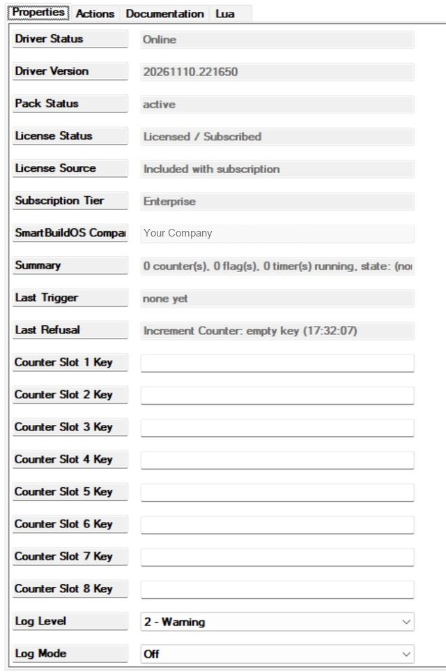
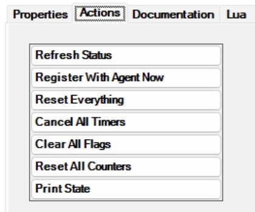

# SmartBuildOS Logic Pack

The Logic Pack adds a set of small building blocks to Composer programming:
counters, flags, one named state, timers you can restart and cancel, and three
ways to tame a busy trigger: wait until it goes quiet (debounce), let it
through at most once per period (throttle), or let it through once a day. You
address each one by a name you type in the programming line, its key. There is
nothing to create first: a counter, a flag or a timer exists from the first
line that names it. One driver serves the whole project, and what it holds is
stored on the controller and comes back after a restart.

Requires the SmartBuildOS Agent (`smartbuildos.c4z`) paired to a
SmartBuildOS system. The Agent is the licensing authority (SKU
`SBOS_LOGIC_PACK`): **License Status** shows this driver's standing. A
definitive licence denial with enforcement on makes the pack **read-only**:
commands are refused and say so under **Last Refusal**, conditionals and
variables keep answering, nothing is lost. Only a definitive denial does
this. A missing Agent, an Agent that has not answered yet or a cloud that
cannot be reached leave the pack active.

## Why not plain Composer variables and timers

Composer already has the Variables agent, the Timer agent and the Scheduler,
and for many jobs they are enough. A Number variable that programming adds 1
to is a counter. A Boolean variable is a flag. A String variable is a state. A
timer that every motion event restarts is the classic "off after the last
motion".

Keep the stock way when:

- You need one flag or one counter, used in one place. A variable in the
  Variables agent needs no driver and no licence, and it is where the next
  technician will look first.
- The job runs on the clock or the calendar. That is the Scheduler. This
  driver has no clock events; the only date it knows is the midnight roll of
  once-per-day.
- A device already knows the answer. If a light's or a room's own conditional
  says what you need, use it instead of copying it into a flag.
- You need many counters that conditionals compare. Here only the eight
  counters mapped to a slot have a variable and a conditional.
- The programming must not depend on anything else. A script that uses this
  driver stops acting if the pack is ever read-only.

The Logic Pack is for the rest:

- **Nothing to create per item.** Each stock variable or timer is made in its
  agent before programming can use it. Here the key is typed in the line.
  Twenty rooms with an off-after-motion countdown are twenty keys in one
  driver.
- **The fiddly patterns are one command.** "Wait until it has been quiet for
  two seconds", "at most once a minute" and "only once today" can each be
  built from a stock timer or variable and two or three scripts that have to
  stay in step. Here they are `DEBOUNCE`, `THROTTLE` and `ONCE_PER_DAY`.
- **Timers know when they are due.** A timer is stored with the moment it
  runs out. After a controller restart it either carries on with the time it
  has left or, if that moment passed while the controller was down, fires at
  once and says it is late.
- **Events fire on a real change only.** Setting a flag that is already set,
  or the state the house is already in, fires nothing.
- **One place to look.** The action *Print State* lists every counter, flag,
  running timer and once-per-day key, and **Last Refusal** names any command
  the driver did not accept, with the reason.

## What it is for

| You want | Use |
| --- | --- |
| A light or a fan that goes off N minutes after the last motion or button press | `START_TIMER` on every trigger, then the event *Timer Expired* |
| That countdown stopped when somebody switches off by hand | `CANCEL_TIMER` |
| To know whether a countdown is still running | The conditional *Timer is running* |
| Door openings, doorbell presses or visits counted | `INCREMENT_COUNTER`, and **Counter Slot 1 Key** to read the count in `COUNTER_1` |
| Something done on the tenth time | The event *Counter Changed* with the conditional *Counter slot 1* |
| Something done only the first time each day: a greeting, a reminder | `ONCE_PER_DAY`, then the event *Once Per Day Passed* |
| One action when a chattering sensor or a dragged slider settles | `DEBOUNCE`, then the event *Debounced Trigger* |
| A doorbell or an alert that cannot repeat more than once a minute | `THROTTLE`, then the event *Throttled Trigger* |
| A yes or no remembered: guests staying, an alert acknowledged | `SET_FLAG`, `CLEAR_FLAG`, `TOGGLE_FLAG` and the conditional *Flag is set* |
| One named mode that any script can ask about | `SET_STATE`, the event *State Changed* and the conditional *Current state* |
| To see what programming did | The action *Print State*, **Last Trigger** and **Last Refusal** |

## Setup

<!-- walkthrough: Set up Logic Pack -->
1. Install and pair the SmartBuildOS Agent from Composer's Agents tab.
1. Add this driver (one per project, anywhere; a Utility room is fine).
   **Driver Status** reads `Online` and **Pack Status** reads `active`.
1. Read **License Status**. The driver asks the Agent by itself until it
   answers; the action *Register With Agent Now* asks at once.
1. Optionally map up to eight counters to the variables `COUNTER_1` to
   `COUNTER_8` with the **Counter Slot N Key** properties, so programming can
   read them as numbers and the *Counter slot N* conditionals can compare
   them. Type the counter's key; a slot left empty reads 0.
1. In programming, pick this driver and add one command to any script, for
   example `INCREMENT_COUNTER` with `KEY` set to `test`. Run it, then press
   *Print State* on the Actions tab: the Lua tab lists the counter `test`
   with the value 1. *Reset All Counters* removes it again.

## Keys

Every building block except the state is addressed by a `KEY` you type in
programming. The driver tidies what you type, so small differences in
spelling still reach the same key.

| You type | The key is |
| --- | --- |
| `Good Night`, `good night` or `GOOD_NIGHT` | `good_night` |
| `Front Door Opens` | `front_door_opens` |
| `kitchen.motion #2` | `kitchen_motion_2` |

- The key is trimmed and lower-cased. Every run of spaces or punctuation
  becomes one `_`, and it is cut to 40 characters. Keep to plain letters,
  digits and spaces: an accented letter is not kept (`Séjour` becomes
  `s_jour`).
- An empty key, or one with nothing but punctuation, is refused.
- Each kind of block has its own keys. The counter `porch` and the timer
  `porch` do not touch each other.
- Keys are project-wide, not per room. Put the room in the key yourself:
  `kitchen_motion`, `hall_light`.
- Where you type a key (a command, a keyed conditional, a slot property) any
  spelling works. Where you compare a variable such as `LAST_TIMER_KEY`, the
  variable holds the tidied key: compare with `hall_light`, not `Hall Light`.

## One event per kind: check the key

The driver has one *Timer Expired* event for all timers, one *Counter
Changed* for all counters, and so on. A script on one of these events runs
for every key, so start it with a conditional on the variable that says which
key it was.

| Event | The key is in | Also set |
| --- | --- | --- |
| *Timer Expired* | `LAST_TIMER_KEY` | `LAST_TIMER_LATE` |
| *Counter Changed* | `LAST_COUNTER_KEY` | `LAST_COUNTER_VALUE`, and the slot variable when mapped |
| *Flag Changed* | `LAST_FLAG_KEY` | `LAST_FLAG_VALUE` |
| *Debounced Trigger* | `LAST_TRIGGER_KEY` | |
| *Throttled Trigger* | `LAST_TRIGGER_KEY` | |
| *Once Per Day Passed* | `ONCE_KEY` | |
| *State Changed* | (one state only) | `CURRENT_STATE`, `PREVIOUS_STATE` |

The variables are set first and the event fires after, so a script on the
event can read them.

## Counters

A counter is a whole number under a key. A counter nobody has used reads 0.

- `INCREMENT_COUNTER` adds `BY` to the counter `KEY`, and
  `DECREMENT_COUNTER` subtracts it. Leave `BY` empty to count by 1.
- `SET_COUNTER` sets the counter to `VALUE`. `RESET_COUNTER` sets it to 0.
- `BY` and `VALUE` must be whole numbers. `1.5` or a word is refused.
- A counter stays within plus or minus 1,000,000,000. A result beyond that is
  held at the limit.

When the value changes, the driver sets `LAST_COUNTER_KEY` and
`LAST_COUNTER_VALUE`, updates the slot variable if the counter is mapped to
one, and fires *Counter Changed*. A command that leaves the value where it
was fires nothing. The one exception is the first command that names a new
counter: it creates the counter and fires the event, even when the value is
0.

**Slots.** Composer conditionals take one value, so a conditional cannot ask
"is counter KEY at least N". Instead, type a counter's key in **Counter Slot
1 Key** and that counter is copied to the variable `COUNTER_1` and answered
by the conditional *Counter slot 1*, which compares it with a number (equal,
not equal, less, less or equal, greater, greater or equal). There are eight
slots. Changing a slot property updates its variable at once. A counter that
is not in a slot still counts; read it from `LAST_COUNTER_VALUE` in a script
on *Counter Changed*.

## Flags

A flag is a yes or no under a key. A flag nobody has set is not set.

- `SET_FLAG` sets it, `CLEAR_FLAG` clears it, `TOGGLE_FLAG` turns it over.
  Toggling a flag that was never set sets it.
- *Flag Changed* fires only when the flag really changes, with
  `LAST_FLAG_KEY` and `LAST_FLAG_VALUE` (`True` or `False`). Setting a flag
  that is already set fires nothing.
- The conditional *Flag is set* takes the key as its value: with "equal" it
  is true when the flag is set, with "not equal" when it is not.

## The state

The state is one name for the whole project: `Home`, `Away`, `Night`, or
whatever your programming needs. It is empty until the first `SET_STATE`.

- `SET_STATE` moves to `STATE`. The name is trimmed and cut to 60 characters,
  and otherwise kept exactly as typed. Unlike a key, capitals count: `Night`
  and `night` are two different states. An empty name is refused.
- When the state differs from the current one, `PREVIOUS_STATE` takes the old
  name, `CURRENT_STATE` the new one, and *State Changed* fires. Setting the
  state it is already in fires nothing.
- The conditional *Current state* compares the name, equal or not equal, with
  the same exact capitals.
- The driver has no rules about which state may follow which. Any `SET_STATE`
  is accepted; the "machine" is the programming you put on *State Changed*,
  using `CURRENT_STATE` and `PREVIOUS_STATE`.
- *Print State* shows the last ten changes since the driver started, with
  their times.

## Timers

A timer is a countdown under a key.

- `START_TIMER` starts the timer `KEY` for `SECONDS`. If that timer is
  already running it starts again from now, with the new `SECONDS`. That is
  what makes "N minutes after the last motion" one command.
- `SECONDS` must be more than 0. Fractions are accepted (`1.5`). Anything
  above seven days is cut to seven days.
- When the time runs out the driver sets `LAST_TIMER_KEY`, sets
  `LAST_TIMER_LATE` to `False`, and fires *Timer Expired* once. The timer is
  then gone.
- `CANCEL_TIMER` stops the timer `KEY`. Nothing fires. Cancelling a timer
  that is not running is not an error.
- The conditional *Timer is running* takes the key: "equal" is true while it
  runs, "not equal" while it does not.

**After a controller restart.** A timer whose time passed while the driver
was down fires as soon as the driver starts, with `LAST_TIMER_LATE` set to
`True`. A timer still in the future carries on with the time it has left.
Take a 100-second and a 1000-second timer started together, and a controller
that comes back 200 seconds later: the first fires at once, marked late; the
second fires 800 seconds after that, not late. Use `LAST_TIMER_LATE` when a
late action could be wrong, such as an announcement.

## Debounce

Debounce turns a burst of triggers into one event after the burst ends.

- `DEBOUNCE` restarts the quiet timer of `KEY`. When `KEY` has had no
  `DEBOUNCE` call for `MILLISECONDS`, the driver sets `LAST_TRIGGER_KEY` and
  fires *Debounced Trigger* once.
- Example: with 2000 milliseconds, calls at 0 and at 1.5 seconds give one
  event at 3.5 seconds.
- The `MILLISECONDS` of the latest call is the one that counts. `0` fires at
  once. Anything above one hour (3,600,000) is cut to one hour. An empty or
  negative value is refused.
- A pending debounce is not kept across a controller restart, and *Cancel All
  Timers* drops it. In both cases nothing fires.

Use it for a slider somebody drags, a setpoint somebody turns, or several
sensors that trip together. For a countdown of minutes that must survive a
restart, use a timer.

## Throttle

Throttle lets the first trigger through and drops the rest for a while.

- `THROTTLE` fires *Throttled Trigger* at once, with `LAST_TRIGGER_KEY` set,
  unless `KEY` already fired within the last `MILLISECONDS`. In that case the
  call is dropped: nothing fires then, and nothing fires later.
- The window is counted from the last time the key fired, not from the last
  dropped call. With 60,000 milliseconds: a call at 0 fires, a call at 40
  seconds is dropped, a call at 65 seconds fires.
- `0` always fires. Anything above one hour is cut to one hour.
- A dropped call is not a refusal and does not appear under **Last
  Refusal**. *Print State* counts dropped calls as `throttle_suppressed`.

## Once per day

- `ONCE_PER_DAY` fires *Once Per Day Passed*, with `ONCE_KEY` set, the first
  time it is called for `KEY` today. Later calls the same day fire nothing
  and are not refusals.
- "Today" is the controller's local calendar date. The day rolls at local
  midnight, not 24 hours after the last pass: a key that passed at 23:59
  passes again at 00:01.
- The conditional *Once-per-day already passed today* takes the key and asks
  without using the pass up: "equal" is true when it has passed today.
- Passes from earlier days are forgotten by the driver; there is nothing to
  reset.

## What comes back after a restart

The driver writes what it holds two seconds after any change, and once more
when it is stopped in the normal way (by an update, for example). A change
made in the last two seconds before a power cut may not have been written.

| Block | After a restart |
| --- | --- |
| Counters | Values kept; `COUNTER_1` to `COUNTER_8` are filled in again |
| Flags | Kept |
| State | Kept; `CURRENT_STATE` and `PREVIOUS_STATE` are filled in again, and *State Changed* does not fire |
| Timers | Overdue timers fire at once, marked late; the others carry on |
| Debounce | A pending one is dropped; nothing fires |
| Throttle | The last fire time is kept, so the window continues |
| Once per day | Today's passes are kept |

## Worked examples

### A light that goes off five minutes after the last motion

<!-- walkthrough: Off after the last motion -->
1. On the motion sensor's event for motion, turn the hall light on. Under it
   add this driver's command `START_TIMER` with `KEY` set to `hall light` and
   `SECONDS` set to `300`.
1. Pick this driver's event *Timer Expired*. Add a conditional on the
   variable `LAST_TIMER_KEY` being equal to `hall_light` (the tidied key,
   with the underscore). Inside it, turn the hall light off.
1. Optional: on the event for the light being switched off, add
   `CANCEL_TIMER` with `KEY` set to `hall light`, so a countdown does not
   stay behind when somebody switches off by hand.
1. Walk past the sensor, then press *Print State*: the Lua tab lists
   `hall_light` under the running timers with the seconds it has left.

Every new motion starts the 300 seconds again. Motion at 12:00:00 and again
at 12:03:20 turns the light off at 12:08:20. For a second room, use another
key and add its own conditional to the same *Timer Expired* script.

### Counting door openings

- On the door contact's event for opening, add `INCREMENT_COUNTER` with `KEY`
  set to `front door opens`. Leave `BY` empty.
- Type `Front Door Opens` in **Counter Slot 1 Key**. `COUNTER_1` now follows
  the count: after the third opening it reads 3.
- To act on the tenth opening, pick the event *Counter Changed*, add a
  conditional on `LAST_COUNTER_KEY` being equal to `front_door_opens`, and
  inside it the conditional *Counter slot 1* equal to 10. Use "equal", not
  "greater or equal", or the script runs again on every opening after the
  tenth.
- To start again each day, add `RESET_COUNTER` with the same `KEY` to a
  Scheduler event at midnight.

`COUNTER_1` is an ordinary read-only number variable, so it can also go
wherever Composer lets you pick a variable.

### A morning scene, once a day

- On the kitchen motion sensor's event for motion, inside a time conditional
  of your own (after 06:00, say), add `ONCE_PER_DAY` with `KEY` set to
  `morning kitchen`.
- Pick the event *Once Per Day Passed*. Add a conditional on `ONCE_KEY` being
  equal to `morning_kitchen`, and inside it raise the shades and start the
  radio.

The first motion after 06:00 runs the scene. Every later motion that day
does nothing. The time conditional matters: the day starts at midnight, so
without it a trip to the kitchen at 00:30 would use up today's pass. Any
other script can ask whether the scene has run with *Once-per-day already
passed today* and the key `morning kitchen`.

### A simple state machine: Home, Away, Night

- Pick three names and type them the same way everywhere: `Home`, `Away`,
  `Night`.
- On the Good Night button add `SET_STATE` with `STATE` set to `Night`. On
  the Away button, `Away`. On the front door unlocking, `Home`.
- Pick the event *State Changed* and add one conditional per state: *Current
  state* equal to `Night` runs the night scene, equal to `Away` the away
  scene.
- For a welcome scene only on coming home, use *Current state* equal to
  `Home` together with a conditional on `PREVIOUS_STATE` being equal to
  `Away`. Coming from `Night`, it does not run.
- In any other script, ask the state: on hall motion, *Current state* equal
  to `Night` sets the light to 20%, otherwise to 100%.

Pressing Good Night twice does not replay the scene, because the second
`SET_STATE` changes nothing. After a controller restart `CURRENT_STATE` is
still `Night` and *State Changed* does not fire again. There is one state per
project; a second, independent yes or no is a flag.

## Programming reference

### Commands

| Command | Parameters | What it does |
| --- | --- | --- |
| `INCREMENT_COUNTER` | `KEY`, `BY` | Adds `BY` (empty is 1). Fires *Counter Changed* |
| `DECREMENT_COUNTER` | `KEY`, `BY` | Subtracts `BY` (empty is 1). Fires *Counter Changed* |
| `SET_COUNTER` | `KEY`, `VALUE` | Sets the counter. Fires *Counter Changed* when the value differs |
| `RESET_COUNTER` | `KEY` | Sets the counter to 0 |
| `SET_FLAG` | `KEY` | Sets the flag. Fires *Flag Changed* when it was not set |
| `CLEAR_FLAG` | `KEY` | Clears the flag. Fires *Flag Changed* when it was set |
| `TOGGLE_FLAG` | `KEY` | Turns the flag over. Fires *Flag Changed* |
| `SET_STATE` | `STATE` | Moves the state. Fires *State Changed* when it differs |
| `DEBOUNCE` | `KEY`, `MILLISECONDS` | Restarts the quiet timer. *Debounced Trigger* fires after the quiet |
| `THROTTLE` | `KEY`, `MILLISECONDS` | Fires *Throttled Trigger* now, or drops the call |
| `ONCE_PER_DAY` | `KEY` | Fires *Once Per Day Passed* the first time today |
| `START_TIMER` | `KEY`, `SECONDS` | Starts or restarts the timer. *Timer Expired* fires at the end |
| `CANCEL_TIMER` | `KEY` | Stops the timer. Nothing fires |
| `RESET_ALL` | `WHAT` | `Counters`, `Flags`, `Timers` or `Everything` |

`RESET_ALL` by scope:

- `Counters`: every counter goes to 0, with *Counter Changed* for each one
  that was not 0, and the counter keys are forgotten.
- `Flags`: every set flag is cleared, with *Flag Changed* for each.
- `Timers`: every running timer and pending debounce is cancelled. Nothing
  fires.
- `Everything`: all of the above, plus the once-per-day passes and the
  throttle history, and the state is emptied, with *State Changed* if there
  was one. A `RESET_ALL` with `WHAT` left empty also resets everything.

### Events

*Debounced Trigger*, *Throttled Trigger*, *Once Per Day Passed*, *Timer
Expired*, *State Changed*, *Counter Changed*, *Flag Changed*, *Pack
Read-Only* (the licence halted the pack) and *Pack Restored* (it is active
again).

### Conditionals

| Conditional | Value | True when |
| --- | --- | --- |
| *Counter slot 1* to *Counter slot 8* | A number, with any of the six comparisons | The counter mapped to that slot compares so. An empty slot counts as 0 |
| *Flag is set* | The flag key | Equal: set. Not equal: not set |
| *Current state* | The state name | Equal or not equal, exact capitals |
| *Timer is running* | The timer key | Equal: running. Not equal: not running |
| *Once-per-day already passed today* | The key | Equal: passed today. Not equal: not yet |
| *Logic Pack is active* | | The pack is not read-only |

### Variables

All are read-only.

| Variable | Holds |
| --- | --- |
| `COUNTER_1` to `COUNTER_8` | The counter mapped to each slot, as a number |
| `CURRENT_STATE`, `PREVIOUS_STATE` | The state, and the one before it |
| `LAST_TRIGGER_KEY` | The key of the last *Debounced Trigger* or *Throttled Trigger* |
| `LAST_TIMER_KEY`, `LAST_TIMER_LATE` | The key of the last *Timer Expired*, and `True` when it fired late after a restart |
| `LAST_COUNTER_KEY`, `LAST_COUNTER_VALUE` | The last counter that changed, and its new value |
| `LAST_FLAG_KEY`, `LAST_FLAG_VALUE` | The last flag that changed, and `True` or `False` |
| `ONCE_KEY` | The key of the last *Once Per Day Passed* |
| `PACK_STATUS` | `starting`, `active` or `read-only (licence)` |

## Properties

| Property | What it shows or sets |
| --- | --- |
| **Driver Status**, **Driver Version** | `Online` once the driver runs, and its build |
| **Pack Status** | `starting`, `active` or `read-only (licence)` |
| **License Status**, **License Source**, **Subscription Tier**, **SmartBuildOS Company** | What the Agent answered for this driver |
| **Summary** | How many counters, set flags and running timers there are, and the state. Refreshed once a minute |
| **Last Trigger** | The last timer, debounce, throttle, once-per-day or state change, with the time. Counter and flag changes are not shown here |
| **Last Refusal** | The last command the driver did not accept, the reason and the time |
| **Counter Slot 1 Key** to **Counter Slot 8 Key** | The counter each slot follows |
| **Log Level**, **Log Mode** | Logging, for support |

## Actions

| Action | What it does |
| --- | --- |
| Print State | In the Lua tab: status, licence, the state and its last ten changes, every counter (with its slot), the flags that are set, running timers with the time left, today's once-per-day keys, and counts of calls and refusals |
| Reset All Counters, Clear All Flags, Cancel All Timers, Reset Everything | The same as `RESET_ALL` with `Counters`, `Flags`, `Timers` or `Everything` |
| Register With Agent Now | Asks the Agent for the licence at once |
| Refresh Status | Repaints the status properties and the slot variables now |

## Reading the status

A refused command never stops programming: the script carries on, and the
refusal is written to **Last Refusal** as the command, the reason and the
time, for example `Start Timer: SECONDS must be more than 0 (17:32:07)`.

| Reason | What to do |
| --- | --- |
| `empty key` | Type a `KEY` with at least one letter or digit |
| `empty state` | Type a `STATE` |
| `BY must be an integer`, `VALUE must be an integer` | Use a whole number, or leave `BY` empty for 1 |
| `MILLISECONDS must be 0 or more` | Type a number; an empty field is refused |
| `SECONDS must be more than 0` | Type a number above 0 |
| `too many keys` | That kind of block already holds 200 keys. See Limits |
| `read-only` | The licence holds the pack read-only. Read **License Status** |

Other things to check:

- **A script on *Timer Expired* runs for the wrong timer.** It needs a
  conditional on `LAST_TIMER_KEY`. The same goes for the other shared events.
- **A conditional on a key variable is never true.** Compare with the tidied
  key, `hall_light`, not with what you typed in the command.
- ***Current state* is never true.** Check the capitals: `Night` is not
  `night`.
- **`COUNTER_1` stays at 0.** Check that **Counter Slot 1 Key** names the
  counter the command uses, and read **Last Refusal**.
- **Nothing responds.** If **Pack Status** reads `read-only (licence)`,
  commands are refused until the licence is restored. Timers and debounces
  that were already running still fire. **License Status** then ends in
  `(read-only)`.
- **Summary looks out of date.** It is repainted once a minute; press
  *Refresh Status*.

## Limits

| What | Limit |
| --- | --- |
| Key length | 40 characters after tidying; two long keys with the same first 40 are the same key |
| State name | 60 characters |
| Counter value | Plus or minus 1,000,000,000 |
| Debounce and throttle window | 0 to 3,600,000 milliseconds (one hour) |
| Timer | More than 0 seconds, up to 604,800 (seven days) |
| Keys per kind | 200 |

What counts towards the 200 differs by kind. Flags count only while set,
timers only while running, debounces only while pending, and once-per-day
keys only for today. A counter keeps its key after `RESET_COUNTER`; only
`RESET_ALL` with `Counters` or `Everything` frees counter keys. A throttle
key is kept from its first use until `RESET_ALL` with `Everything`.

## What is not claimed

- Debounce and throttle resolution follows Director's timers (tens of
  milliseconds).
- A debounce window that spans a controller restart is not restored: the
  quiet period has, by definition, passed, and nothing fires.
- Keys are project-wide, not per room.
- There is one state per project, with no rules about allowed transitions.
- Sequences (press A then B within N seconds) and repeating intervals are
  not built in. Compose them from a timer and a counter in programming.
- Once per day follows the controller's own date and time zone. If those are
  wrong, the day rolls at the wrong moment.
- The key variables hold the most recent key only. When two keys fire in the
  same instant each sets its variable and fires its event in turn; whether
  each script then reads its own key has not been checked on a controller.
- Checked on a controller so far: the driver comes online with **Pack
  Status** `active`, *Print State* runs, and a command with no key is
  refused and named under **Last Refusal**. The rest of this page comes from
  the driver's code and its automated tests, which run off the controller.
  That includes timers across a restart and the way the conditionals appear
  in Composer.
- Nothing the pack holds (keys, counts, flags, the state) is sent anywhere.
  The driver has no network code of its own; it registers its licence with
  the Agent on the same controller.
