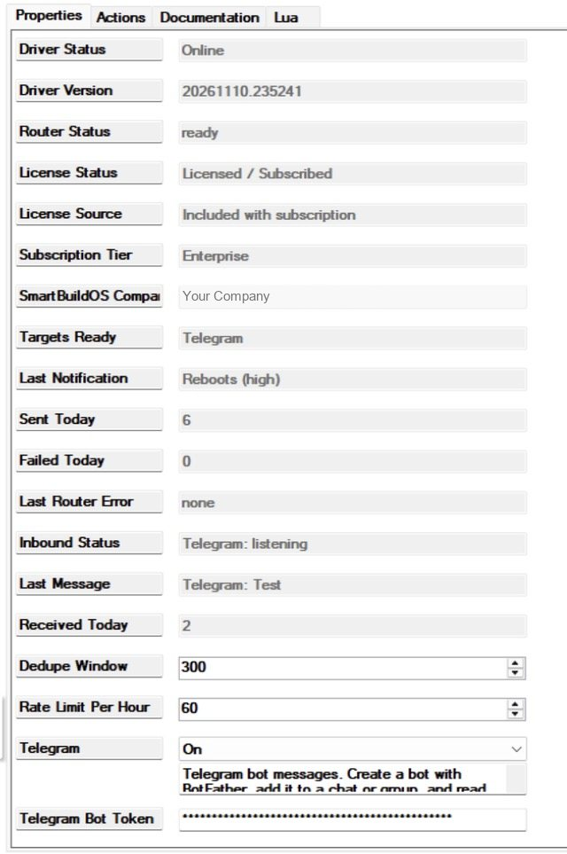
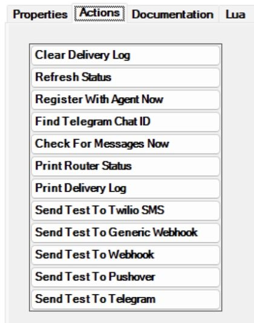
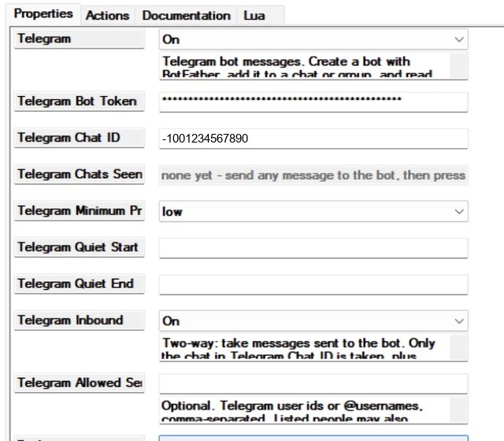
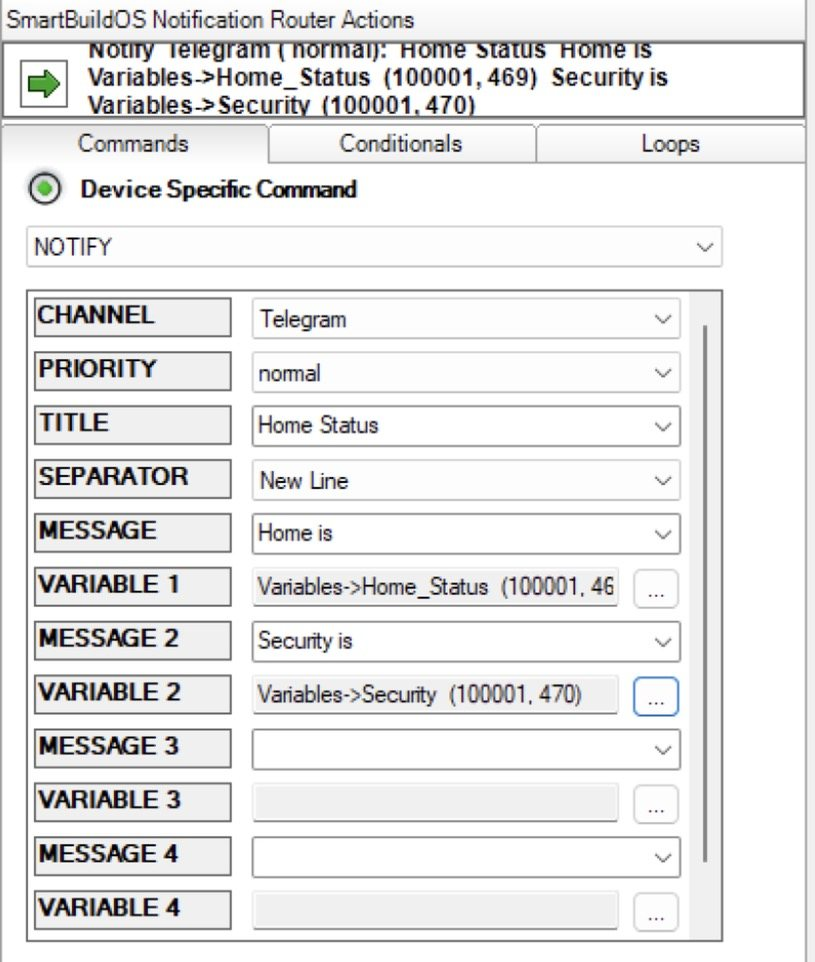
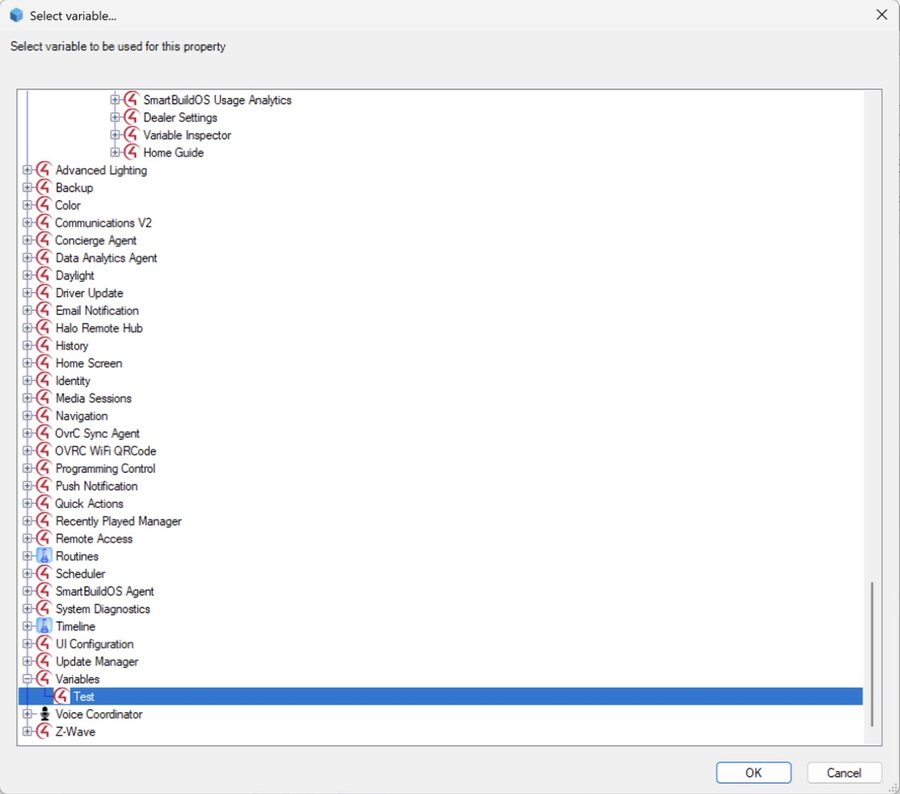
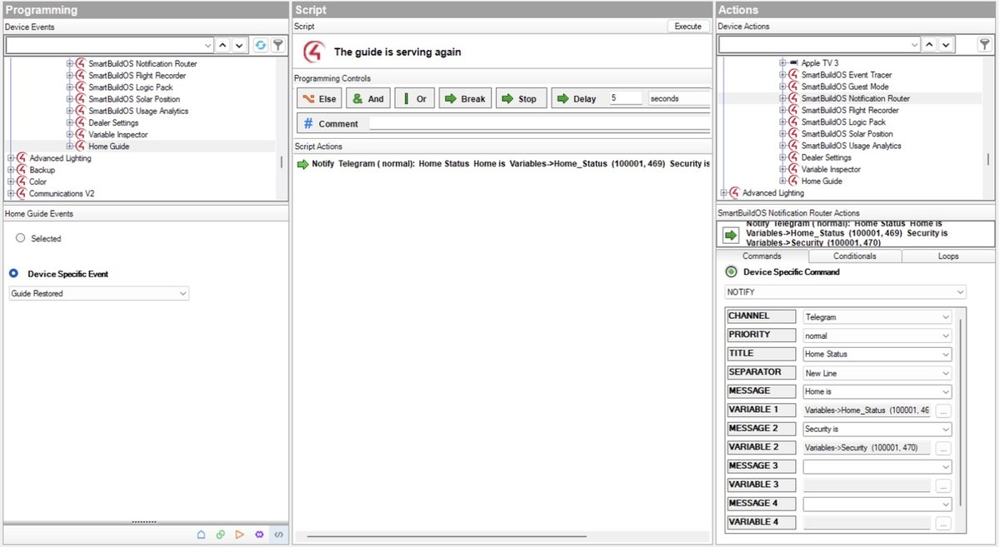
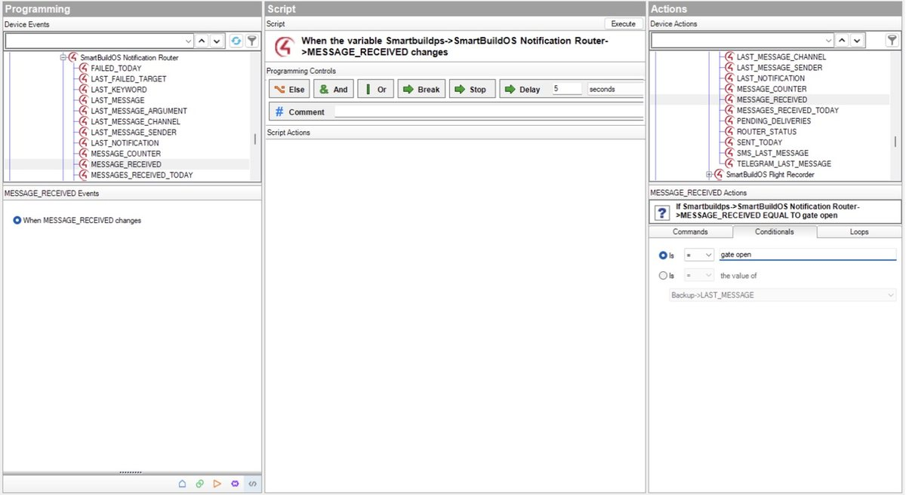

# SmartBuildOS Notification Router

The Notification Router gets a message from a Control4 system to a person's
phone or a team's channel, and a message from that person back to the
house. You write one programming command, **Notify**, and the router
decides where it goes: Telegram, Pushover, a Slack or Discord channel, any
other system that accepts a web request, or a text message through Twilio.

It is for the things Control4's own notifications do not cover: a channel a
whole service team watches, a message with live values in it, a reply the
house acts on, and a hand-off to another system. It needs no 4Sight
subscription and no SmartBuildOS service to deliver; the controller talks to
each service directly.

Licensing is through the **SmartBuildOS Agent** (SKU
`SBOS_NOTIFICATION_ROUTER`); **License Status** shows this driver's standing.

## What it is for

| You want | How the router does it |
| --- | --- |
| **Tell someone the moment something happens.** The garage has been open for ten minutes, a leak sensor is wet, the alarm tripped. | Put **Notify** in the programming for that event. Set the **PRIORITY**: each target has a minimum priority, so *critical* can reach a phone at night while *low* stays quiet. |
| **Send a status with the real values in it.** "Home is currently Occupied. The security is currently Armed Away." | Write the message in pieces and pick the variables ([Writing a message](#writing-a-message)). The values are read when the line runs. |
| **Ask the house a question from your phone.** Text `status` and get the answer back. | Turn on two-way, set a **Keyword**, and answer with the **Reply** command ([Two-way](#two-way-messages-sent-to-the-house)). |
| **Tell the house to do something by message.** `gate open`, `goodnight`. | Program on the `MESSAGE_RECEIVED` variable or on a keyword event. Set an **Inbound PIN** first for anything that unlocks, opens or disarms. |
| **Keep a service team informed across many homes.** The controller restarted, a driver went offline, a battery is low. | Send to a Slack or Discord channel through the **Webhook** target ([Webhooks](#webhooks-slack-discord-and-your-own-system)). One channel can collect every site. |
| **Hand an event to another system.** A ticket, a spreadsheet row, an automation, your own server. | The **Generic Webhook** target posts a small JSON document to any address you give it. |
| **Reach the homeowner and the dealer differently.** | Turn on more than one target. **Notify All** sends to every target that is on; **Notify** with a CHANNEL sends to one. |
| **Not be flooded.** A sensor that chatters, a routine that runs every minute. | The **Dedupe Window** sends the same text to the same target once, and **Rate Limit Per Hour** caps each target. |

**What every target gets.** Its own on/off switch, minimum priority and
quiet hours. A failed send is retried twice, and the **delivery log** (Print
Delivery Log) shows each attempt and why it failed.

## Setup

<!-- walkthrough: Set up the router -->
1. Install the **SmartBuildOS Agent** from Composer's Agents tab and pair it.
1. Add this driver to the project (one per project). **Driver Status** reads
   `Online` and **License Status** shows the licence within a few seconds.
1. Turn on a target and fill in its credentials:
   - **Telegram**: a bot token and a chat id. The
     [Telegram walkthrough](#telegram-create-the-bot-and-find-the-chat-id)
     below takes you through both.
   - **Pushover**: an application token and your user key.
   - **Webhook**: a Slack or Discord channel's webhook address, and
     **Generic Webhook**: any address that accepts a JSON POST. See
     [Webhooks](#webhooks-slack-discord-and-your-own-system) for both, with
     examples.
   - **Twilio SMS**: Account SID, Auth Token, From and To numbers in E.164
     form (+15551234567).
1. On the **Actions** tab press **Send Test To …** for that target. **Targets
   Ready** lists the targets that are on and fully configured, and **Last
   Notification** shows the test.
1. In programming, add **Notify** or **Notify All** to any routine. See
   [Writing a message](#writing-a-message).





## Telegram: create the bot and find the chat id

Telegram needs two things from you: a **bot** that the router sends as, and
the **chat** it sends to. The chat can be you alone, a group, or a channel.
Everything below is done in the Telegram app on a phone or a computer, then
finished in Composer.

<!-- walkthrough: Create the Telegram bot -->
1. In Telegram, search for **BotFather** and open the account with the blue
   verified tick. BotFather is Telegram's own bot for making bots.
1. Send `/newbot`. BotFather asks for a **name** (shown in chats, for example
   `Lake House`) and then a **username** that must be unique and end in `bot`
   (for example `lakehouse_c4_bot`).
1. BotFather answers with the bot's **token**, a long text of digits, a
   colon, then letters. Copy the whole line.
1. In Composer, select the router and paste the token into **Telegram Bot
   Token**. Set **Telegram** to On.

<div class="chat">
<p class="me">/newbot</p>
<p class="who">BotFather</p>
<p class="them">Asks what the bot should be called.</p>
<p class="me">Lake House</p>
<p class="them">Asks for a username ending in “bot”.</p>
<p class="me">lakehouse_c4_bot</p>
<p class="them">Confirms the bot and gives its token:<br><code>1234567890:AAH…your-token…</code></p>
</div>
<p class="chat-note">An illustration of the conversation, not a screenshot. BotFather's own wording is longer and may change.</p>

> **The token is a password.** Anyone who has it can send as your bot and
> read what is sent to it. If it leaks, send `/revoke` to BotFather for a new
> one and paste the new one into Composer.

Now choose where the messages go, and get that chat's id.

<!-- walkthrough: Find the chat id -->
1. **Make the chat.** Pick one:
   - **Just you:** open your new bot in Telegram and press **Start** (or send
     it any message). A bot cannot write to a person who has not written to
     it first.
   - **A group** (the household, the service team): add the bot to the group
     as a member, then send any message in the group.
   - **A channel** (one-way announcements): add the bot to the channel as an
     **administrator** with the right to post messages.
1. In Composer, on the router's **Actions** tab, press **Find Telegram Chat
   ID**.
1. Read **Telegram Chats Seen** on the Properties tab. It lists each chat the
   bot has heard from with its id, newest first, for example
   `Family (group): -1001234567890 · Sam (private): 123456789`.
1. Type the id of the chat you want into **Telegram Chat ID**, minus sign
   included. Group and channel ids are negative.
1. Press **Send Test To Telegram**. The test arrives in that chat.



**If Telegram Chats Seen stays empty.** Telegram only keeps what a bot has
not yet read, and for about a day. Write to the bot again (or remove and
re-add it to the group), then press **Find Telegram Chat ID** once more. If
it says `HTTP 409`, another program is reading this bot or the bot has a
webhook: use a bot of its own for the house. `HTTP 401` means the token is
not right.

**Groups and two-way.** In a group, Telegram by default shows a bot only the
messages that are commands, such as `/gate open`. That is enough for
keywords (`/gate` matches the keyword `gate`). To let the bot see every
message in the group, send `/setprivacy` to BotFather, choose the bot, choose
**Disable**, then remove the bot from the group and add it again. A channel
can only be sent to; messages for the house come from a private chat or a
group.

## Webhooks: Slack, Discord and your own system

A webhook is a web address that accepts a message. The router has two
webhook targets.

### Webhook: a Slack or Discord channel

Slack and Discord each give you an address for one channel. Whatever the
router sends to it appears in that channel.

<!-- walkthrough: Send notifications to a Slack or Discord channel -->
1. **Get the channel's address.**
   - **Discord:** open the channel's settings, then **Integrations** →
     **Webhooks** → **New Webhook**, and **Copy Webhook URL**. It looks like
     `https://discord.com/api/webhooks/123456789012345678/AbCd…`.
   - **Slack:** in your Slack app's settings choose **Incoming Webhooks**,
     turn them on, **Add New Webhook to Workspace**, pick the channel and
     copy the URL. It looks like
     `https://hooks.slack.com/services/T0000000/B0000000/XXXXXXXX…`.
1. In Composer, paste it into **Webhook URL** and set **Webhook** to On.
1. Press **Send Test To Webhook** on the Actions tab. The test appears in
   the channel, posted as *Control4*.
1. In programming, use **Notify** with CHANNEL **Webhook**.

The address is a password: anyone who has it can post to the channel. It is
a masked property and is never written to the log.

**Example.** A line on the controller's *Director Reloaded* event:

| Field | Value |
| --- | --- |
| CHANNEL | Webhook |
| PRIORITY | high |
| TITLE | Controller restarted |
| MESSAGE | Lake House came back at |
| VARIABLE 1 | the time variable you keep |

The channel shows:

<div class="chat">
<p class="who">Control4</p>
<p class="them">Controller restarted<br>Lake House came back at 18:42</p>
</div>
<p class="chat-note">An illustration of how the post reads, not a screenshot.</p>

What the router sends, for anyone checking the receiving side:

```json
{
  "text": "Controller restarted\nLake House came back at 18:42",
  "content": "Controller restarted\nLake House came back at 18:42",
  "username": "Control4"
}
```

Slack reads `text` and Discord reads `content`; each ignores the other.

### Generic Webhook: any system that takes JSON

Use this to hand a notification to something that is not a chat: an
automation service, a ticketing system, a home-grown server. The router
sends an HTTP `POST` with a JSON body to **Generic Webhook URL**.

<!-- walkthrough: Post notifications to your own system -->
1. Get the address your system listens on, for example
   `https://example.com/hooks/control4`. It must start with `http://` or
   `https://` and be reachable from the controller.
1. Paste it into **Generic Webhook URL**. If the system expects a token,
   paste it into **Generic Webhook Bearer Token**.
1. Set **Generic Webhook** to On and press **Send Test To Generic Webhook**.
1. In programming, use **Notify** with CHANNEL **Generic Webhook**.

**Example.** This Notify line:

| Field | Value |
| --- | --- |
| CHANNEL | Generic Webhook |
| PRIORITY | normal |
| TITLE | Home Status |
| SEPARATOR | New Line |
| MESSAGE + VARIABLE 1 | Home is currently + Occupied |
| MESSAGE 2 + VARIABLE 2 | The security is currently + Armed Away |

arrives at your address as:

```http
POST /hooks/control4 HTTP/1.1
Content-Type: application/json
Authorization: Bearer YOUR-TOKEN

{
  "title": "Home Status",
  "message": "Home is currently Occupied\nThe security is currently Armed Away",
  "priority": "normal",
  "channel": "generic",
  "source": "control4",
  "sent_at": 1794362400
}
```

| Field | What it holds |
| --- | --- |
| `title`, `message` | The TITLE and the composed message, values filled in |
| `priority` | `low`, `normal`, `high` or `critical` |
| `channel` | `generic` when the line named this target, `all` from Notify All |
| `source` | Always `control4` |
| `sent_at` | When it was sent, in seconds since 1970 (UTC) |

The `Authorization` line is sent only when a bearer token is set.

**What your system should answer.** Any `2xx` status means delivered. A
`4xx` (other than 408 and 429) is treated as a wrong address or token and is
not retried; anything else is retried after 5 and 30 seconds. To check the
receiving side without the controller, send it the same thing yourself:

```bash
curl -X POST https://example.com/hooks/control4 -H "Content-Type: application/json" -d '{"title":"Test","message":"Hello from the bench","priority":"normal","channel":"generic","source":"control4","sent_at":0}'
```

If your system expects the bearer token, add the same `Authorization`
header the router sends, shown in the request above.

Both webhook targets only send. Messages for the house come in through
Telegram or Twilio SMS.

## Routing rules

- **Priority** is low, normal, high or critical. A target's **Minimum
  Priority** gates what it receives.
- **Quiet hours** per target (`HH:MM` to `HH:MM`, may cross midnight) hold
  everything back except **critical**, which always goes through, and raise
  *Quiet Hours Suppressed*.
- **Dedupe Window**: the same title and message to the same target inside
  the window is sent once. Zero disables it. Test actions bypass it.
- **Rate Limit Per Hour** per target; a dropped notification raises *Rate
  Limited*.
- **Retries**: a failed send is retried after 5 s and again after 30 s. A
  4xx answer other than 408 and 429 is a configuration error and fails at
  once with "check the target's settings". *Target Unreachable* fires on the
  first failure, *Delivery Failed* once the attempts are spent.
- **Pushover critical** is sent as an emergency that repeats every minute
  for an hour until acknowledged, as the Pushover API requires.

## Writing a message

A notification is written the way it reads, top to bottom, on the Notify
command in the programming window: a text, then a variable, then the next
text. Only the variable's **value** is sent, never its name, and it is read
at the moment the line runs.



<!-- walkthrough: A message with a live value in the middle -->
1. In programming, select the router in the Actions tree and choose the
   **NOTIFY** command. Pick a **CHANNEL** and a **PRIORITY**, and type a
   **TITLE**.
1. In **MESSAGE**, type the words before the value: `This system rebooted`.
1. Next to **VARIABLE 1**, press `…`. Composer opens its *Select variable…*
   tree with every room, device and variable of the project. Pick the
   variable and press OK.
1. In **MESSAGE 2**, type the words after the value: `times`. Leave
   **SEPARATOR** on Space, because this is one sentence.
1. Drag the green arrow into the script. If the variable holds `3`, the
   message that arrives is **This system rebooted 3 times**.



There are four variables and five texts: MESSAGE, VARIABLE 1, MESSAGE 2,
VARIABLE 2, MESSAGE 3, VARIABLE 3, MESSAGE 4, VARIABLE 4, MESSAGE 5. Leave
any of them empty.

### One sentence, or one message per line: SEPARATOR

A text and the variable under it make one **message**: MESSAGE with
VARIABLE 1, MESSAGE 2 with VARIABLE 2, and so on. **SEPARATOR**, just above
MESSAGE, chooses what goes between one message and the next.

| SEPARATOR | Use it when | `Home is currently` + Occupied, `The security is currently` + Armed Away |
| --- | --- | --- |
| **Space** (default) | the texts continue one sentence, with a value in the middle | Home is currently Occupied The security is currently Armed Away |
| **New Line** | each message is a statement of its own | Home is currently Occupied<br>The security is currently Armed Away |
| **Period** | the same, on one line | Home is currently Occupied. The security is currently Armed Away |
| **Comma**, **Semicolon**, **Dash**, **Vertical Bar** | a short list of readings | Home is currently Occupied, The security is currently Armed Away |

With **Space**, `This system rebooted` + 3 + `times` reads "This system
rebooted 3 times": that is why it is the default, and why a line written
before this setting existed sends exactly what it sent. A message left empty
adds no separator, and a message that already ends in `.`, `!` or `?` is not
given a second mark.



It arrives as:

<div class="chat">
<p class="who">Control4</p>
<p class="them">Home Status<br>Home is Occupied<br>Security is Armed Away</p>
</div>
<p class="chat-note">An illustration of the message, not a screenshot. The TITLE is always on its own line above the message.</p>

Try it:

<div class="tryit" id="tryit">
<div class="row"><label for="tsep">SEPARATOR</label><select id="tsep"><option value="">Space</option><option value="nl" selected>New Line</option><option value=", ">Comma</option><option value=". ">Period</option><option value="; ">Semicolon</option><option value=" - ">Dash</option><option value=" | ">Vertical Bar</option></select></div>
<div class="row"><label for="t1">MESSAGE</label><input id="t1" value="Home is currently"></div>
<div class="row var"><label for="v1">VARIABLE 1 holds</label><input id="v1" value="Occupied"></div>
<div class="row"><label for="t2">MESSAGE 2</label><input id="t2" value="The security is currently"></div>
<div class="row var"><label for="v2">VARIABLE 2 holds</label><input id="v2" value="Armed Away"></div>
<div class="row"><label for="t3">MESSAGE 3</label><input id="t3" value=""></div>
<output id="tout" for="tsep t1 v1 t2 v2 t3" aria-live="polite">Home is currently Occupied
The security is currently Armed Away</output>
<p class="hint">What arrives. Change the separator or type in the boxes.</p>
</div>
<script>
(function () {
  var before = [".", ",", ";", ":", "!", "?", "%", ")", "]", "}", "°"];
  var after = ["(", "[", "{", "$", "#", "£", "€"];
  function starts(s, list) { return list.some(function (p) { return s.slice(0, p.length) === p; }); }
  function ends(s, list) { return list.some(function (p) { return s.slice(-p.length) === p; }); }
  /* The driver's own rule: pieces of one sentence, tight against punctuation. */
  function join(pieces) {
    var text = "", lastWasText = false;
    pieces.forEach(function (p) {
      var piece = p.value.trim();
      if (!piece) return;
      var tight = text === "" || (p.isText && starts(piece, before)) || (lastWasText && ends(text, after));
      text += (tight ? "" : " ") + piece;
      lastWasText = p.isText;
    });
    return text;
  }
  var out = document.getElementById("tout");
  var sep = document.getElementById("tsep");
  if (!out || !sep) return;
  function piece(id) { return { value: document.getElementById(id).value, isText: id.charAt(0) === "t" }; }
  /* A message is a text and the variable under it. */
  var groups = [["t1", "v1"], ["t2", "v2"], ["t3"]];
  function paint() {
    var between = sep.value === "nl" ? "\n" : sep.value;
    var text;
    if (between === "") {
      text = join([].concat.apply([], groups).map(piece));
    } else {
      text = "";
      groups.forEach(function (g) {
        var part = join(g.map(piece));
        if (!part) return;
        if (text === "") text = part;
        else if (/^[.,;]/.test(between) && /[.,;:!?]$/.test(text)) text += " " + part;
        else text += between + part;
      });
    }
    out.textContent = text || "(nothing to send)";
  }
  ["tsep", "t1", "v1", "t2", "v2", "t3"].forEach(function (id) {
    var e = document.getElementById(id);
    e.addEventListener("input", paint);
    e.addEventListener("change", paint);
  });
  paint();
})();
</script>

**Spaces are added for you.** Inside a message, and between messages when
SEPARATOR is Space, the pieces are joined with one space. A text
that begins with punctuation (`. , ; : ! ? % ) °`) sits tight against the
value before it, and a text that ends with `( [ { $ # £ €` sits tight against
the value after it, so `Costs $` + `40` reads `Costs $40`.

**Picking is enough.** With only MESSAGE and VARIABLE 1 filled in, the value
follows the text: `Garage:` + a variable holding `1` is sent as `Garage: 1`.

**Putting a value anywhere, and changing how it reads.** Write `${1}` to
`${4}` inside any text (the TITLE too) and that picked variable goes there
instead of at its own row:

| You write | VARIABLE 1 | It is sent as |
| --- | --- | --- |
| `Garage is ${1\|Open\|Closed}` | Garage Door → STATE | `Garage is Open` |
| `Pool ${1\|.1}°F` | Variables → Pool Temp | `Pool 81.5°F` |
| TITLE `Garage ${1\|open\|closed}` | Garage Door → STATE | `Garage open` |

**Written out, with no picker.** The token Control4's agents use works too:

- `${Garage->Garage Door::STATE}` is `Room->Device::VARIABLE`.
- `${Garage Door::STATE}` when the device name is unique in the project.
- `${231::STATE}` by device id, which survives a rename.
- `${Variables::Pool Temp}` for one of the project's custom variables.

Case, spaces and underscores in the names do not matter.

**How the value is shown.** Add one of these after a `|`:

- `${1|Open|Closed}` for on/off values: the first text when the value is 1,
  true, on, yes or a non-zero number; the second when it is 0, false, off,
  no or empty. Any other text is sent as it is. The second text may be left
  empty: `${1| (door open)|}`.
- `${2|.1}` rounds a number to that many decimals (0 to 3).

**One variable as the whole text.** The TITLE and MESSAGE fields also have a
drop-down listing every variable. Choosing one there makes that variable's
value the entire text of the field; this is Composer's own behaviour for a
text parameter. Use the VARIABLE pickers to mix a value with words.

**What you can rely on.**

- A variable that cannot be read is sent as `?` and never stops the
  notification. *Message Variable Missing* fires, **Last Router Error** names
  the token and the reason, and **Print Delivery Log** lists each one.
- A variable whose name marks it as a credential (user code, PIN, password,
  token and the like) is sent as `[hidden]`. These messages leave the house.
- The **Dedupe Window** compares the filled-in text: the same reading twice
  is sent once, a changed reading is a new message.
- Only `${1}` to `${4}` and `${device::variable}` are tokens. Anything else,
  `{braces}` and JSON included, is left exactly as written. A value is filled
  in once; a token inside a value is not expanded again.
- A value is one line of at most 120 characters.
- A picked variable is stored by id, so renaming the device or the variable
  later changes nothing.

## Two-way: messages sent to the house

A person can send a message to the house and programming reacts to it. Two
channels can receive: **Telegram** and **Twilio SMS**. Slack and Discord
webhooks, Pushover and the generic webhook can only send.

**How it works.** A controller cannot be called from the internet, so the
router asks for new messages every few seconds (**Inbound Poll Seconds**,
default 5) using the credentials the target already has. A reply therefore
takes up to one poll interval to be noticed.

**Turn it on.**

1. Set **Telegram Inbound** or **Twilio Inbound** to On. **Inbound Status**
   reads `listening` once the first answer comes back, or names the problem.
1. Send a message to the bot, or a text to the Twilio number.
1. It appears in **Last Message** and in the variables below, and the events
   fire.

**Who is taken.** An inbound message can start programming, so the router
takes it only from a sender you named:

| Channel | Taken by default | Add more with |
| --- | --- | --- |
| Telegram | the chat in **Telegram Chat ID** | **Telegram Allowed Senders**: user ids or @usernames |
| Twilio SMS | the number in **Twilio To Number** | **Twilio Allowed Senders**: phone numbers |

In a Telegram group, every member is taken until you list people in
**Telegram Allowed Senders**; then only they are, and they may also message
the bot privately. Anything else fires *Message Rejected*, and its text is
never stored, logged or shown.

**The simplest way to act on a message: `MESSAGE_RECEIVED`.** When a message
is taken, the router writes its text into the variable `MESSAGE_RECEIVED`.
Program on the variable changing, and test what it says:

<!-- walkthrough: Run programming when a message says "gate open" -->
1. Set **Message Received As** to **Lower Case**. A phone capitalises the
   first word, and `Gate open` is not the same text as `gate open`.
1. In programming, open the router in the left-hand tree and select the
   variable **MESSAGE_RECEIVED**. The event is *When MESSAGE_RECEIVED
   changes*.
1. On the right, select the router's **MESSAGE_RECEIVED** variable again and
   open the **Conditionals** tab. Choose **Is =** and type `gate open`. Drag
   the question mark into the script.
1. Drag what should happen (open the gate) onto that condition, so it sits
   indented under it.
1. Add one more condition for each other message you want to answer, on the
   same event.



- **Programming can set it.** `MESSAGE_RECEIVED` is not read-only: the
  Commands tab has *Set to Value*, so a routine can clear it or write to it.
- **The same message twice still runs.** If the variable already holds the
  text that arrives, the router empties it first and then writes the text,
  so the change is seen. Your condition is simply false for the empty step.
- Only a message that was **taken** reaches it (see *Who is taken*), with
  the Inbound PIN already removed.
- The other variables below keep the message exactly as sent, whatever
  **Message Received As** says.

**What else programming gets.**

- Variables: `LAST_MESSAGE`, `LAST_MESSAGE_CHANNEL`, `LAST_MESSAGE_SENDER`,
  and one per channel, `TELEGRAM_LAST_MESSAGE` and `SMS_LAST_MESSAGE`.
  `MESSAGE_COUNTER` goes up by one for every message, so programming on a
  variable change runs even when the same words arrive twice.
- Events: *Message Received*, *Telegram Message Received*, *SMS Message
  Received*, *Message Rejected*. Variables are set before the events fire.
- **Keywords.** Type a word or short phrase in **Keyword 1** to **Keyword
  8**. A message that is the keyword, or begins with it, fires *Keyword N
  Received*; the rest of the message is in `LAST_MESSAGE_ARGUMENT` and the
  keyword in `LAST_KEYWORD`. Case does not matter, the longest keyword wins,
  and a Telegram command such as `/status` matches the keyword `status`.
  With Keyword 2 = `gate`, the message `Gate open now` fires *Keyword 2
  Received* with the argument `open now`.
- **Reply** (command): sends its message back to whoever wrote last, on the
  channel they used. It is written in the same pieces as Notify, so *When
  Keyword 1 Received → Reply "Garage is" + VARIABLE 1* answers a status
  question with a live value. A reply is not held back by quiet hours, the
  minimum priority or the dedupe window; the hourly rate limit still applies.

**Protection you can rely on.**

- **No replay.** A message older than two minutes (or three poll intervals,
  if that is longer) is ignored, so a controller that was off does not act
  on an old command when it starts. A message is handled once, including
  across a driver update or a controller restart.
- **Inbound PIN** (optional). When set, every message must begin with the
  PIN and a space, as in `4471 gate open`. The PIN is removed before the
  text reaches any variable or the log.
- At most 20 messages a minute per channel; text is one line of at most 500
  bytes. The text only ever becomes variables and a keyword match; nothing
  in it is run.
- When an ask fails, **Inbound Status** names the cause and the router backs
  off, up to five minutes, then recovers by itself.

**Limits to know.**

- **A texting number can be forged.** Set an Inbound PIN before letting an
  SMS unlock, disarm or open anything.
- **One reader per Telegram bot.** If another program reads the same bot, or
  the bot has a webhook, Inbound Status says `HTTP 409`. Use a bot of its
  own for the house.
- The controller's clock must be right to within a minute or two, or every
  message looks old and is ignored. **Print Router Status** shows the count
  of `stale` messages.
- Twilio keeps and bills messages under your Twilio account; the router only
  lists them.

## What is NOT claimed

Delivery means the target's API accepted the message, not that a person read
it. Nothing is queued across a Director restart: a notification in flight
during a reboot is lost and the next one is not affected.

## Actions

| Action | What it does |
| --- | --- |
| Send Test To … | A normal-priority test notification to that target (it must be On) |
| Print Delivery Log | The last 50 deliveries with target, outcome, attempts and reason |
| Print Router Status | Targets, limits, counters, deliveries in flight, inbound status and counts |
| Check For Messages Now | Asks Telegram and Twilio at once instead of waiting for the next poll |
| Find Telegram Chat ID | Lists the chats that wrote to the bot, with their ids, in **Telegram Chats Seen** and the Lua output. Takes nothing: the messages stay unread for the listener |
| Clear Delivery Log | Empties the log |
| Register With Agent Now / Refresh Status | Licence and status refresh |

## Programming

- Commands: **Notify** (CHANNEL, PRIORITY, TITLE, SEPARATOR, then MESSAGE,
  VARIABLE 1, MESSAGE 2, VARIABLE 2 … VARIABLE 4, MESSAGE 5), **Notify All**
  (PRIORITY, TITLE, SEPARATOR and the same pieces), **Reply** (SEPARATOR and
  the same pieces, no title).
- Events: *Notification Sent*, *Delivery Failed*, *Target Unreachable*,
  *Quiet Hours Suppressed*, *Rate Limited*, *Router Degraded*, *Router
  Restored*, *Message Variable Missing*, *Message Received*, *Telegram
  Message Received*, *SMS Message Received*, *Message Rejected*, *Keyword 1
  Received* to *Keyword 8 Received*.
- Conditionals: *At least one target is configured and enabled*, *Quiet
  hours are active on every enabled target*.
- Variables: `ROUTER_STATUS`, `LAST_NOTIFICATION`, `SENT_TODAY`,
  `FAILED_TODAY`, `LAST_FAILED_TARGET`, `PENDING_DELIVERIES`,
  `LAST_MESSAGE`, `LAST_MESSAGE_CHANNEL`, `LAST_MESSAGE_SENDER`,
  `LAST_MESSAGE_ARGUMENT`, `LAST_KEYWORD`, `TELEGRAM_LAST_MESSAGE`,
  `SMS_LAST_MESSAGE`, `MESSAGE_COUNTER`, `MESSAGES_RECEIVED_TODAY`, and
  `MESSAGE_RECEIVED`, the one programming may also set.

## Privacy

Tokens, keys and webhook URLs are password properties and never appear in
the delivery log, the Lua output or any variable; the log records the target
and a masked destination (for SMS the last four digits are hidden). Message
text is whatever your programming puts in it: do not put codes or personal
details in notifications. A message variable sends a variable's value to the
target's service; credential-named variables are refused, but any other
variable you pick or write out is sent as it is.

Inbound messages: the text of a message that is taken is kept in the
variables, in **Last Message** and, cut to 60 characters, in the delivery
log. The text of a refused message is not kept anywhere. A texting number is
logged with its last four digits hidden. The Inbound PIN is a password
property and is stripped from the text before anything else sees it.
