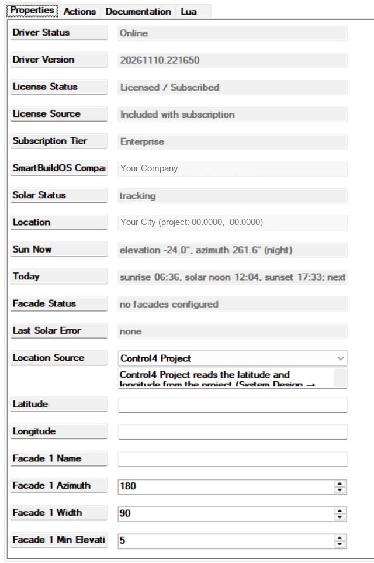
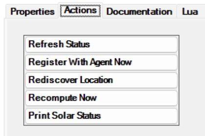
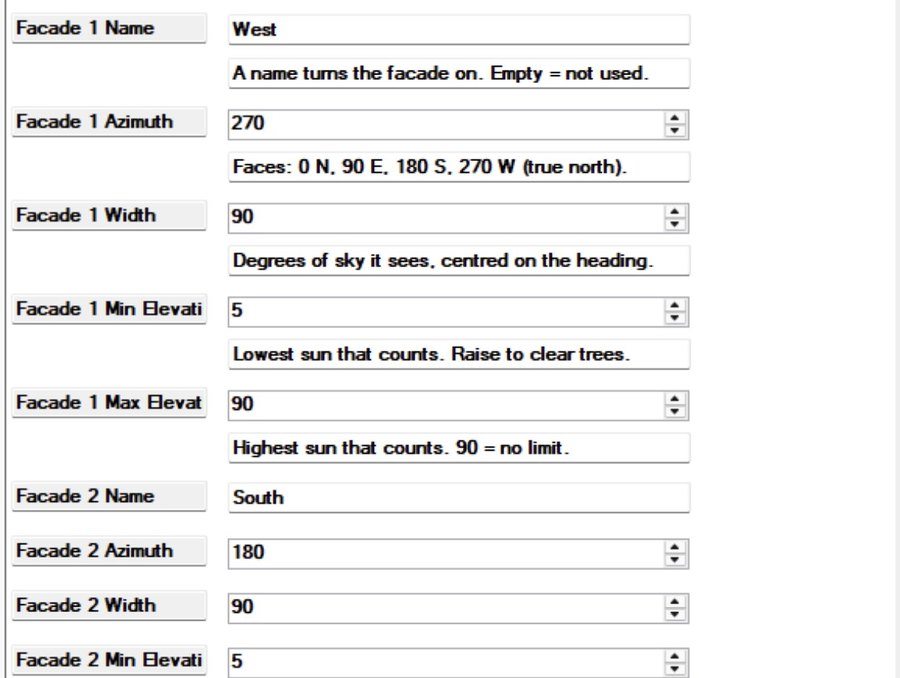
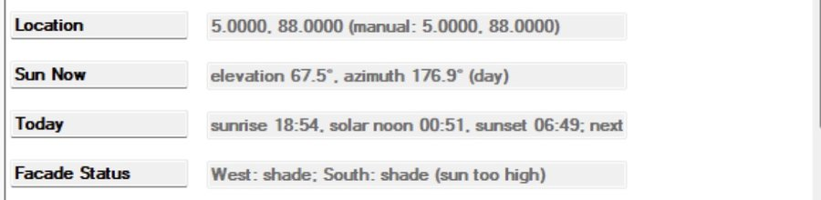
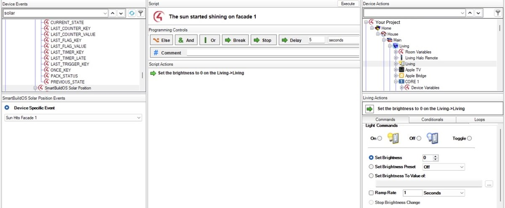
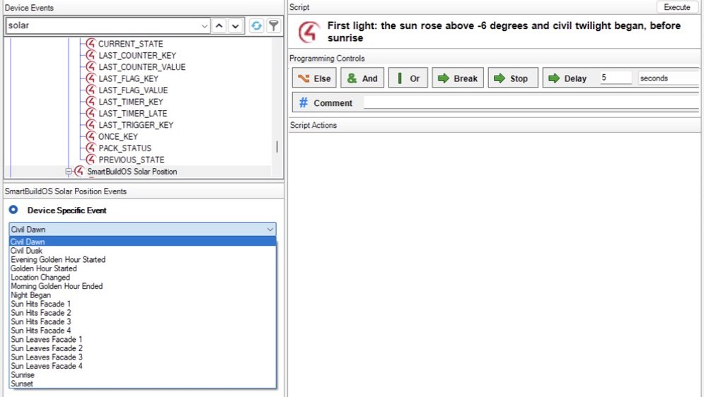

# SmartBuildOS Solar Position

Control4 knows when the sun rises and sets. It does not know where the sun is:
how high, from which direction, and whether it is on the west glass right now.
This driver works that out every minute from the project's coordinates, with no
internet, and hands it to programming: an event when the sun reaches or leaves
each of up to four facades, an event at every boundary of the day from first
light to night, conditionals you can ask at any moment, and variables for the
sun's elevation, its direction and the minutes left to sunset.

Requires the SmartBuildOS Agent (`smartbuildos.c4z`) paired to a SmartBuildOS
system. The Agent is the licensing authority (SKU `SBOS_SOLAR`): **License
Status** shows this driver's standing.

## Why not a sunrise or sunset schedule

A schedule answers "when". Shades and glare need "where". The moment the sun
comes round onto a wall of glass has little to do with sunset, and it moves
through the year by hours.

These figures are this driver's own, for a west and a south facade at 26°N
(each 90 degrees wide, sun counted from 5 degrees up):

| Date | Sunset | Sun reaches the west glass | That is, before sunset | South glass in the sun |
| --- | --- | --- | --- | --- |
| 21 June | 20:15 | 13:33 | 6 h 42 min | 13:11 to 13:34, 23 minutes |
| 22 September | 19:17 | 14:48 | 4 h 29 min | 11:39 to 14:51, over 3 hours |
| 21 December | 17:34 | 15:17 | 2 h 17 min | 09:20 to 15:23, 6 hours |

- "Lower the west shades X minutes before sunset" is right on one day. Across
  the year it is out by up to four and a half hours.
- A fixed clock time is out by an hour and three quarters.
- The south glass has no sunrise or sunset rule at all: 23 minutes in June, six
  hours in December.

Keep the Scheduler for what it does well: "porch light on at sunset", weekday
rules, date ranges, random times. This driver has no calendar. It adds the part
the Scheduler cannot know.

## What it is for

| You want | Use |
| --- | --- |
| Shades that come down only while the sun is on that glass, all year, with no seasonal edits | *Sun Hits Facade* and *Sun Leaves Facade* |
| The same for glass under an overhang or a balcony, where a high sun never gets in | **Facade Max Elevation** |
| A light that comes on with motion only when it is dark | The conditional *It is night*, or *The sun is up* |
| Exterior lights on at sunset and off once it is properly light | *Sunset* and *Morning Golden Hour Ended* |
| A scene when it is actually dark, not just after sunset | *Night Began* |
| Something done a set time before sunset or sunrise | `MINUTES_TO_SUNSET`, `MINUTES_TO_SUNRISE` |
| The low evening sun kept off the television | *Evening Golden Hour Started*, with *The sun is on facade* |
| The sun's height or direction in your own logic | `SUN_ELEVATION`, `SUN_AZIMUTH` |

## Setup

<!-- walkthrough: Set up Solar Position -->
1. Install and pair the SmartBuildOS Agent.
1. Add this driver, one per project. **Location** shows the coordinates it
   found in the project. If the project has none, set **Location Source** to
   Manual Coordinates and fill in **Latitude** and **Longitude** (south and
   west are negative).
1. Check **Sun Now** and **Today** against the sky and a weather app. They
   should agree to the minute.
1. Name the facades you care about and give each its heading. The next section
   shows how.
1. Read **Facade Status**: it names each facade and says sun or shade.

## Facades: tell it which way the glass faces

A facade is one direction the building looks in. Rooms that share a wall share
a facade; a corner room has two. There are four.

<!-- walkthrough: Describe a facade -->
1. **Name.** Type a name in `Facade 1 Name`, for example West. A facade with no
   name is not used.
1. **Azimuth.** Stand inside, square to the glass, looking out. The direction
   you face is the heading: 0 north, 90 east, 180 south, 270 west. Read it from
   a phone compass set to true north, or from a map with north at the top.
1. **Width.** How much sky the glass sees, centred on the heading. Leave 90 for
   a flat wall. Widen it for a bay or corner glass; narrow it where side walls
   or fins cut the view.
1. **Min Elevation.** The lowest sun that counts. Leave 5 unless trees, a hill
   or the house next door block more: then use the height of their top in
   degrees, as a phone level shows it when sighted from the window.
1. **Max Elevation.** The highest sun that counts. Leave 90 unless something
   above the glass keeps a high sun out. See the next section.
1. **Check.** **Facade Status** shows the facade at once. Change a setting and
   it updates.

A facade is in the sun when the sun's elevation is between its minimum and its
maximum and its direction is within half the width of the heading. Every edge
has one degree of give: once in the sun, a facade stays in the sun until the
sun is a full degree outside, so a sun grazing an edge never flaps the shades.
Changing a setting is not an event: nothing fires until the sun next moves
across an edge.

### Max Elevation: overhangs, balconies and the high summer sun

Near midsummer the sun stands almost overhead at noon. It is in front of the
south glass and puts next to nothing through it, and an overhang or a balcony
above cuts it off completely. With no ceiling the driver would still say "sun".

Set **Facade Max Elevation** to the angle above which the glass is in shadow.
For an overhang: measure how far it sticks out, and the height from the bottom
of the glass up to its underside.

| The overhang sticks out | Max Elevation |
| --- | --- |
| as far as the glass is tall | 45 |
| half the height of the glass | 63 |
| a third of the height | 72 |
| a quarter of the height | 76 |

That is the angle for a sun square to the glass. From the side the overhang
shades the glass a little sooner, so the driver errs towards reporting sun for
a few minutes longer, never towards missing it.

When the sun is in front of a facade but above its ceiling, **Facade Status**
says so: `South: shade (sun too high)`.

A facade with a ceiling can be in the sun twice in one day, before and after
the high sun. It then fires *Sun Hits* and *Sun Leaves* twice, which is what
the shades need. At 26°N on 22 September, south glass with a ceiling of 60 is
in the sun from 11:39 to 12:19 and again from 14:16 to 14:51.

### Try it: when is the sun on your glass

Put in a site, a date and a facade. The answer is worked out here in the page
with the driver's own rules, so it is what the events will do on that day.

<label for="s-lat">Latitude</label><input id="s-lat" value="26" inputmode="decimal">

<label for="s-lon">Longitude</label><input id="s-lon" value="-80" inputmode="decimal">

<label for="s-date">Date (YYYY-MM-DD)</label><input id="s-date" value="2026-06-21">

<label for="s-off">Hours from UTC</label><input id="s-off" value="-4" inputmode="decimal">

<label for="s-az">Azimuth</label><input id="s-az" value="270" inputmode="numeric">

<label for="s-w">Width</label><input id="s-w" value="90" inputmode="numeric">

<label for="s-min">Min Elevation</label><input id="s-min" value="5" inputmode="numeric">

<label for="s-max">Max Elevation</label><input id="s-max" value="90" inputmode="numeric">

<output id="s-out" for="s-lat s-lon s-date s-off s-az s-w s-min s-max" aria-live="polite">Sunrise 06:29, sunset 20:15, highest sun 87°
In the sun 13:33 to 19:53 (6 h 20 min)</output>

Times are local to the site: set "Hours from UTC" for that date (New York is -4 in summer and -5 in winter).

This calculator needs scripting, which this viewer has turned off. The figures shown are for the values in the boxes.

## The day, boundary by boundary

Every minute the driver updates **Sun Now** (elevation, direction and the
phase) and **Today** (sunrise, solar noon, sunset, and the next of each). The
day has six boundaries, each a height of the sun, and one event at each. The
times in the last column are 21 June at 26°N, to show the spacing.

| Boundary | The sun | Event | Example |
| --- | --- | --- | --- |
| First light | passes 6 degrees below the horizon, rising | *Civil Dawn* | 06:03 |
| Sunrise | passes the horizon, rising | *Sunrise* | 06:29 |
| Full daylight | passes 6 degrees up, rising | *Morning Golden Hour Ended* | 07:03 |
| Low evening sun | passes 6 degrees up, setting | *Evening Golden Hour Started* | 19:42 |
| Sunset | passes the horizon, setting | *Sunset* | 20:15 |
| Dark | passes 6 degrees below the horizon, setting | *Night Began* | 20:42 |

Between them the phase (`DAY_PHASE`) reads `night`, `dawn`, `golden_morning`,
`day`, `golden_evening`, `dusk`. Because the boundaries are heights and not
minutes, they stay right through the year and at any latitude: the 27 minutes
of dusk in this example are 48 in London in June.

Two older events remain for programming that already uses them. *Golden Hour
Started* fires at sunrise and again when the evening golden hour starts. *Civil
Dusk* fires at sunset. For new programming use the six above.

## Worked examples

### West shades that follow the sun

<!-- walkthrough: Shades that follow the sun -->
1. Describe the facade: name West, azimuth 270.
1. In Programming, pick this driver and the event *Sun Hits Facade 1*. Add the
   command that lowers the west shades.
1. Pick the event *Sun Leaves Facade 1*. Add the command that raises them.
1. Optional: put the lowering inside the conditional *The sun is up* from this
   driver and a check of your own, such as a room not in Away mode.

In June that lowers them at 13:33 and raises them at 19:53. In December, 15:17
and 17:11. Nobody edits a schedule in between.

### South glass under a balcony

The balcony above sticks out half the height of the glass, so set `Facade 2 Max
Elevation` to 63. At 26°N the facade then stays in shade all day around
midsummer, when the sun crosses the south far above 63 degrees, and the shades
stay up. In winter the noon sun is 41 degrees up and gets under the balcony:
*Sun Hits Facade 2* fires at 09:20 and the shades come down.

### A hallway light only when it is dark

On the motion sensor's event, add the conditional *It is night* from this
driver, and inside it the light at 40%. Use *The sun is up* turned to "has the
sun down" if you want twilight included. No variable to maintain, and it is
right the moment the controller restarts.

### Exterior lights, and a time before sunset

- *Sunset*: landscape lights on.
- *Night Began*: path lights to full, blackout shades down.
- *Morning Golden Hour Ended*: everything exterior off.
- Thirty minutes before sunset: program on the variable `MINUTES_TO_SUNSET`
  changing, with the condition that it equals 30. The variable counts down by
  one every minute and never skips a number.

## Programming reference

- Events: *Sun Hits Facade 1..4*, *Sun Leaves Facade 1..4*, *Civil Dawn*,
  *Sunrise*, *Morning Golden Hour Ended*, *Evening Golden Hour Started*,
  *Sunset*, *Night Began*, *Golden Hour Started*, *Civil Dusk*, *Location
  Changed*.
- Conditionals: *The sun is up*, *It is night*, *It is golden hour*, *The sun
  is on facade 1..4*.
- Variables: `SUN_ELEVATION`, `SUN_AZIMUTH` (whole degrees), `IS_DAYLIGHT`,
  `DAY_PHASE`, `NEXT_SUNRISE`, `NEXT_SUNSET` (local HH:MM),
  `MINUTES_TO_SUNSET`, `MINUTES_TO_SUNRISE`, `SUN_ON_FACADE_1..4`,
  `LOCATION_SOURCE`.
- Command: *Recompute Sun* (also runs every minute).

## Actions

| Action | What it does |
| --- | --- |
| Print Solar Status | Location, sun, today's times, each facade's settings and state, in the Lua tab |
| Recompute Now | Runs the minute tick now |
| Rediscover Location | Re-reads the project (or manual) coordinates |
| Register With Agent Now / Refresh Status | Licensing and property refresh |

## What is not claimed

Accuracy is the NOAA algorithm's: about a minute on sunrise and sunset, tenths
of a degree on position. Weather is not modelled: on an overcast day the sun
still "hits" a facade, so pair the event with a light sensor if that matters.
Terrain and buildings are not modelled either: the minimum and maximum
elevation per facade are how you account for a tree line or an overhang. Polar
day and night are reported as a phase without sunrise and sunset times. A
controller whose OS lacks system events still follows a changed project
location within the hour.
