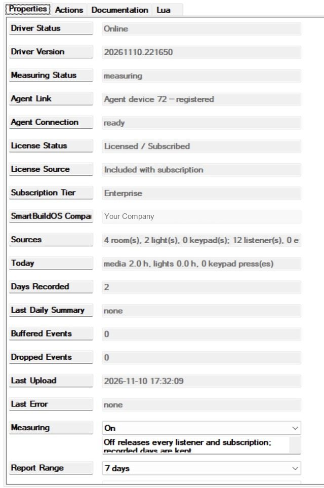
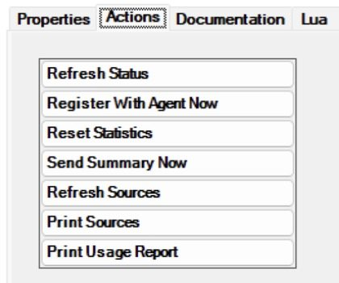

# SmartBuildOS Usage Analytics

Measures how the home is actually used, from the variables and events the
project already exposes, and keeps thirty days of daily figures on the
controller: media hours per room and per source, on-hours per light, button
presses per keypad, and the lists a dealer wants before a service visit —
rooms never used, keypads never pressed, lights never on. Printable from
Composer; uploaded once a day through the **SmartBuildOS Agent** for the
Studio usage view.

Requires the SmartBuildOS Agent (`smartbuildos.c4z`, a build with module
services) paired to a SmartBuildOS system. The Agent is the licensing
authority (SKU `SBOS_USAGE_ANALYTICS`): **License Status** shows this driver's
standing. Measuring continues during an internet outage; uploads wait in the
Agent's bounded, journaled queue.

## Setup

<!-- walkthrough: Set up Usage Analytics -->
1. Install the SmartBuildOS Agent from Composer's Agents tab and pair it.
1. Add this driver (one per project). **Agent Link** shows the Agent's device
   id and **Agent Connection** reads `ready` once registered.
1. That is all. **Sources** reports how many rooms, lights and keypads are
   measured; **Today** keeps a running total.

## What is measured

- **Rooms**: in use while the room's `POWER_STATE` is on; the source is
  `CURRENT_SELECTED_DEVICE`. Rooms without those variables are counted under
  Sources, not measured.
- **Lights**: on while `LIGHT_STATE` is true or `LIGHT_LEVEL` / `Brightness
  Percent` is above zero. On-cycles are counted too.
- **Keypads**: devices whose catalogued Composer events are presses (Pushed,
  Pressed, Clicked, Tapped — not Released). Each press is counted per button.

Devices are recognised by variable signature and event names, never by name.
**Exclude Device IDs** removes rooms or devices from measuring.

## Behaviour

- Running time is booked when it is known: on every change and once a minute,
  so a day boundary misattributes at most one minute.
- A room or light whose state was never read is not counted until its first
  known value; current values are read when the plan is applied, so a room
  already playing counts from then.
- Days roll by the controller's local calendar. A finished day is handed to
  the Agent once as `usage.daily`; thirty days are kept, older ones dropped.
- **Measuring Off** releases every listener and subscription; recorded days
  are kept. A definitive licence denial with enforcement on does the same and
  says so under Last Error.
- Nothing but the typed values above is recorded: no media titles, no
  volumes, no variable values of other kinds.

## Actions

| Action | What it does |
| --- | --- |
| Print Usage Report | Report for the **Report Range** (Today / 7 days / 30 days) to the Lua output: rooms by media hours with top source, lights by on-hours, keypads by presses, unused lists |
| Print Sources | Every measured room, light and keypad |
| Refresh Sources | Re-plan against the current project (also automatic on project changes) |
| Send Summary Now | Stage a `usage.summary` for the Report Range |
| Reset Statistics | Drop every recorded day and start again |
| Register With Agent Now / Refresh Status | Agent housekeeping |

## Programming

- Command **Send Usage Summary** (DAYS: 1, 7 or 30).
- Events: *Measuring Degraded*, *Measuring Restored*, *Daily Summary Sent*,
  *Agent Connected*, *Agent Disconnected*.
- Conditionals: *Measuring is active*, *Agent link is ready*.
- Variables: `MEASURING_STATUS`, `MEDIA_HOURS_TODAY`, `LIGHT_HOURS_TODAY`,
  `KEYPAD_PRESSES_TODAY`, `DAYS_RECORDED`, `SOURCES`, `BUFFERED_EVENTS`,
  `DROPPED_EVENTS`, `LAST_ERROR`.

## What is not claimed

Media hours say the room was on and which source was selected, not that
anyone watched. Keypad presses count Composer press events the keypad driver
declares; a keypad whose driver declares none is not measured and is listed
under Sources as such.
