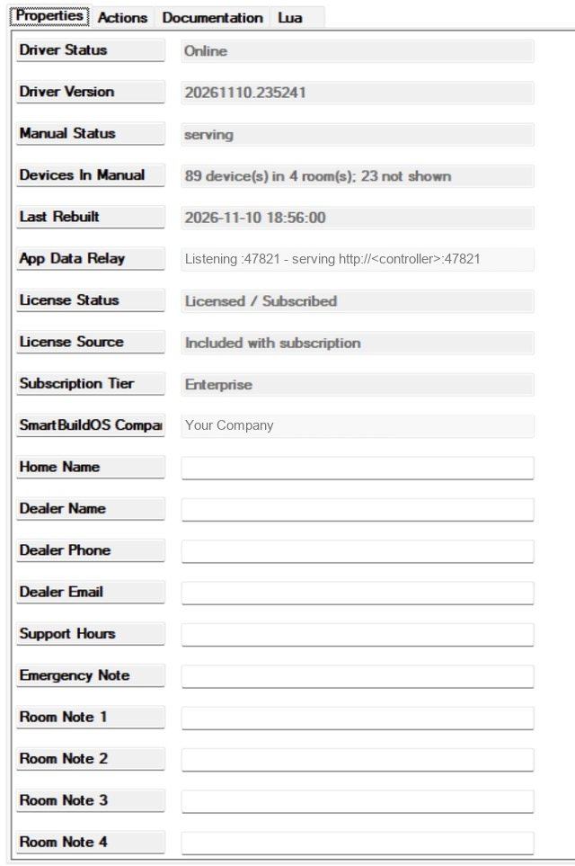
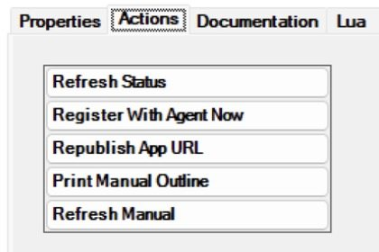

# SmartBuildOS Home Guide

A user manual written for this house, by the system itself. One tile in
Navigator opens a page that lists every room, the devices in it grouped by
what they are (lights, keypads, shades, climate, locks, TV and music, cameras,
garage and gates, security, sensors), a plain paragraph on how each kind is
used, your contact block, your notes per room, and a short "what to do if"
list. It is rebuilt from the project on start, every hour, on the **Refresh
Manual** action and on the **Rebuild Manual** programming command, so a renamed
device or a new room shows up without anyone editing a document.

Requires the SmartBuildOS Agent (`smartbuildos.c4z`) paired to a SmartBuildOS
system; the Agent is the licensing authority (SKU `SBOS_USER_MANUAL`) and
**License Status** shows this driver's standing. The guide itself runs
entirely on the controller: no cloud, no internet needed to read it.

## Setup

<!-- walkthrough: Set up Home Guide -->
1. Install the SmartBuildOS Agent from Composer's Agents tab and pair it.
1. Add this driver to any room (one per project is enough). The **Home
   Guide** tile appears in that room's Navigator menu; make it visible in
   other rooms through Room Experience Visibility if you like.
1. Fill in **Home Name**, **Dealer Name**, **Dealer Phone**, **Dealer
   Email**, **Support Hours** and **Emergency Note**.
1. Optionally add up to six **Room Note** lines, each written as
   `Room name: text` (for example `Kitchen: The pendants dim from the keypad
   by the fridge.`). Notes for the same room join together.
1. Check **App Data Relay** reads `Listening :47821 - serving http://<controller>:47821`.
   The driver finds the controller's address by asking itself on each
   candidate address and keeping the one that answers, so another Control4
   device on the network (a remote, a touch screen) is never taken for the
   controller. If it says the address is unknown, or that there was no
   answer on it, type the controller's LAN IP into **App Relay Address**.

## How it works

The page ships inside this driver and is served same-origin from a small
relay the driver runs on port 47821 (the same proven mechanism as the
SmartBuildOS Atmosphere app). The data route carries a token minted on the
controller; the page itself holds no secrets. Devices are classified by their
driver file name first, then by their name; what nothing matches is listed
under "Other equipment" rather than left out. Infrastructure (SmartBuildOS
drivers, agents, UI devices, power controllers, timers, scenario buttons and
any device with no room) is never shown.

## What is NOT claimed

The guide lists what exists, never what state it is in, and it does not
control anything. The how-to paragraphs are generic for each kind of device;
your Room Notes are where house-specific instructions belong.

## Actions

| Action | What it does |
| --- | --- |
| Refresh Manual | Rebuild from the project now |
| Print Manual Outline | Rooms, groups and devices to the Lua output, plus what was excluded and why |
| Republish App URL | Send the web view URL to Navigator again (close and reopen the tile to see it) |
| Register With Agent Now | Re-register the licence with the SmartBuildOS Agent |
| Refresh Status | Repaint the status properties |

## Programming

- Command **Rebuild Manual**.
- Events **Manual Rebuilt**, **Guide Unavailable**, **Guide Restored**.
- Variables `MANUAL_STATUS`, `MANUAL_ROOMS`, `MANUAL_DEVICES`, `LAST_REBUILT`.

## Privacy

The manual holds device and room names and the dealer block you typed.
Nothing leaves the controller. The relay answers the manual only to a request
carrying the token Navigator was given; `/ping` answers to anyone on the LAN
and reveals nothing.
