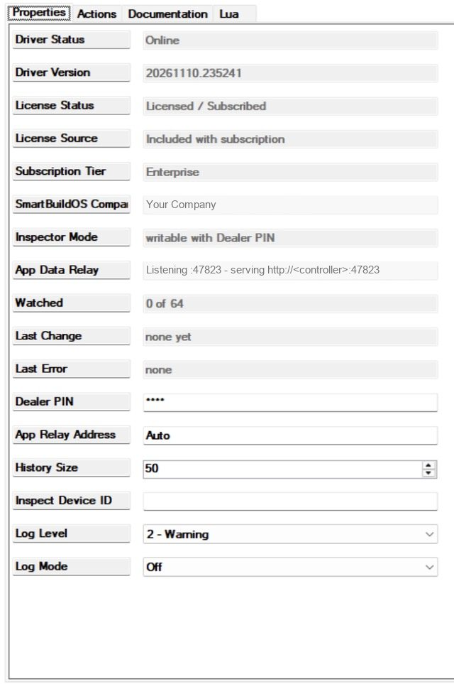
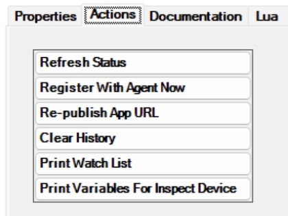

# SmartBuildOS Variable Inspector

Every device in a Control4 project carries variables: a light's level, a
lock's state, a driver's own counters. Composer Pro shows them to someone
sitting in a Composer session. This driver puts that view on a touch screen
and in the Control4 app, without a Pro session: the devices in the project,
the variables of the one you tap (live while it is open), a watch list that
keeps a short history of each watched variable and raises a Composer event
when one changes, and a Set that asks for a Dealer PIN. It is a dealer tool
for commissioning and fault finding, not a page for the homeowner.

Requires the SmartBuildOS Agent (`smartbuildos.c4z`) paired to a SmartBuildOS
system; it is the licensing authority (SKU `SBOS_VARIABLE_INSPECTOR`).
**License Status** shows this driver's standing. Reading never depends on the
licence; a definitive denial with enforcement on makes the inspector
read-only. Needs Control4 OS 3.3.2 or later.

## Why not Composer's own variable view

Composer Pro already lists every device's variables in its variable tree,
and Programming can react to any one of them changing. This driver adds four
things to that:

- A view with no Composer session. The inspector is a Navigator tile, so a
  technician can read a variable while standing at the keypad that changes
  it, with no laptop and nobody connected to the project.
- What the variable did, not only what it is. As far as we know Composer
  keeps no record of a variable's earlier values. The watch list keeps the
  newest 50 to 200 changes of each watched variable, each with its time and
  the value before it.
- One event for a whole list. *Watched Variable Changed* fires for any
  variable on the watch list, so one script covers many variables.
- A printout. *Print Variables For Inspect Device* and *Print Watch List*
  write the same to the Lua tab, where you can copy it into a job note.

Composer is still the right tool when:

- you are already in a Composer session and only need to look a variable up
  once;
- you want programming to run when one particular variable changes: Composer
  programs on a device's variable directly and needs no driver for it;
- the change is meant to stay. Set is for testing; see
  [What is not claimed](#what-is-not-claimed).

The inspector is not a search tool either: it opens one device at a time and
cannot look a variable name up across the whole project.

## What it is for

| You want | Use |
| --- | --- |
| A device's variables and values without opening Composer | The **Variable Inspector** tile: filter the device list, tap the device |
| The same from Composer, as text you can copy | **Inspect Device ID** and *Print Variables For Inspect Device* |
| To see a value move while you press the button that should move it | Open the device on the page: values refresh every two seconds |
| A record of what a variable did while you tested programming | Watch on the page, then the Watch list tab or *Print Watch List* |
| To put a variable on the watch list from programming | `WATCH_VARIABLE`, and `UNWATCH_VARIABLE` to take it off |
| Programming that runs when anything on the watch list changes | *Watched Variable Changed*, or the variable `LAST_CHANGE` |
| The device id behind a name, or the name behind an id | The filter box: it matches name, room, driver file and id |
| To write a value and see what your programming does with it | Set on the page, with the **Dealer PIN** |
| To know that someone wrote a value, or tried to | *Value Set From Page* and *Set Refused* |
| A tile that can only read | Leave **Dealer PIN** empty; test it with *Inspector is read-only* |

## Setup

<!-- walkthrough: Set up Variable Inspector -->
1. Install and pair the SmartBuildOS Agent (Composer → Agents).
1. Add this driver (one per project). **Driver Status** reads `Online`. It
   adds a **Variable Inspector** tile to Navigator (hide it from rooms the
   customer uses; it is a dealer tool, and whoever opens it can read every
   variable it shows).
1. Set a **Dealer PIN**. **Inspector Mode** changes from
   `read-only (set a Dealer PIN to allow writes)` to
   `writable with Dealer PIN`. Without a PIN the page is read-only: you can
   browse and read, but not watch or set.
1. **App Data Relay** should read
   `Listening :47823 - serving http://<controller>:47823 to the app`: the
   address is one the driver's own relay has answered on. If it says the
   address is unknown, or the page cannot load data, set
   **App Relay Address** to the controller's LAN address and run
   *Re-publish App URL*, then close and reopen the tile (Navigator does not
   change the URL of an open web view).
1. Open the tile. The header shows the mode and the device list fills in,
   grouped by room.





## How it works

### The page

The page has two tabs, Devices and Watch list.

- Devices lists what Director reports for the project, sorted by room and
  then name, each with its driver file and its device id. The filter box
  narrows the list as you type; it matches the name, the room, the driver
  file and the id. The inspector leaves itself out of the list.
- Tapping a device opens it. Each variable shows its name, its id, how the
  value reads (`boolean`, `number`, `string`, or `unknown` when it has no
  value), whether its device marks it read-only, and the value. Refresh reads
  the whole device again.
- Each variable has a Watch button, and a Set button when it can be written.
  A masked variable has neither.
- Watch list shows every watched variable with its device, its value, how
  many changes were recorded and the newest ten of them, newest first.

Director lists a driver and each of its proxies as separate devices with one
name (seen on the bench with another driver that reads the same list), and
the inspector shows every entry. A device can therefore appear twice under
one name with two ids; the variable you want may be under either.

### One open device

Opening a device registers a listener for each of its variables, so Director
tells the driver when one changes. The page asks the driver for the current
state every two seconds while a device is open, and every five seconds
otherwise, and stops asking while it is hidden.

The driver holds one open device, for every screen. Opening another device
releases the first one's listeners, and so does going back to the device
list. Two people using the tile at once take the live view from each other.
Watched variables stay registered whatever is open. A change on the open
device raises no Composer event; only watched variables do.

### What can be changed, and what cannot

| Item | From the inspector |
| --- | --- |
| A variable its device does not mark read-only | Set sends a new value to Director, with the Dealer PIN |
| A variable marked read-only on its device | Shown; no Set |
| A credential-named variable | Shown masked; no Watch, no Set |
| This driver's own variables | Not listed; the inspector does not inspect itself |
| Another driver's properties | Not shown and not changed |
| Device commands (on, off, lock …) | None are sent |

### The watch list

| Limit | Value |
| --- | --- |
| Watched variables | 64. **Watched** reads for example `1 of 64` |
| History kept per variable | **History Size**: 50 to 200 changes, default 50 |
| History shown on the page | The newest 10 per variable |
| History printed by *Print Watch List* | The newest 20 per variable |
| Length of a value, shown or set | 512 characters; longer is cut |

- The list itself is saved and comes back after a restart or a driver
  update. The history is held in memory only and starts empty again.
- Every change Director reports for a watched variable is added to its
  history with the time and, when it is known, the value before.
  *Watched Variable Changed* fires at once.
- **Last Change** and the variables `LAST_CHANGE`, `LAST_CHANGE_DEVICE`,
  `LAST_CHANGE_VARIABLE` and `LAST_CHANGE_VALUE` are written two seconds
  after the change. When changes come faster than that, they are written
  once, two seconds after the last one. **Watched** and `WATCHED_COUNT`
  follow a watch made on the page two seconds later too.
- A variable watched from the page starts with the value it had at that
  moment. One added by `WATCH_VARIABLE`, and every watched variable after a
  restart, shows no value until its next change, and that first change has no
  "was".
- A new **History Size** applies to variables watched from then on, and to
  all of them after *Clear History* or a restart.
- The list keeps the device name as it was when the variable was added.

### Masked variables

A variable is credential-named when its name, in capitals and with spaces and
punctuation removed, contains one of: `USERCODE`, `ACCESSCODE`, `PINCODE`,
`PASSCODE`, `PASSWORD`, `PASSWD`, `TOKEN`, `SECRET`, `APIKEY`, `DISARMCODE`,
`ARMCODE`, `KEYCODE`, `LOCKCODE`, `CREDENTIAL`. So `USER_CODE_1`,
`Access Code` and `API_KEY` are all masked.

A masked variable shows `••••••` in place of its value, on the page and in
the Lua output. It gets no listener, cannot be watched and cannot be set.
This is not a setting and cannot be turned off.

Masking goes by the name only. A code kept in a variable called `PIN`, or
under any other name not on that list, is shown like any other value.

### Set

Set sends the value to Director with `C4:SetDeviceVariable` and says so:
`sent to Director (C4:SetDeviceVariable); verify on the next read`. It never
claims the value took. The page reads the device back right after, and what
it then shows is the proof. *Value Set From Page* fires when the value was
sent. The value goes as text, as typed.

Refusals are named, and each fires *Set Refused*:

| The page says | Why |
| --- | --- |
| `read-only: licence enforcement or no Dealer PIN` | The inspector is in read-only mode |
| `Dealer PIN required` | The PIN typed is empty or not the **Dealer PIN** |
| `variable is read-only on its device` | Its device marks the variable read-only |
| `credential-named variables are never written` | The name is on the masked list |
| `variable not found on the device` | The device no longer has that variable |
| `set failed:` and Director's message | Director raised an error |

### Read-only mode

The inspector is read-only when the licence is enforced against the driver,
or when no **Dealer PIN** is set. **Inspector Mode** says which.

| | Writable | Read-only |
| --- | --- | --- |
| Device list, open a device, live values | Yes | Yes |
| The Print actions | Yes | Yes |
| The existing watch list: history, *Watched Variable Changed* | Yes | Yes |
| Clear history | Yes | Yes |
| Watch and unwatch, on the page and by command | Yes | Refused |
| Set | With the PIN | Refused |

Only a definitive denial with enforcement on counts as "enforced". A status
that is merely uncertain, such as `Cloud Validation Required`, leaves the
inspector writable.

The PIN is asked for by Set only. Once a **Dealer PIN** is set, anyone who
opens the tile can watch, unwatch and clear history without typing it.

### How the tile reaches the driver

The driver runs a small web server on the controller, the relay, on port
47823. The page asks the relay for its data over plain HTTP on the LAN. Every
request for data must carry a token the driver made once and keeps across
restarts; without it the relay answers `403`.

The driver has to tell the tile which address the controller answers on, and
it does not take an address on trust:

- **App Relay Address**, when it holds anything but `Auto`, is used as
  written and is not checked.
- Otherwise the driver asks, in order, the address Director gives for the
  controller and then each address found on a Control4-made device in the
  project. Director's address is published at once, before it answers; any
  other is published only after it answers.

Asking means requesting `/ping` on the driver's own relay at that address and
accepting only its own reply. A confirmed address is asked again every 15
minutes. After a pass with no answer the driver tries again after 1, 2, 4
and 8 minutes, then every 15. When the address changes, the tile is sent its
new URL. The URL is also sent at start, again a minute later, when
**App Relay Address** changes, and by *Re-publish App URL*.

The page itself can come from two places:

| The driver | The tile opens | Data |
| --- | --- | --- |
| knows the address and can read its page file | `http://<controller>:47823/app` with the token | From the relay, same address |
| knows the address, cannot read its page file | The `controller://` page inside the driver, with the relay's address and the token in the URL | From the relay |
| does not know the address | The `controller://` page with nothing added | None: the page says it has no relay address |

On the bench controller the driver could not read its page file: `/app`
answered `503 app not loadable`, and the tile uses the second row, the
`controller://` fallback. Nothing needs setting for this.

## Worked examples

The names, ids and values below are from the driver's test project. Yours
differ.

### Watch a variable while you test programming

You have a keypad button that should take the kitchen pendants to 40%, and
something else keeps changing them.

<!-- walkthrough: Watch a variable during a test -->
1. Open the tile. In Devices, type `kitchen` in the filter and tap Kitchen
   Pendants.
1. Tap Watch beside `LIGHT_LEVEL`. The button reads Watching and the count on
   the Watch list tab goes to 1. In Composer **Watched** reads `1 of 64`.
1. Press the keypad button and let the programming run.
1. Open the Watch list tab. Each change is one line: the time, the new value
   and the value before it, newest first.
1. In Composer run *Print Watch List* for the same history as text, oldest
   first, each change numbered.
1. Tap Watching to release the variable when you are done.

```
== Watch list: 1 variable(s), mode: writable with Dealer PIN ==
  Kitchen Pendants / LIGHT_LEVEL (device 12, variable 1001) = 100
      14:02:12  #1  LIGHT_LEVEL = 40  (was 75)
      14:02:16  #2  LIGHT_LEVEL = 0  (was 40)
      14:02:28  #3  LIGHT_LEVEL = 100  (was 0)
```

The button did its job at 14:02:12. Four seconds later something took the
light to 0, and twelve seconds after that to 100: that is the programming to
go and find. **Last Change** then reads
`Kitchen Pendants: LIGHT_LEVEL = 100 (14:02:28)`, `LAST_CHANGE_DEVICE` is 12
and `LAST_CHANGE_VALUE` is `100`.

### Find which device owns a variable

A log line names device 20 and you want to know what it is; or you know a
lock has a status variable and want its exact name and id.

- From an id: type `20` in the filter. It matches every device whose id,
  name, room or driver file contains those digits, so the list is short, not
  always one line. The id is under each name.
- From a name: type part of the device or room name, here `lock`. If the
  device appears twice, open both entries and look for the variable in each.
- For a copy in Composer: put the id in **Inspect Device ID** and run
  *Print Variables For Inspect Device*. Each line is the variable's id, its
  name and its value.

```
== Variables of device 20 (Front Lock) ==
    2001  LockStatus                       = Locked
    2002  USER_CODE_1                      = ••••••
```

With no id set the action prints
`Set Inspect Device ID to a Director device id first`. For an id that is not
in the project it prints `not in the project` in the heading and
`no readable variables`.

### Write a value to see what programming does

Open the device, tap Set beside the variable, type the new value and the
Dealer PIN, and tap Send. With the test project, setting `LIGHT_LEVEL` to
`55` with the right PIN answers
`sent to Director (C4:SetDeviceVariable); verify on the next read`. With a
wrong PIN it answers `Dealer PIN required` and nothing is sent. After a value
is sent the page reads the device again. If the value shown has not moved, it
did not take, or its driver wrote its own value back.

### One piece of programming for the whole watch list

- To know only that something changed (flash a bench light, count changes):
  program on *Watched Variable Changed*.
- To use what changed (a line in a notification or a log): program on the
  variable `LAST_CHANGE` changing and use its text, for example
  `Kitchen Pendants: LIGHT_LEVEL = 40`. Do not read `LAST_CHANGE_VALUE`
  inside a *Watched Variable Changed* script: the event fires first and the
  variables are written two seconds later, so the script would read the
  change before.
- To start watching from programming: the command `WATCH_VARIABLE` with
  `DEVICE` set to the device and `VARIABLE` to the variable's name, for
  example `LockStatus`. Capitals do not matter. **Watched** goes up by one;
  if the name is not found on that device, **Last Error** reads
  `WATCH_VARIABLE: no variable named` with the name and the device id it
  looked at.

## Programming reference

Events:

| Event | Fires when |
| --- | --- |
| *Watched Variable Changed* | Director reports a change of a variable on the watch list |
| *Value Set From Page* | A Set from the page was sent to Director |
| *Set Refused* | A Set from the page was refused, for any of the reasons above |

Conditional: *Inspector is read-only* (its two states are named `read-only`
and `writable`). It is also true while the driver is starting.

Variables (all read-only):

| Variable | Holds |
| --- | --- |
| `WATCHED_COUNT` | How many variables are on the watch list |
| `LAST_CHANGE` | The last watched change as text: device name, variable name and value |
| `LAST_CHANGE_DEVICE` | The device id of that change |
| `LAST_CHANGE_VARIABLE` | The variable's name |
| `LAST_CHANGE_VALUE` | The new value as text; a true or false value reads `true` or `false` |
| `RELAY_STATUS` | `listening` or `not_listening`; `starting` until the driver is up |

Commands:

| Command | Parameters | What it does |
| --- | --- | --- |
| `WATCH_VARIABLE` | `DEVICE` (a device picker), `VARIABLE` (the variable's name, typed) | Adds that variable to the watch list. Refused in read-only mode, when the list is full, when it is already watched and for a credential-named variable; **Last Error** says which |
| `UNWATCH_VARIABLE` | `DEVICE`, `VARIABLE` | Takes it off the watch list. Does nothing in read-only mode or when it was not watched |

## Properties

| Property | What it shows or sets |
| --- | --- |
| **Driver Status**, **Driver Version** | `Online` once started; the build |
| **License Status**, **License Source**, **Subscription Tier**, **SmartBuildOS Company** | The driver's standing with the Agent |
| **Inspector Mode** | Writable or read-only, and why |
| **App Data Relay** | Whether the relay listens and which address the tile is given |
| **Watched** | Watched variables, for example `1 of 64` |
| **Last Change** | The last watched change and its time; `none yet` before the first |
| **Last Error** | The last refusal or fault. It stays until the driver restarts |
| **Dealer PIN** | The PIN Set asks for. Empty means read-only |
| **App Relay Address** | `Auto`, or the controller's LAN address to use as written |
| **History Size** | Changes kept per watched variable, 50 to 200, default 50 |
| **Inspect Device ID** | The device id *Print Variables For Inspect Device* prints |
| **Log Level**, **Log Mode** | Logging to the Lua tab and the controller log |

## Actions

| Action | What it does |
| --- | --- |
| Print Variables For Inspect Device | Every variable of the device in **Inspect Device ID** to the Lua output |
| Print Watch List | The watch list with the recent history of each |
| Clear History | Empty every history ring; **Last Change** reads `none yet (history cleared)` |
| Re-publish App URL | Push the web-view URL to Navigator again |
| Register With Agent Now | Ask the Agent for the licence now |
| Refresh Status | Repaint the status properties |

## Troubleshooting

**App Data Relay** reads:

| Value | Meaning, and what to do |
| --- | --- |
| `Listening :47823 - serving http://<controller>:47823 to the app` | Working. The address is confirmed, or it is the one you typed in **App Relay Address** |
| The same, ending `(checking)` | Director's address for the controller is published and is being asked. Wait a moment |
| The same, ending `(no answer on it: check App Relay Address)` | Nothing answered at the published address. Set **App Relay Address** to the controller's LAN address |
| `Listening :47823 - controller address UNKNOWN, set App Relay Address` | No address was found. Set **App Relay Address** |
| `Not listening - port 47823 unavailable` | The relay could not open its port and the page cannot load data; **Last Error** says the same. The port is fixed: make sure the project has one copy of this driver |

**Inspector Mode** reads `writable with Dealer PIN`,
`read-only (set a Dealer PIN to allow writes)`, or `read-only (licence:`
followed by the **License Status** text. Until the driver is up it reads
`starting`.

On the page:

| You see | Meaning, and what to do |
| --- | --- |
| `offline` in the header | The page cannot reach the relay. Check **App Data Relay**, and that the screen or phone is on the same network as the controller |
| `Cannot reach the driver: no relay address in the page URL; run Re-publish App URL in Composer` | The tile was opened before the driver knew the controller's address. Check **App Data Relay**, run *Re-publish App URL*, close and reopen the tile |
| A blank tile after a controller restart | The first URL can be lost while the project starts; the driver sends it again a minute after it starts. Close and reopen the tile |
| A device stops updating | Someone opened another device on another screen, or went back to the list there. Open the device again |
| No Set button | The variable is read-only on its device, or the inspector is in read-only mode |
| `watch list full (64)` | Release a variable you no longer need |

From a computer on the same network, `http://<controller>:47823/ping` answers
`{"ok":true,"service":"variable-inspector"}` when the relay is up. `/app` at
the same address answering `503` is the page-file case described above, not a
fault.

**Last Error** is repainted with the other status properties once a minute
and by *Refresh Status*, so a refused Set can take up to a minute to show
there as `set refused:` and the reason. A refused `WATCH_VARIABLE` shows at
once.

**License Status** reading `SmartBuildOS Agent Found - Checking...`: the
driver asks the Agent again after 5, 15, 30 and 60 seconds and then every
five minutes; *Register With Agent Now* asks at once. The licence makes the
inspector read-only only when the status ends in `(read-only)`.

## Privacy

The relay serves JSON only to a page that carries the minted token, on the
LAN. `/ping` and `/app` need no token and carry no project data. The traffic
is plain HTTP, and the token is part of the tile's URL.

The Dealer PIN travels only in the body of a Set request and is never echoed
or stored anywhere but the Composer property. Credential-named variables are
masked everywhere, including the Lua output.

Everything else is readable by whoever opens the tile. Variable history stays
in the controller's memory and is not sent to SmartBuildOS. With **Log Level**
at `3 - Info` or higher and **Log Mode** not `Off`, each value sent by Set is
written to the log with its device and variable.

## What is not claimed

Setting another device's variable is documented in DriverWorks but has not
been measured on a bench by this driver yet; the result message says "sent",
and the read-back is the proof. Some drivers re-assert their variables and
will overwrite a set value at once.

What the bench record does say: the driver was installed, its status
properties read as described here (**Inspector Mode** in both states,
**App Data Relay** with the controller's own address, **Watched** at
`0 of 64`), *Print Watch List* and *Print Variables For Inspect Device* were
run and their output read in the Lua tab, and the relay answered `/ping` on
the controller's address.

Not exercised on a controller in the last pass: `WATCH_VARIABLE` and
`UNWATCH_VARIABLE`. The record also does not report the page in use on a
touch screen or in the Control4 app, so the device list, live values,
watching, the history, the three events and Set are described here from the
code and its automated tests, which run without a controller.

The page served by the relay itself (`/app`) has not been seen working: on
the bench controller it answers `503` and the `controller://` fallback is in
use. Use from outside the site's network has not been tested; the page
reaches the driver at the controller's LAN address.

There is no search for a variable across devices, no editing of other
drivers' properties, and no upload of history. Values are read for display:
text that reads as a number is shown as that number, so `075` shows as `75`.
