# SmartBuildOS VenueFlow

VenueFlow turns an existing Control4 project into a control surface that venue
staff can use without training: a bar, a restaurant, an office, a conference
room. Staff see their venue, tap the displays they mean, pick what to watch, and
VenueFlow asks Control4 to do it. They never see a Control4 room list, a matrix
output or an HDMI input.

The installer sets all of that up once, in **Installer Studio**, a page this
driver serves on the venue's network: which displays exist and which Control4
rooms they are, where they hang on the floor plan, which sources each can show,
the audio zones and their volume limits, the scenes and schedules, and what each
staff profile may see and do.

> **Release standing.** This build is **simulation verified**. Its logic is
> tested against a simulated Control4 project. On a bench controller it has been
> installed and run in Simulation only, on a build of 14 November 2026: it has
> not yet controlled real equipment, and nothing has run on a touch screen or in
> the Control4 apps. The Venue Studio for the client, source controls, Remote
> Management and every later fix have run only against the simulator. Start in
> Simulation, and follow the hardware validation list in the repository
> (`docs/smartbuildos-venueflow/HARDWARE_VALIDATION.md`) before a venue relies
> on it.
>
> **About the pictures.** Every screenshot here was taken in desktop Chromium
> against the driver's simulator, with its sample venues, on 19 November 2026:
> none comes from a touch screen, the Control4 apps or a controller. There are
> no Composer screenshots yet (properties, actions, programming).

## What it is for

| You want                                                   | VenueFlow gives you                                                                                                             |
| ---------------------------------------------------------- | ------------------------------------------------------------------------------------------------------------------------------- |
| A bartender to put the game on six TVs in two taps         | Command Center: tick displays, pick a source, Route. Each display reports back                                                  |
| Staff to see the room, not a device list                   | Visual Floor Plan: TVs where they hang, on your own floor plan picture                                                          |
| A meeting room anyone can run                              | Simplified Room Control: four big buttons (Present Laptop, Video Conference, Watch TV, Room Off) with volume, lights and shades |
| A manager to see what is wrong                             | Manager Overview: what is on, what did not confirm, what is muted, Open and Close, All Off                                      |
| One button for "Game Day"                                  | Scenes: power, video, audio, volume, lighting, in order, with a report of what each device did                                  |
| The venue to open itself                                   | Schedules, on the controller's clock                                                                                            |
| The bar tablet to control only the bar                     | Staff profiles with areas, sources, zones and scenes, enforced by the driver                                                    |
| To set a venue up without writing programming for each one | Installer Studio: wizard, device mapping with test buttons, layout designer, visual programming                                 |
| To know a route really happened                            | Every change is confirmed against Control4's room state, or reported as "not confirmed"                                         |

What it is not: a matrix driver. VenueFlow selects a source in a display's
Control4 room and Control4 routes the video through whatever the project has
(HDMI matrix, AV-over-IP, direct). The project's AV connections must already
work in Composer.

## Before you start

- Control4 OS 3.3.2 or later.
- Each display that should show its own picture is **its own Control4 room**
  (the usual commercial arrangement), with its video path to the shared sources
  connected in Composer.
- Each audio zone is a Control4 room with volume control. A zone that must be
  independent of the pictures needs its own room, and audio hardware that can
  really play a different source there.
- The SmartBuildOS Agent in the project, for licensing.

## Set it up

<!-- walkthrough: Add the driver -->

1. In Composer Pro, check the title bar names the system you mean to work on.
1. Driver, Add or Update Driver, and choose `smartbuildos-venueflow.c4z`.
1. System Design, Items, Search: type VenueFlow, select a room, double-click the
   driver to add it.
1. Open its Properties. **Driver Status** reads "Online - Simulation": the
   driver starts in Simulation and sends nothing to Control4.
1. Set **Installer Passcode** to six or more characters and press Set. Without a
   passcode, Installer Studio stays off.
1. Read the **Installer Studio** property: it shows the address, for example
   `http://<controller address>:47861/studio`. If it says the address is
   unknown, see "The tile does not load" below.
1. In Navigator, make the VenueFlow tile visible in the rooms where staff will
   use it.

<!-- walkthrough: Build the venue in Installer Studio -->

1. On a laptop or tablet on the venue network, open the Installer Studio address
   and sign in with the passcode.

1. **Setup Wizard, step 1**: pick the business type and name the venue. The
   template brings areas, scenes and staff profiles you can change.

1. **Step 2, Discover Devices**: list the project's devices. The categories are
   a suggestion; you can map anything by hand.

1. **Step 3, Map Control4 Devices**: for each display, choose its Control4 room
   and device; add the sources; add the audio zones with their volume limits.

1. **Step 4, Layout Design**: upload a floor plan or start blank, and drag each
   display to where it hangs.

   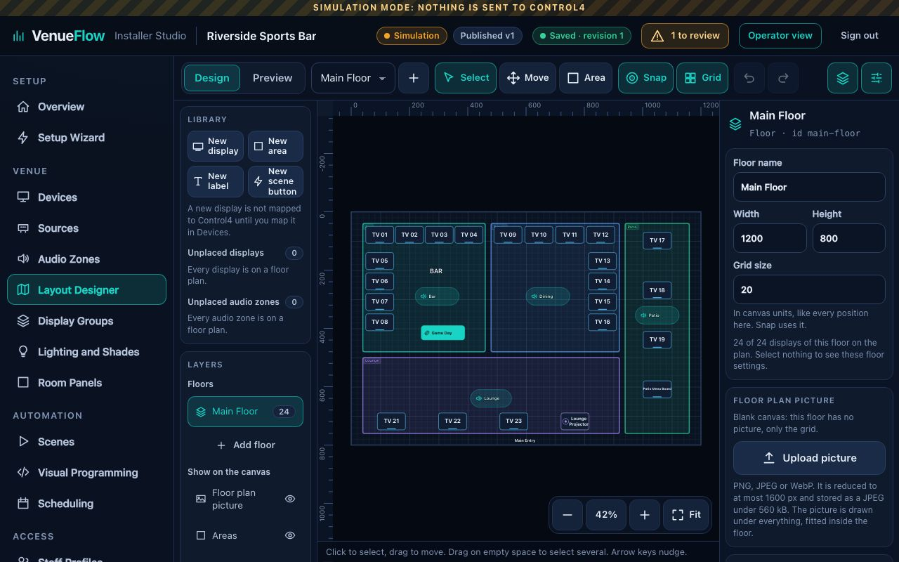

1. **Step 5, Staff Profiles**: who may see which areas, use which sources and
   scenes, and which screens they get. Give managers a PIN. Choose the profile a
   tile opens with.

1. **Step 6, Review and Publish**: fix the errors, tick each warning you have
   checked, publish.

   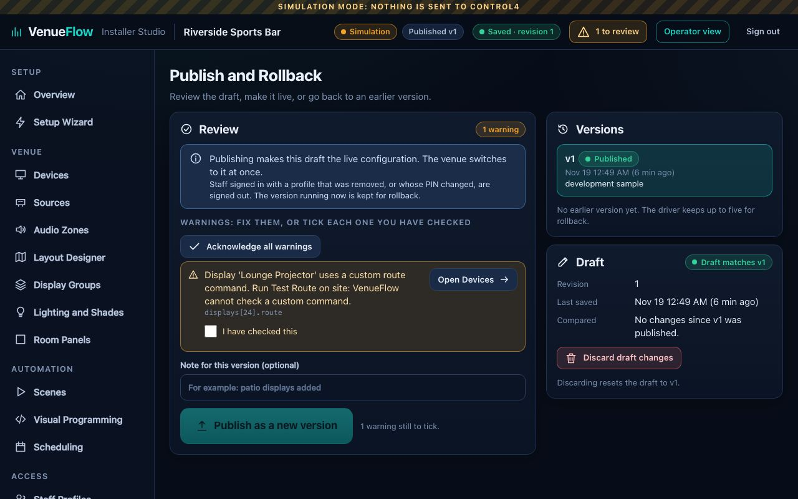

1. While still in Simulation, open the tile and try everything: the page behaves
   as it will, against a simulated project.

<!-- walkthrough: Go live -->

1. Make sure nobody is relying on the rooms.
1. In Installer Studio, Devices: select a display and press **Query Status**. It
   should show what Composer shows for that room.
1. Set the property **Control Mode** to **Live** and press Set.
1. Devices: **Test Route** on one display (it warns that this interrupts the
   display). The display should change, and the Studio should say "confirmed".
   If it says "not confirmed", the room's video path in Composer is the first
   thing to check.
1. Repeat for each display and each audio zone, then try the operator page.

## The four operator screens

Each staff profile gets the screens the installer allows.

**Floor Plan.** The venue from above. Tap displays to select them, pick a
source, Route Video. "Listen" sends that source's sound to an audio zone. Scene
shortcuts and zone volume sit along the bottom.

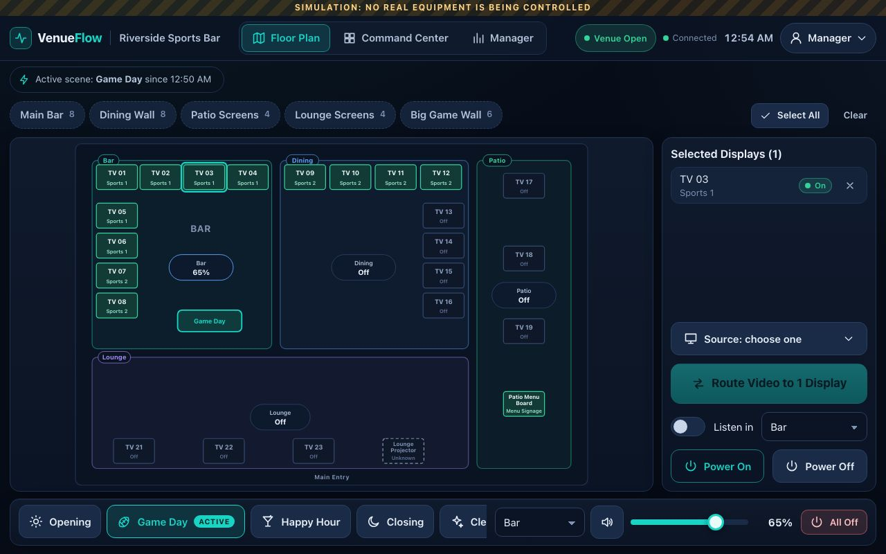

On a small screen the displays are drawn small, because the plan keeps the
venue's proportions. A tap near a display, not exactly on it, selects the
nearest display; a tap as near two displays as one opens a "Which display?"
list. On a short screen the side panel scrolls, and a fade with an arrow at its
bottom edge says there is more below (Power On and Power Off).

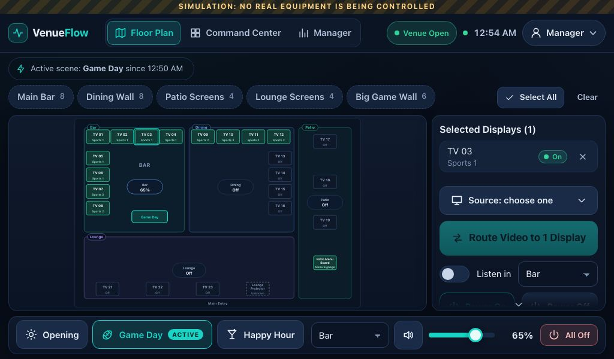

**Command Center.** A grid of displays with filters by area and group. Select,
choose a source, route; or pick the source first and tap displays. Audio zones
have a mixer row. A long display, source or zone name takes two lines.

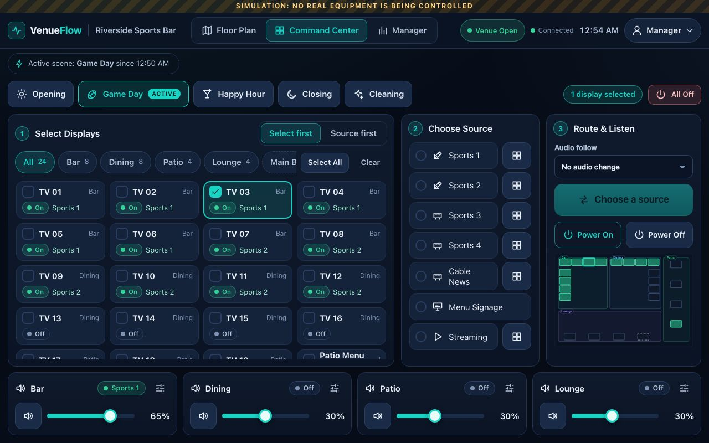

**Room Control.** Large buttons that run the room's scenes, with volume,
lighting presets and shades when the room has them.

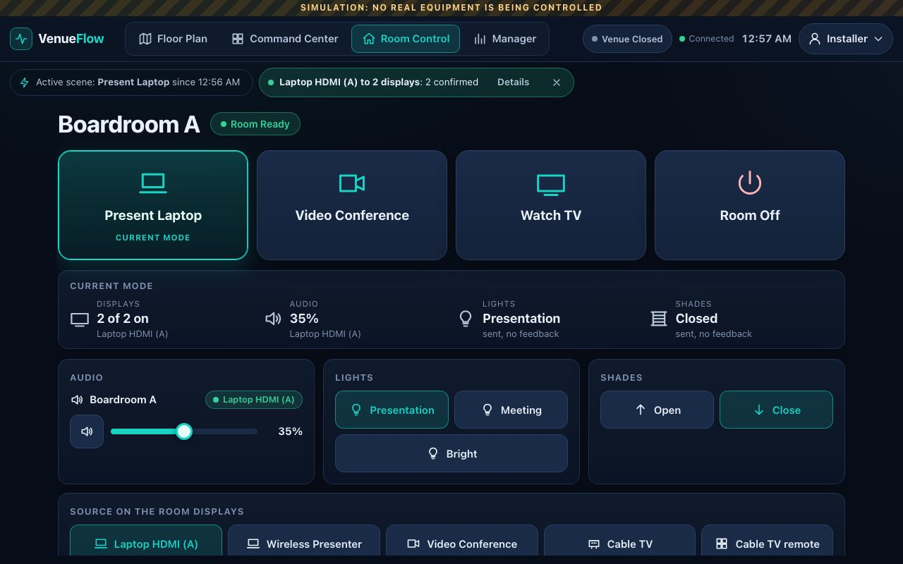

**Manager.** Counts, alerts with a way to resolve each, scenes, Open and Close
venue, All Off with a preview of what it will switch off. Under a restricted
licence, opening or closing the venue still works, and the screen says how many
automations set for that moment did not run.

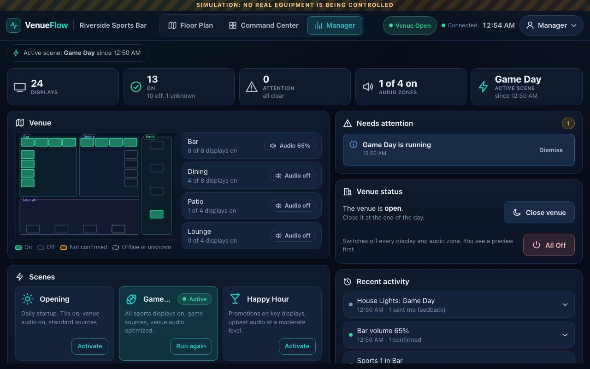

On a phone the screens stack into one column.

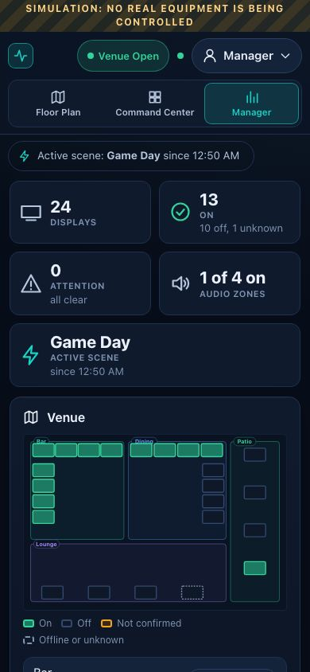

These sizes were checked with touch emulation against the simulator, in three
desktop browser engines (Chromium, WebKit and Firefox, the last being the touch
screens' engine family but not their version): 1024 x 600, 1280 x 800, 1920 x
1200, two tablet and two phone sizes. On a phone the Floor Plan's volume slider
has a row of its own. At 1024 x 600 the volume sliders are narrow (about one
pixel per volume step), so use a volume preset for an exact level. Nothing has
been tried on a T3, a T4 or a phone yet.

What the marks mean on every screen:

| Mark          | Meaning                                                             |
| ------------- | ------------------------------------------------------------------- |
| Confirmed     | Control4 reports the display or zone in that state                  |
| Working       | The command was sent; the answer is awaited (up to about 8 seconds) |
| Sent          | The device gives no feedback; VenueFlow cannot confirm it           |
| Not confirmed | Control4 did not report the change, or reported another state       |
| Unknown       | Not read yet                                                        |
| Offline       | Control4 reports the display's link down                            |

A route to six displays reports six outcomes. If four changed and two did not,
the screen says so and names them.

## Scenes, rules and schedules

In Installer Studio, a scene reads as **WHEN / IF / DO**:

- WHEN Game Day is pressed
- IF the venue is open
- DO: power on the Main Bar displays; route Sports 1 to TVs 01 to 06; route
  Sports 2 to TVs 07 to 12; play Sports 1 in the Bar zone; set the Bar zone to
  65%; lighting preset Game Day; send a notification.

Steps come from a fixed list: power displays, route video, tune a channel, route
audio, set volume, mute, turn a zone off, lighting preset, shade, wait, IF /
ELSE, run another scene, set a variable, mark the venue open or closed, send a
notification. Nothing you type is run as code.

**Tune a channel** (under Displays in Add step) puts a source's box on one of
its favourite channels or on a number you type. Only switched-on sources with
the number keypad are offered. The keys go to the source's own Control4 device,
the step shows as sent (a box gives no feedback), and the scene does not wait
for the last digit: put a Wait before a step that needs the channel. Staff need
permission to run the scene, not "Use source controls". Removing a favourite
that a step uses asks first and names the scenes and schedules that use it. If
it is removed anyway, the Studio names the scene, schedule or rule and the venue
cannot be published until the step is changed. Stopping the scene stops the rest
of the number; after a number is cut off, or on a box that dials without Enter,
the next number for that box waits about 3 seconds so the digits do not run
together (an assumption, not seen on a box). Not yet seen to move a real box.

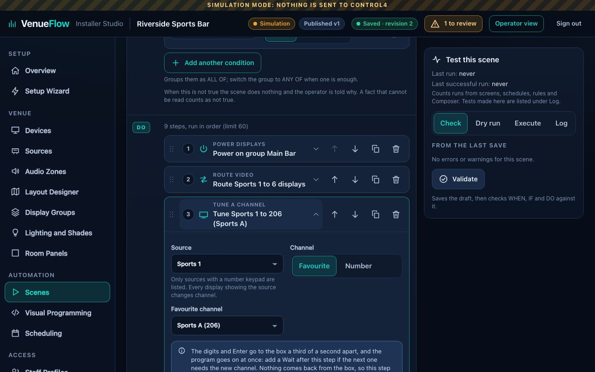

**Dry run** shows what a scene would do and sends nothing. **Execute test** runs
it for real and shows each step and each device. A scene marked "ask first"
shows operators a preview and waits for confirmation.

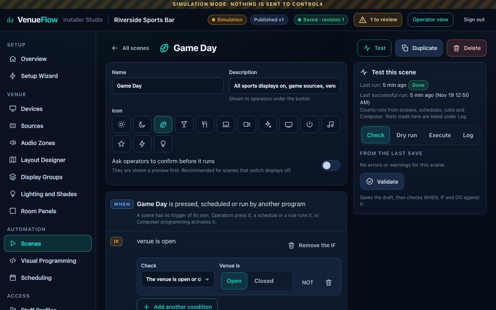

A **rule** adds a trigger: a schedule, another scene, the venue opening or
closing, a display or zone changing state, a Control4 variable, or a Control4
event sent from Composer programming (see Programming).

Schedules follow the controller's clock and the project's time zone. A schedule
missed while the controller was off is not run late; the manager is told it was
missed.

## Staff profiles and sign-in

A tile opens as the profile the installer chose (for example Bartender, bar
only), with no sign-in. Staff with a PIN (a manager) tap the profile chip and
sign in on that screen; the screen then shows what that profile may see.

Permissions are enforced by the driver. A screen that has been tampered with
still cannot route a display its profile does not have.

### Source controls

A source can have basic controls: channel up, down and last, a number keypad
with up to 24 favourite channels, arrows with guide, info and menu, and play,
pause and skip. Choose the groups per source in Sources (a cable or satellite
source starts with channel keys and a keypad) and give staff the permission
**Use source controls**. Staff then get a remote button beside the source. The
keys go to the Control4 device the source is mapped to. Nothing comes back from
a box, so a press is shown as sent, and a key changes every screen showing that
source. Scenes, rules and schedules can do the same with the **Tune a channel**
step. Only run against the simulator so far: test it on site in Live mode.

### The Venue Studio

The venue's owner or manager can change the day-to-day themselves. Give their
profile **May open the Venue Studio** in Staff Profiles (the Owner role has it)
and a PIN. Signed in, they choose Venue Studio from the profile menu on a
control screen, or pick their name at `http://<controller>:47861/studio`. They
can change scenes, schedules, staff profiles and PINs, source names, channel
labels and favourite channels, and volume presets, and publish that. Everything
else needs the Installer Passcode, and only the installer can grant the
permission. Two kinds of staff profile stay entirely the installer's: the one a
tile opens with, and any profile a station opens with (the client cannot change,
rename or remove them, or set or clear their PIN). While the draft holds changes
the installer saved, or the dealer sent through Remote Management, the client
can keep editing but cannot publish or discard: the Studio says why (the
installer saved changes, the dealer saved changes remotely, or the draft holds a
change only the installer can make) and who to ask, in its header, on Home and
on Publish and Rollback, where the buttons are disabled. In Staff Profiles the
profiles screens open with are shown read-only to the client. The driver
enforces all of this.

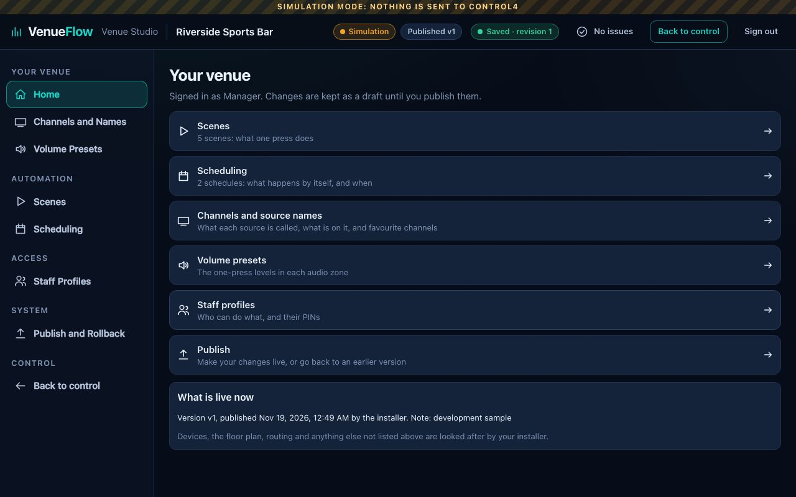

Publish and Discard act on the draft revision the page last loaded or saved. If
the draft changed since (another window, the installer, the dealer), nothing is
published or discarded: the page says so and loads the draft again.

## Properties

No Composer screenshot of the properties exists yet.

| Property                                                                | Meaning                                                                                                                                                                                  |
| ----------------------------------------------------------------------- | ---------------------------------------------------------------------------------------------------------------------------------------------------------------------------------------- |
| Driver Status                                                           | Online, Online - Simulation, or an error                                                                                                                                                 |
| Driver Version                                                          | The build stamp                                                                                                                                                                          |
| Venue                                                                   | The published venue's name                                                                                                                                                               |
| Configuration                                                           | The published version and what it holds                                                                                                                                                  |
| Draft                                                                   | The draft's revision in Installer Studio                                                                                                                                                 |
| Venue Status                                                            | open or closed                                                                                                                                                                           |
| Active Scene                                                            | The scene last run                                                                                                                                                                       |
| Alerts                                                                  | How many alerts the venue has now (see Programming)                                                                                                                                      |
| Installer Studio                                                        | Its address, or why it is off                                                                                                                                                            |
| App Data Relay                                                          | The address the tile is served from, and whether it answered                                                                                                                             |
| Last Error                                                              | The last refused Composer command or internal error                                                                                                                                      |
| License Status, License Source, Subscription Tier, SmartBuildOS Company | From the SmartBuildOS Agent                                                                                                                                                              |
| Control Mode                                                            | Simulation (nothing is sent to Control4) or Live                                                                                                                                         |
| Installer Passcode                                                      | Opens Installer Studio. Hidden. Empty keeps the installer's Studio off                                                                                                                   |
| Remote Management                                                       | What smartbuildos.io may do with this venue's configuration through the Agent: Off (default), Draft only, or Draft and publish. It never controls equipment. See Remote Management below |
| Remote Management Status                                                | Off, waiting for the Agent, or on, with the last remote command                                                                                                                          |
| AI Core                                                                 | Read-only. See [AI Core](#ai-core)                                                                                                                                                       |
| App Relay Address                                                       | Auto, or the controller's address when the tile will not load                                                                                                                            |
| Log Level, Log Mode                                                     | At "3 - Info" with Print, every command sent to Control4 is printed in the Lua tab                                                                                                       |

## AI Core

VenueFlow talks to SmartBuildOS AI Core only while **Remote Management** is on,
because only then does it have a connection to the SmartBuildOS Agent; with it
`Off` (the default) it registers nothing and sends nothing.

- **Remote Management off:** the read-only **AI Core** property shows
  `Installed — this driver does not report` when AI Core is in the project and
  `Not installed` when it is not.
- **Remote Management on:** it reports like the other SmartBuildOS drivers and
  the property shows the usual values (`Found — reporting (v…)`,
  `Not installed`, `Found — not responding`, …). It tells AI Core what VenueFlow
  is, a few facts that name no one (Live or Simulation, whether a configuration
  is published and how many displays, sources, audio zones and scenes it has,
  the alert count, the remote level, whether the page relay listens) and when a
  page request fails inside the driver. It sends no events, answers no questions
  and offers no actions; venue, scene and staff names, passcodes and PINs are
  never sent.

Switching **Remote Management** moves between the two at once. Tested on the
simulator only, not on a controller.

## Actions

| Action                      | What it does                                                                 |
| --------------------------- | ---------------------------------------------------------------------------- |
| Print Installer Studio Link | Prints the Studio address in the Lua tab                                     |
| Print Operator Page Link    | Prints the tile's address (it carries the tile's token: treat it as private) |
| Print Status                | Prints a summary and the latest warnings                                     |
| Reload Configuration        | Re-reads the published venue and Control4's state. Sends no command          |
| Refresh Status              | Re-reads every mapped room                                                   |
| End Staff Sessions          | Signs every staff member out                                                 |
| Reset Sign-in Locks         | Clears a lock after too many wrong PINs or passcodes                         |
| Register With Agent Now     | Asks the SmartBuildOS Agent for the licence again                            |

## Programming

Commands (Device Specific Command):

| Command                                         | Use                                                    |
| ----------------------------------------------- | ------------------------------------------------------ |
| Activate the VenueFlow scene SCENE              | Run a scene by name from a keypad button or a schedule |
| Trigger the VenueFlow event NAME                | Start the rules that wait for that event name          |
| Route the source SOURCE to TARGET               | TARGET is a display, a display group, or All           |
| Mark the venue STATUS                           | Open or Closed                                         |
| Turn off every VenueFlow display and audio zone | All Off                                                |

Events: Scene Activated, Notification, Alert Raised, Configuration Published,
Venue Opened, Venue Closed, Licence Restricted, Licence Restored.

Variables: VENUE_STATUS, ACTIVE_SCENE, NOTIFICATION_TEXT, ALERT_COUNT.

Conditionals: *Venue is open* (choose open or closed); *Active scene* = or != a
scene name; *VenueFlow has alerts* (choose showing alerts or clear). Both
choices of the two true-or-false conditionals are honoured: "Venue is closed" is
true when the venue is closed.

**The venue's alerts.** The **Alerts** property, the variable ALERT_COUNT and
the conditional *VenueFlow has alerts* count the same thing: every current alert
of the venue. That is each stored alert (a notification, an interrupted scene, a
missed schedule, until someone dismisses it) and each alert VenueFlow detects (a
display or zone change that was not confirmed, a display Control4 reports
offline, a restricted licence, until its cause clears). A muted zone is shown on
the Manager screen but is not an alert here. **Alert Raised** fires once for
each stored alert, and once when a detected alert appears; it fires again for
that alert only after it cleared and came back. Dismissing an alert lowers
ALERT_COUNT at once.

On the Manager screen a profile sees only the alerts about what it may see: an
interrupted scene or rule, or a missed schedule, is shown (and may be dismissed)
only to a profile that may see every display, audio zone and scene it concerns;
a notification is shown to every profile with View Alerts. The property, the
variable and the conditional always count every alert of the venue.

**Configuration Published** fires on every publish and on every rollback (a
rollback makes an older version live again).

**Worked example: a notification when a scene asks for one.** In the scene, add
the step "Send notification" with the text "Keg change needed". In Composer, on
the VenueFlow event **Notification**, add your notification driver's command and
insert the variable NOTIFICATION_TEXT as the message. To test: run the scene
with Execute test; the Lua tab shows the event, and the message arrives with the
text.

**Worked example: a Control4 event starts a VenueFlow rule.** In Installer
Studio, add a rule with the trigger "A Control4 event" named `Doorbell`. In
Composer, on the doorbell's event, add the command **Trigger the VenueFlow
event** with NAME `Doorbell`. To test: press Execute on that programming line
and look at the rule's last run in the Studio.

A command that is refused (an unknown scene, a condition not met) says why in
the **Last Error** property. Under a restricted licence, **Trigger the VenueFlow
event** runs no rule and is refused, for example
`TRIGGER_EVENT refused: licence restricted: 2 rule(s) not run`. When some rules
run and others do not, the command is done and Last Error says so
(`TRIGGER_EVENT: 1 rule(s) run, 1 not run`). **Mark the venue** always sets the
status, even under a restricted licence; the rules waiting for that change then
do not run, and Last Error reads, for example,
`SET_VENUE_STATUS: status set; 2 rule(s) not run: licence restricted`.

## Remote Management

The property **Remote Management** decides what smartbuildos.io may do with this
venue's configuration, through the SmartBuildOS Agent: Off (the default), Draft
only (read the configuration and fill the draft; someone on site publishes), or
Draft and publish (also publish a reviewed draft and roll back). It never routes
video, changes a volume, runs a scene or sets a PIN.

**Device mapping stays on site.** Which Control4 room or device a display,
source, audio zone, lighting preset or shade addresses, a display's power,
feedback and route (its custom route command included), a lighting preset's
command, and the device of a rule's Control4-variable trigger or condition are
set by the installer in Installer Studio. Remote Management refuses a draft that
would change them, with "Remote Management cannot change device mapping or
device commands: ... Change these on site in Installer Studio.", and stores
nothing. It also refuses to publish while the draft's mapping differs from what
is live (even a change the installer made on site and has not published), and to
roll back to a version with another mapping. A display or source added remotely
arrives unmapped. Everything else (names, layout, scenes, rules, schedules,
groups, volume limits and presets, staff profiles, channel labels, favourites, a
source's control groups) the dealer can still change remotely, and with "Draft
and publish" put live: a scene written remotely can route any mapped source to
any mapped display and tune any mapped box.

The smartbuildos.io side exists: in the dealer's System Studio, Drivers &
Licenses, VenueFlow. The two sides have never been run together with a
controller, so treat Remote Management as untested and keep it Off on a venue
that relies on VenueFlow until the bench run in the hardware validation list has
passed.

## What changed on 19 November 2026

Run only against the simulator and the test shim, and the pages in three desktop
browser engines, not on a controller, a touch screen or a phone.

- Scenes, rules and schedules can **tune a channel** (see Scenes, rules and
  schedules).
- Remote Management can no longer change device mapping or device commands, nor
  put a mapping change live (see Remote Management).
- A shade's open and closed levels must be numbers from 0 to 100.
- A tap on the floor plan is judged from where the finger went down, the same in
  every browser engine; taps no longer get lost while a Studio section redraws,
  or under a notice.
- Removing a favourite channel that a scene or schedule uses asks first.

## What changed on 18 November 2026

These changes are in the source and have been run only against the simulator and
the test shim, not on a controller.

For a programmer:

- *Configuration Published* now also fires on a rollback.
- *Venue is open* and *VenueFlow has alerts* answer the choice you made
  ("closed", "clear"); before, the driver ignored the choice and always answered
  the "open" and "showing alerts" question. How Composer passes the choice has
  not been seen on a controller.
- ALERT_COUNT, the Alerts property and *VenueFlow has alerts* now include the
  alerts VenueFlow detects, and *Alert Raised* fires when one appears (see "The
  venue's alerts" above). A muted zone no longer counts.
- *Trigger the VenueFlow event* under a restricted licence is refused and writes
  Last Error; one that runs only some of its rules says so in Last Error.
- *Mark the venue* sets the status under a restricted licence and says in Last
  Error which waiting rules did not run.
- Dismissing an alert lowers ALERT_COUNT at once.

For the venue's staff:

- In the Venue Studio, the profile a tile opens with and the profiles stations
  open with are the installer's.
- The Venue Studio waits for the installer when the installer, or the dealer
  remotely, has saved changes that are not yet published or discarded.
- A favourite channel being dialled finishes even if someone publishes at that
  moment, unless that source's Control4 device or the control mode changed.
- The Manager screen shows an interrupted scene or a missed schedule only to a
  profile that may see everything it concerns; notifications still reach every
  profile with View Alerts.
- A client's rollback in the Venue Studio signs every staff member out, the
  client included.
- A backup the installer restores is the installer's work: the client cannot
  publish or discard it until the installer does.

## Licensing

VenueFlow licenses through the SmartBuildOS Agent (SKU SBOS_VENUEFLOW).

| Standing                                             | Effect                                                 |
| ---------------------------------------------------- | ------------------------------------------------------ |
| No Agent, Agent checking, licensed, trial, grace     | Everything works                                       |
| A definite "not licensed" that the platform enforces | Scenes, rules, schedules, publishing and rollback stop |

Routing, power, audio, lighting, shades, All Off, venue status and backup export
always work, and no licence change ever switches a display off.

## Backup

Installer Studio, Configuration Backup: Export downloads one file with the
venue, its floor plan pictures and the staff PIN hashes (never the Installer
Passcode). Restore fills the draft; the venue keeps running on what is published
until you publish. Keep the file private.

## Troubleshooting

**The tile does not load.** Read **App Data Relay**. If the address is unknown
or unconfirmed, set **App Relay Address** to the controller's address, wait a
minute, reopen the tile. From a laptop, `http://<controller address>:47861/ping`
should answer.

**"This venue has not been set up yet".** Nothing is published. If
**Configuration** reads "Sample venue - not run in Live mode", a sample venue is
published and Control Mode is Live: build the real venue or return to
Simulation.

**A display says "Not confirmed".** Control4 did not report the change. Check
the display, the source and the room's video path in Composer; then Resolve
(Manager screen) or Query Status (Studio, Devices).

**Sound changes when the picture changes.** The display and the audio zone are
the same Control4 room. The Studio warns about this. Give the zone its own room.

**Nothing reaches Control4.** Control Mode is Simulation.

**A schedule did not run.** It was missed while the controller was off (an alert
says so), or its rule is disabled, or the day is not ticked.

**Signed out.** Sessions end when the driver restarts, when a PIN or the
passcode changes, and after the time limits.

The full troubleshooting guide, the installer, operator and programmer guides,
the data model and the hardware validation list are in the repository under
`docs/smartbuildos-venueflow`.
